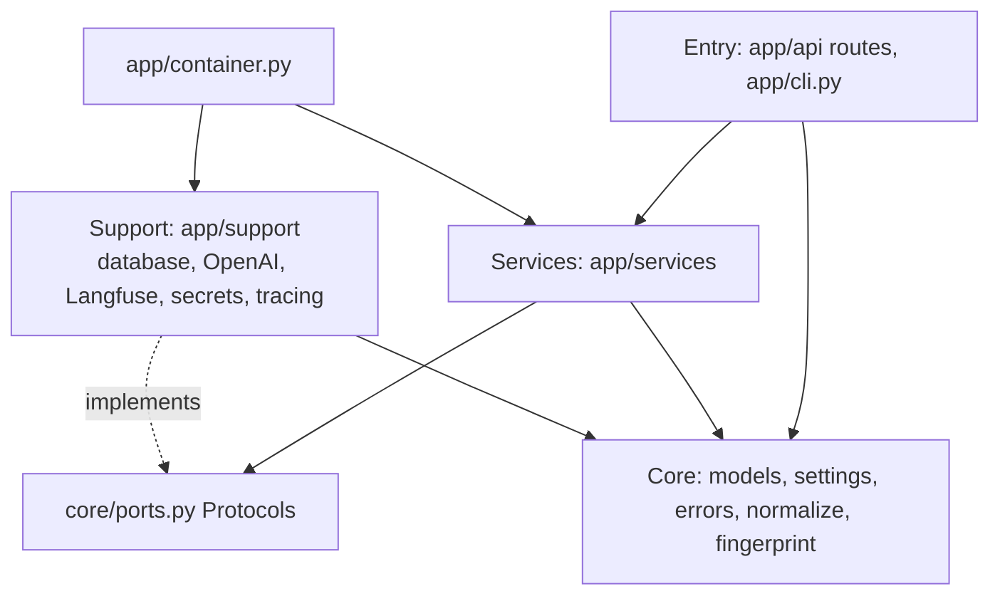
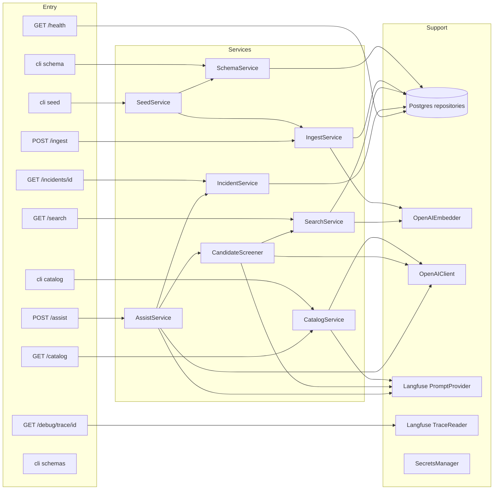
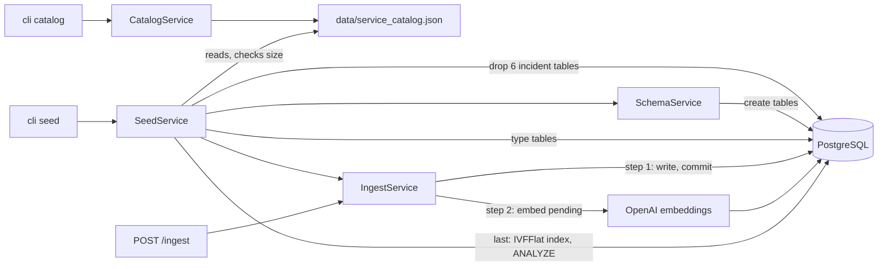
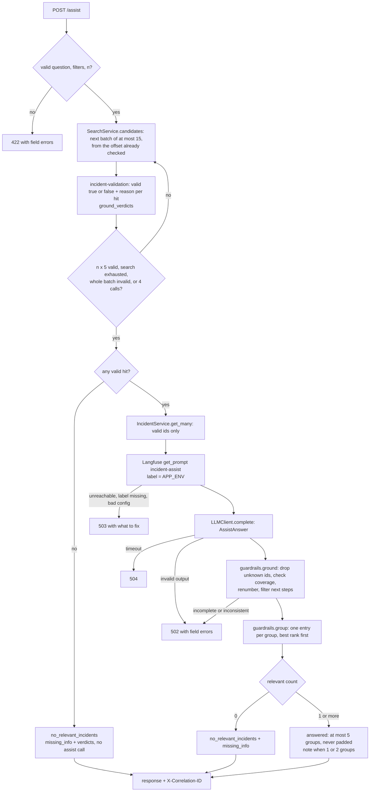
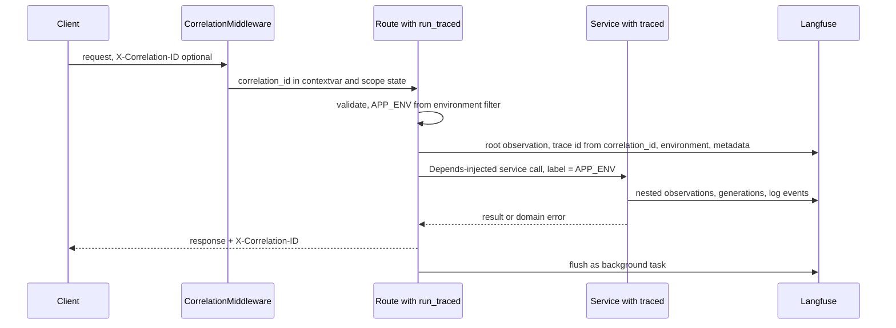
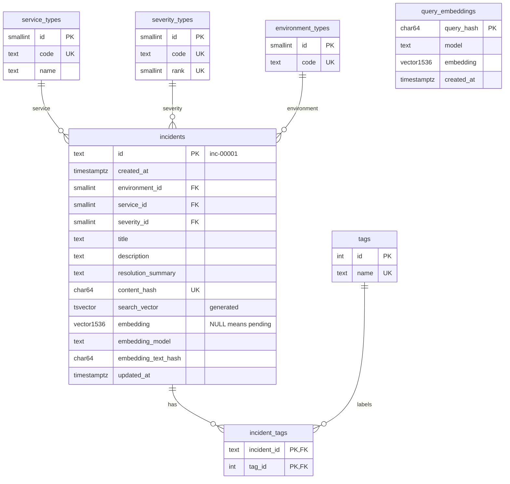
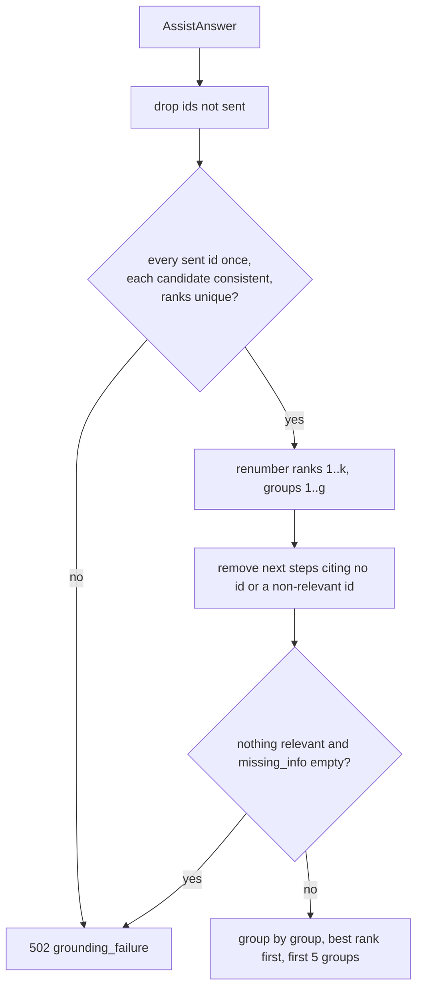
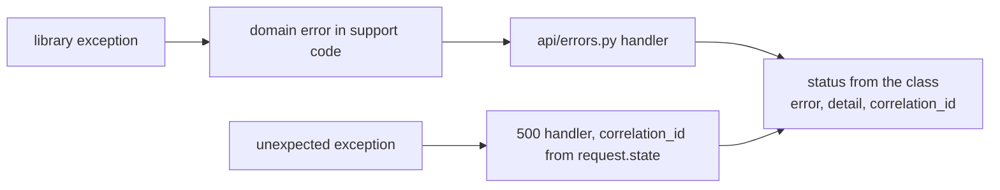

# Design Document

## Overview

The Incident Triage API is a FastAPI application on EC2 (us-east-2) backed by RDS PostgreSQL with pgvector. Synthetic incidents are generated once by an LLM (catalog), turned into a reproducible dataset by a seeded generator, and written through a single ingest path that normalizes, checks, deduplicates and embeds them. Search is hybrid (full-text plus vectors, reciprocal rank fusion) and is shared by `/search` and `/assist`.

`/assist` runs two LLM steps. `CandidateScreener` validates search hits in batches of at most 15 with the `incident-validation` prompt (valid true/false with a reason) until n × 5 valid hits are found. One `incident-assist` call then judges relevance, ranks and groups the full records of the valid hits. Guardrails ground both outputs in the IDs that were sent, and the response shows one entry per group, at most 5, never padded. Langfuse owns prompts, traces and log events.

Detailed designs: [architecture.md](../../../architecture.md), [database-architecture.md](../../../database-architecture.md), [trace-architecture.md](../../../trace-architecture.md), [prompts/](../../../prompts/README.md). Requirements: [requirements.md](requirements.md).

Key decisions:

| Decision | Choice | Reason |
|----------|--------|--------|
| Layers | entry → services → support, all use core | separation of concerns; services testable with fakes |
| Wiring | `app/container.py` + FastAPI `Depends` | one place builds clients; routes stay thin |
| Search | full-text + `text-embedding-3-small`, RRF k = 60 | text matches and meaning matches; same path for `/assist` |
| Candidate screening | `incident-validation` in batches of ≤ 15, at most 4 calls | cheap filter on title and snippet; the assist call sees only valid records |
| Grouping | LLM `group` per relevant candidate (same root cause and same fix) | reworded copies of one problem show once; text-hash clustering missed them |
| Grounding | IDs not sent are dropped, inconsistent answers rejected (502) | never trust the LLM with real data; facts come from the database |
| Result count | one entry per group, at most 5, never padded | padding would show unrelated incidents |
| LLM settings | Langfuse prompt `config` (strict JSON schema) | change model or schema without code changes |
| Prompt label | request `environment` (`prod` → `production`) | prompt version per environment |
| Tracing | Langfuse only, no app trace store | Langfuse is the owner; works with any worker count |
| Errors | `{error, detail, correlation_id}`, status from the domain error class | clear messages that name what to fix; no stack traces |
| Duplicates | SHA-256 Content_Hash of canonical JSON | detects the same incident under a new ID |
| Embedding failures | save first, embed pending rows on every ingest | OpenAI outages never lose incidents |
| Reproducibility | fixed seed, fixed dates, `id` tiebreak, stored query vectors, exact IVFFlat | same data and request give the same result |

## Architecture

### Layers



Imports only point down, and services use support only through the Protocols in `core/ports.py` (plus the `traced` decorator). The container is the only place that builds clients.

### Components and calls



`CandidateScreener` calls `SearchService.candidates`, so `/assist` uses the same search path as `/search`. `cli schemas` only prints the output JSON schemas and builds no container.

### Database setup and data flow



The seed checks the catalog size before it drops anything. Ingest commits incidents before embedding, so an embedding failure never removes saved rows.

### `/assist` flow



The validation step keeps unrelated hits out of the assist context, and stops early when a whole batch is invalid because later hits are less similar. Rejected alternatives: forcing 3-5 results, several LLM votes per candidate, a HyDE `incident-query` step before search, and text-hash clustering (replaced by LLM grouping).

### Request lifecycle and tracing



## Components and Interfaces

### Core (`app/core`)

| Item | Purpose |
|------|---------|
| `models/incident.py` | `Incident`, `Environment` (`dev`, `qa`, `stage`, `prod`), `Severity` (`critical`, `high`, `medium`, `low`), `INCIDENT_ID_PATTERN`, `SEVERITY_RANK` |
| `models/filters.py` | `SearchFilters(environment, service, severity, tags)` |
| `models/search.py` | `SearchQuery`, `SearchHit`, `SearchPage` |
| `models/storage.py` | `IncidentRecord`, `ExistingIncident`, `PendingEmbedding`, `EmbeddedRow`, `TypeSets` |
| `models/prompt.py` | `LLMConfig`, `CompiledPrompt`, `LLMResult[T]`, `EmbeddingResult` |
| `models/catalog.py`, `models/trace.py` | `Catalog`, `CatalogEvent`; `TraceView` |
| `ports.py` | Protocols listed below |
| `app_env.py` | `resolve_app_env(environment)` |
| `normalize.py`, `fingerprint.py`, `embedding_text.py` | codes, tags, query text; Content_Hash, text hash, query hash; labeled embedding text |
| `settings.py`, `secrets.py`, `errors.py` | env var settings; secret values as `SecretStr`; domain errors with their HTTP status |

### Ports (`app/core/ports.py`, source of truth)

- `PromptProvider.get(name, variables, label) -> CompiledPrompt`
- `LLMClient.complete(prompt, output_model) -> LLMResult[output_model]`
- `EmbeddingClient.embed_batch(texts) -> EmbeddingResult`
- `IncidentRepository`: `unit_of_work()` (one transaction: `load_types`, `find_existing`, `insert`, `update`, `lock_pending_embeddings`, `save_embeddings`, `count_pending_embeddings`), plus `search`, `get`, `get_many`, `get_query_embedding`, `save_query_embedding`, `ping`
- `SchemaRepository`: `create_schema`, `drop_incident_tables`, `create_vector_index(lists)`, `count_embedded`, `upsert_types`
- `TraceReader.get(correlation_id) -> TraceView`

DDL files live in `app/support/database/sql/`; there is no SQL outside the database package.

### Services (`app/services`)

| Service | Public method | Uses |
|---------|---------------|------|
| `SchemaService` | `create()` | `SchemaRepository` |
| `CatalogService` | `generate(CatalogRequest, label) -> Catalog`, `get() -> Catalog` | `PromptProvider`, `LLMClient`, catalog file |
| `SeedService` | `seed() -> IngestResult` | `SchemaRepository`, `SchemaService`, `IngestService`, catalog file |
| `IngestService` | `ingest(incidents: list[IncidentIn] \| None) -> IngestResult` | `IncidentRepository`, `EmbeddingClient`, `plan.plan_writes` |
| `SearchService` | `search(filters, q, limit) -> SearchResult`, `candidates(filters, q, k, offset) -> SearchResult` | `IncidentRepository`, `EmbeddingClient` |
| `IncidentService` | `get(id)`, `get_many(ids)` | `IncidentRepository` |
| `CandidateScreener` | `screen(question, filters, target, label) -> (valid hits, verdicts)` | `SearchService`, `PromptProvider`, `LLMClient` |
| `AssistService` | `assist(AssistRequest, label) -> AssistResponse` | `CandidateScreener`, `IncidentService`, `PromptProvider`, `LLMClient`, `guardrails` |

Pure functions: `screening.ground_verdicts(answer, hit_ids)`, `guardrails.ground(answer, candidate_ids)`, `guardrails.group(answer, max_groups)`, `plan.plan_writes(records, existing, owner_by_hash)`, `generator.generate_incidents(catalog, seed, repeats)`, and in support `query_builder.build_search(query)` / `build_count(query) -> BuiltQuery(sql, params)`.

### Support (`app/support`)

| Module | Implements |
|--------|-----------|
| `database/` | pool (`sslmode=require`, connect and statement timeouts), `PostgresIncidentRepository`, `PostgresUnitOfWork`, `PostgresSchemaRepository`, `query_builder`, `database_errors` |
| `llm/openai_client.py` | `LLMClient` on the Responses API: config pass-through, schema name check, output parsing, generation observation |
| `llm/openai_embedder.py` | `EmbeddingClient`: timeout, count and dimension checks, embedding observation |
| `llm/errors.py`, `llm/schemas.py` | OpenAI exceptions → domain errors; strict JSON schemas from output models |
| `langfuse/prompts.py` | `PromptProvider`: text prompt by label, no cache, config validated into `LLMConfig` |
| `langfuse/trace_reader.py` | `TraceReader`: observations by trace id, unchanged, with the Langfuse URL |
| `tracing/` | `CorrelationMiddleware`, correlation contextvar, `root_observation`, `schedule_flush`, `traced` = Langfuse `@observe`, JSON log formatter, `LangfuseLogHandler` |
| `secrets/secrets_manager.py` | reads the four secrets with exact keys |

### Entry (`app/api`, `app/cli.py`, `app/container.py`)

- `container.build_container(settings) -> Container` creates clients and services; used by the FastAPI lifespan and the CLI.
- `api/deps.py` has one getter and `Annotated` alias per service; routes use `Depends`.
- `api/tracing.run_traced` opens the root observation, resolves `APP_ENV` and passes it to the service as the prompt label.
- `api/errors.py` registers the handlers for `AppError`, `RequestValidationError` and `Exception`.
- Endpoints: `POST /ingest`, `GET /search`, `GET /incidents/{id}`, `POST /assist`, `GET /catalog`, `GET /debug/trace/{correlation_id}`, `GET /health`.
- CLI: `schema`, `catalog [--services a,b] [--events n]`, `seed`, `schemas`.

## Data Models

### Database



Indexes, normalization, hashing, ingest rules and the hybrid query: [database-architecture.md](../../../database-architecture.md).

### API models

| Model | Fields |
|-------|--------|
| `IncidentIn` | `id`, `created_at` (timezone-aware), `environment`, `service`, `severity`, `title`, `description`, `resolution_summary`, `tags` |
| `IngestResult` | `ingested`, `updated`, `skipped`, `duplicates`, `invalid`, `embedded`, `embedding_pending`, `embedding_error`, `rejected[{id, reason, field, value, duplicate_of}]` |
| `SearchResult` | `total`, `results[{id, title, snippet, score}]` |
| `AssistRequest` | `question` (1-2000 chars), `environment`, `service`, `severity`, `tags`, `candidate_multiplier` (1-5, default 3) |
| `AssistResponse` | `status`, `relevant_incidents[RelevantIncident]`, `note`, `candidates[CandidateAssessment]`, `next_steps[]`, `customer_draft`, `missing_info[]`, `validation[CandidateValidation]`, `prompt_version` |
| `RelevantIncident` | `group`, `rank`, `id`, `title`, `reason`, `rank_justification`, `group_reason`, `environment`, `severity`, `created_at`, `related[RelatedIncident]` |
| `RelatedIncident` | `rank`, `id`, `title`, `reason`, `group_reason`, `environment`, `severity`, `created_at` |
| `CatalogRequest` | `services` (default 20), `events_per_service` (default 20) |
| `TraceView` | `correlation_id`, `trace_id`, `langfuse_url`, `observations[]` |
| Error body | `error`, `detail`, `correlation_id` |

The correlation_id of a successful response is in the `X-Correlation-ID` header. `title`, `environment`, `severity` and `created_at` in `relevant_incidents` come from the database records, not from the LLM.

### LLM output models

```python
class CandidateValidation(BaseModel):
    id: str
    valid: bool
    reason: str


class ValidationAnswer(BaseModel):  # schema "validation_answer"
    candidates: list[CandidateValidation]


class CandidateAssessment(BaseModel):
    id: str
    relevant: bool
    reason: str
    rank: int | None
    rank_justification: str | None
    group: int | None
    group_reason: str | None


class AssistAnswer(BaseModel):  # schema "assist_answer"
    candidates: list[CandidateAssessment]
    next_steps: list[str]
    customer_draft: str
    missing_info: list[str]


class CatalogEvent(BaseModel):
    title: str
    description: str
    resolution_summary: str
    tags: list[str]


class CatalogBatch(BaseModel):  # schema "catalog_batch"
    events: list[CatalogEvent]
```

Strict JSON schemas generated from these models are in `prompts/*.config.json` (`python -m app.cli schemas`).

### Guardrails



Dropping repairs what can be repaired without guessing; anything missing or contradictory rejects the answer. `ground_verdicts` applies the same idea to each validation batch: unknown IDs dropped, a missing, repeated or reasonless verdict rejected.

## Correctness Properties

*A property is a statement that must hold for every valid input. Each property is checked by unit tests, with generated inputs where noted.*

### Property 1: Normalization is idempotent
*For any* incident, normalizing it twice gives the same result as normalizing it once, and its tags are lowercase, unique and alphabetical.
**Validates: Requirements 7.5**

### Property 2: Content_Hash ignores formatting
*For any* incident, changing case, extra spaces, punctuation, tag order, duplicate tags, `id` or `created_at` does not change the Content_Hash; changing any hashed field's words does.
**Validates: Requirements 7.7**

### Property 3: Ingest is idempotent
*For any* valid batch, ingesting it twice leaves the stored incidents and embeddings unchanged after the first time. When every `id` in the batch is unique, the second result counts every incident as `skipped`. When an `id` repeats in one batch, items apply in order and the last version wins; the re-run may count those items as `updated`, but writes the same row and makes no embedding call.
**Validates: Requirements 7.8, 7.9**

### Property 4: Invalid types are never stored
*For any* incident whose environment, service or severity is not in the Type_Tables, the incident is not stored and appears in `rejected` with field and value.
**Validates: Requirements 7.6**

### Property 5: Embedding failures never lose incidents
*For any* batch, when the embedder fails, every valid incident is still stored with a `NULL` embedding, and a later ingest call with no body embeds exactly the pending rows.
**Validates: Requirements 7.10, 8.3, 8.4, 8.5**

### Property 6: Seed is reproducible
*For any* catalog whose events × `SEED_REPEATS` is 200-999 and any `SEED`, running the seed twice produces identical incidents, IDs and dates.
**Validates: Requirements 6.3, 6.4**

### Property 7: Search is reproducible
*For any* data set and request, repeating the request returns the same `total`, IDs and order.
**Validates: Requirements 10.6**

### Property 8: Filters are always applied
*For any* filter combination, every search result matches all given filters, and all given tags.
**Validates: Requirements 10.2, 10.3**

### Property 9: Queries are parameterized
*For any* user input, the SQL text produced by `query_builder` contains no user value; all values are in the parameter list.
**Validates: Requirements 4.5**

### Property 10: Guardrails only accept grounded answers
*For any* LLM answer, guardrails first drop IDs that were not sent, then accept it only if every sent Candidate appears exactly once, relevant entries have unique ranks, a group and non-empty justifications, non-relevant entries have no rank or group, and every reason is non-empty; accepted output has ranks renumbered 1..k and groups 1..g.
**Validates: Requirements 12.5**

### Property 11: Assist never pads
*For any* accepted answer with k relevant Candidates in g groups, `relevant_incidents` has exactly min(g, 5) entries sorted by rank, and the status is `no_relevant_incidents` exactly when k = 0.
**Validates: Requirements 12.6, 12.7**

### Property 12: APP_ENV mapping
*For any* request, APP_ENV equals the `environment` filter for `dev`, `qa`, `stage`, equals `production` for `prod` or no filter, and the search filter itself is unchanged.
**Validates: Requirements 9.4**

### Property 13: Secrets never leak
*For any* error message, log line or recorded observation, no secret value appears.
**Validates: Requirements 2.2, 13.10**

## Error Handling



Support code converts library exceptions into the domain errors of `app/core/errors.py`, and each class carries its HTTP status and `error` code. Only the handlers and `cli.py` catch broad exceptions.

| Domain error (`error` code) | HTTP | Example message |
|-----------------------------|------|-----------------|
| Pydantic validation, `InvalidInput` (`invalid_input`) | 422 | field-level errors with `loc` and `msg` |
| `NotFound` (`not_found`) | 404 | "incident inc-00999 not found"; "catalog not found; run `python -m app.cli catalog`" |
| `TraceNotReady` (`trace_not_ready`) | 404 | "trace not available yet; Langfuse can take a few seconds, retry shortly" |
| `UpstreamInvalid`, `LLMOutputInvalid`, `GroundingFailure`, `EmbeddingInvalid` | 502 | "LLM output does not match `AssistAnswer`: candidates.3.rank: Field required"; "candidates missing from the answer: [...]" |
| `Unavailable` (database), `LangfuseUnavailable`, `PromptLabelMissing`, `PromptConfigInvalid`, `LLMUnavailable`, `EmbeddingUnavailable` | 503 | "Langfuse is unreachable or rejected the keys; check LANGFUSE_HOST and the secrets ..."; "prompt `incident-assist` has no label `qa`; add it in Langfuse"; "OpenAI rejected the API key; check secret `incident-triage/openai-api-key`" |
| `LLMTimeout` (`llm_timeout`) | 504 | "OpenAI did not answer within 30 s; retry, or raise LLM_TIMEOUT_SECONDS (embeddings: EMBEDDING_TIMEOUT_SECONDS) and restart the API" |
| unexpected exception (`internal_error`) | 500 | "unexpected error; see logs" |
| `ConfigurationError` at startup | process exits | "secret incident-triage/db-credentials is missing key dbname"; "... not readable; check AWS_REGION and that the instance role allows secretsmanager:GetSecretValue on it" |

- Every error body is `{error, detail, correlation_id}`; stack traces go only to the stdout log.
- `CorrelationMiddleware` stores the correlation_id in `scope["state"]` because Starlette runs the 500 handler outside the middleware; the handler reads it from `request.state` and sets `X-Correlation-ID` itself.
- An embedding failure inside ingest is not an HTTP error: incidents are saved and the response reports `embedding_pending` and `embedding_error`.
- Langfuse log-event failures are suppressed after the stdout line is written.

## Testing Strategy

- **Unit tests** (`tests/unit/`, one file per component, 346 tests): fakes injected through `core/ports.py` and `app.dependency_overrides`. No AWS, database, OpenAI or Langfuse access.
- **Property tests** (`tests/unit/test_properties.py`): Properties 1, 2, 3, 9, 10 and 11 use generated inputs (Hypothesis); the others use focused examples.
- **Schema sync test** (`test_prompt_schemas.py`): `prompts/*.config.json` schemas equal the schemas generated from `ValidationAnswer`, `AssistAnswer` and `CatalogBatch`.
- **Live tests** (`tests/live/`, marker `live`): call the running EC2 API, skipped unless `API_BASE_URL` is set; cover ingest twice, search, details, assist, catalog and debug trace.
- `pytest` runs unit and property tests only (`-m 'not live'` in `pyproject.toml`); `pytest -m live` runs live tests.
- Dependencies (`requirements.txt`): fastapi, uvicorn, pydantic, psycopg[binary,pool], pgvector, boto3, openai, langfuse (v5), opentelemetry-api, httpx, pytest, hypothesis. `requirements-dev.txt` adds ruff.
