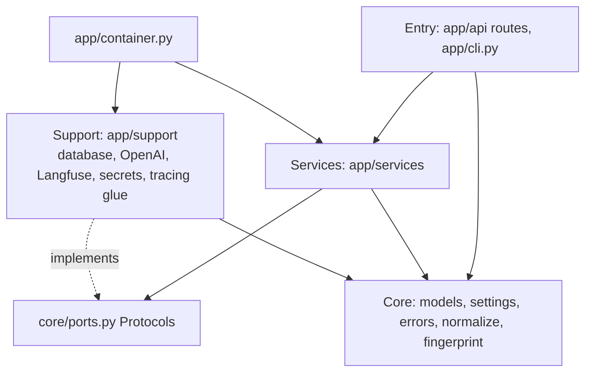
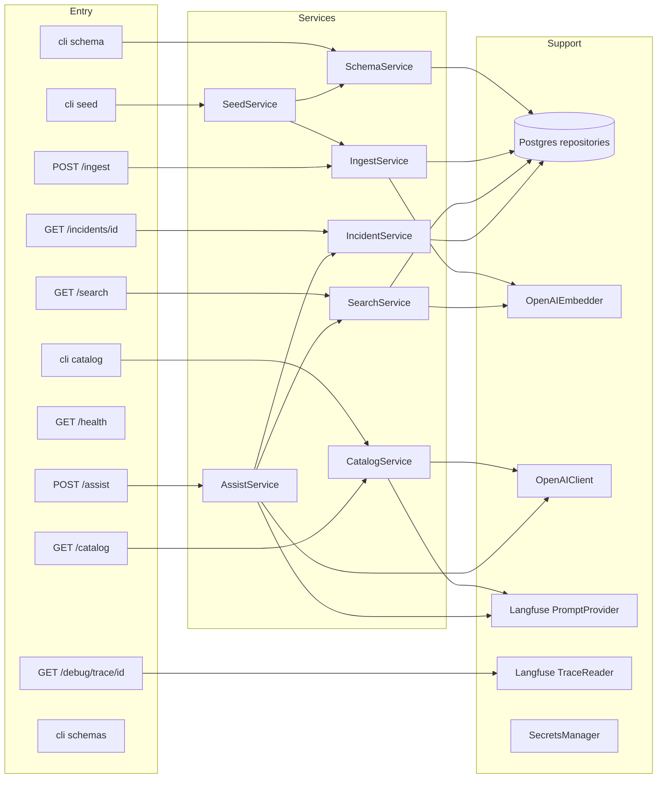
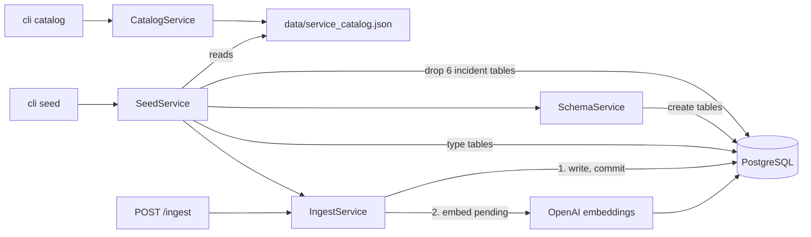
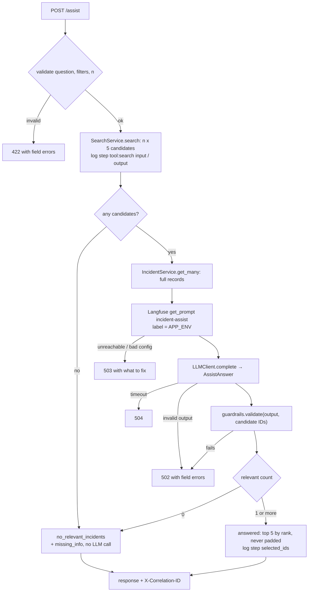
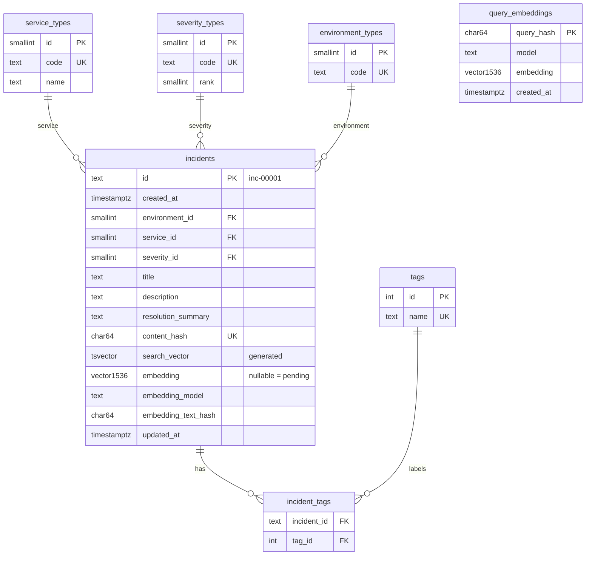

# Design Document

## Overview

The Incident Triage API is a FastAPI application on EC2 (us-east-2) backed by RDS PostgreSQL with pgvector. Synthetic incidents are generated once by an LLM (catalog), turned into a reproducible dataset by a seeded generator, and written through a single ingest path that normalizes, validates, deduplicates and embeds them. Search is hybrid (full-text plus vectors) and is shared by `/search` and `/assist`. `/assist` sends candidates to an OpenAI model with a Langfuse-managed prompt and validates the structured output with guardrails. Langfuse owns prompts, traces and log events.

Detailed designs: [architecture.md](../../../architecture.md), [database-architecture.md](../../../database-architecture.md), [trace-architecture.md](../../../trace-architecture.md), [prompts/](../../../prompts/README.md). Requirements: [requirements.md](requirements.md).

Key decisions:

| Decision | Choice | Reason |
|----------|--------|--------|
| Layers | entry → services → support, all use core | separation of concerns; services testable with fakes |
| Wiring | `app/container.py` + FastAPI `Depends` | one place builds clients; routes stay thin |
| Search | full-text + `text-embedding-3-small`, reciprocal rank fusion | text matches and meaning matches; same path for `/assist` |
| LLM settings | Langfuse prompt `config` (`gpt-6.1-terra`, strict JSON schema) | change model or schema without code changes |
| Prompt label | request `environment` (`prod` → `production`) | prompt version per environment |
| Tracing | Langfuse only, no app trace store | Langfuse is the owner; works with any worker count |
| Duplicates | SHA-256 Content_Hash of canonical JSON | detects the same incident under a new ID |
| Embedding failures | save first, embed pending rows on every ingest | OpenAI outages never lose incidents |
| Reproducibility | fixed seed, fixed dates, `id` tiebreak, stored query vectors | same data and request give the same result |

## Architecture

### Layers



### Components and calls



### Database setup and data flow



### `/assist` flow



### Request lifecycle and tracing

```mermaid
sequenceDiagram
    participant C as Client
    participant M as Correlation middleware
    participant R as Route (traced_endpoint)
    participant S as Service (@observe)
    participant L as Langfuse
    C->>M: request (X-Correlation-ID optional)
    M->>R: correlation_id set
    R->>R: validate; APP_ENV from environment filter
    R->>L: root observation (trace id from correlation_id, environment, metadata)
    R->>S: Depends-injected service call
    S->>L: nested observations, log events
    S-->>R: result or domain error
    R-->>C: response + X-Correlation-ID
    R->>L: flush (background task)
```

## Components and Interfaces

### Core (`app/core`)

| Item | Purpose |
|------|---------|
| `models/incident.py` | `Incident`, `Environment` (`dev`, `qa`, `stage`, `prod`), `Severity` (`critical`, `high`, `medium`, `low`) |
| `models/filters.py` | `SearchFilters(environment, service, severity, tags)` |
| `models/prompt.py` | `LLMConfig`, `CompiledPrompt`, `LLMResult[T]`, `EmbeddingResult` |
| `ports.py` | Protocols listed below |
| `normalize.py` | lowercase/trim codes and tags; tags deduped and alphabetical |
| `fingerprint.py` | canonical JSON + SHA-256 Content_Hash |
| `embedding_text.py` | labeled text of title, description, resolution |
| `settings.py`, `errors.py` | env var settings; domain errors |

### Ports (`app/core/ports.py`, source of truth)

- `PromptProvider.get(name, variables, label) -> CompiledPrompt`
- `LLMClient.complete(prompt, output_model) -> LLMResult[output_model]`
- `EmbeddingClient.embed_batch(texts) -> EmbeddingResult`
- `IncidentRepository`: `unit_of_work()` (one transaction: `load_types`, `find_existing`, `insert`, `update`, `lock_pending_embeddings`, `save_embeddings`, `count_pending_embeddings`), plus `search`, `get`, `get_many`, `get_query_embedding`, `save_query_embedding`, `ping`
- `SchemaRepository`: `create_schema`, `drop_incident_tables`, `upsert_types`
- `TraceReader.get(correlation_id) -> TraceView`

Data exchanged through the ports is in `app/core/models/` (`storage.py`, `search.py`, `prompt.py`, `trace.py`, `catalog.py`). DDL files live in `app/support/database/sql/` (no SQL outside the database package).

### Services (`app/services`)

| Service | Public method | Uses |
|---------|---------------|------|
| `SchemaService` | `create()` | `SchemaRepository` |
| `CatalogService` | `generate(CatalogRequest) -> Catalog`, `get() -> Catalog` | `PromptProvider`, `LLMClient`, file |
| `SeedService` | `seed() -> IngestResult` | `SchemaRepository`, `SchemaService`, `IngestService`, catalog file |
| `IngestService` | `ingest(incidents: list[IncidentIn] | None) -> IngestResult` | `IncidentRepository`, `EmbeddingClient` |
| `SearchService` | `search(filters, q, limit) -> SearchResult`, `candidates(filters, q, k) -> list[Candidate]` | `IncidentRepository`, `EmbeddingClient`, `query_builder` |
| `IncidentService` | `get(id)`, `get_many(ids)` | `IncidentRepository` |
| `AssistService` | `assist(AssistRequest) -> AssistResponse` | `SearchService`, `IncidentService`, `PromptProvider`, `LLMClient`, `guardrails` |

`guardrails.validate(answer, candidate_ids) -> SelectedIncidents` and `query_builder.build(filters, q, vector, limits) -> (sql, params)` are pure functions.

### Support (`app/support`)

| Module | Implements |
|--------|-----------|
| `database/` | pool (`sslmode=require`, statement timeout), `IncidentRepository`, `SchemaRepository`, `query_builder` |
| `llm/openai_client.py` | `LLMClient` with the Responses API, config pass-through, output parsing |
| `llm/openai_embedder.py` | `EmbeddingClient` with batching, timeout, count and dimension checks |
| `langfuse/prompts.py` | `PromptProvider`: text prompt by label, no cache, config validated into `LLMConfig` |
| `langfuse/trace_reader.py` | `TraceReader`: observations by trace ID, returned unchanged with the Langfuse URL |
| `tracing/` | correlation middleware, `traced_endpoint` (root observation, APP_ENV, flush), `traced` = Langfuse `@observe`, JSON log formatter, `LangfuseLogHandler` |
| `secrets/secrets_manager.py` | reads the four secrets with exact keys |

### Entry (`app/api`, `app/cli.py`, `app/container.py`)

- `container.build_container(settings) -> Container` creates clients and services; used by the FastAPI lifespan and the CLI.
- `api/deps.py` has one getter per service; routes use `Depends`.
- Endpoints: `POST /ingest`, `GET /search`, `GET /incidents/{id}`, `POST /assist`, `GET /catalog`, `GET /debug/trace/{correlation_id}`, `GET /health`.
- CLI: `schema`, `catalog [--services ...] [--events n]`, `seed`, `schemas`.

## Data Models

### Database



Indexes, normalization, hashing and ingest rules: [database-architecture.md](../../../database-architecture.md).

### API models

| Model | Fields |
|-------|--------|
| `IncidentIn` | `id`, `created_at`, `environment`, `service`, `severity`, `title`, `description`, `resolution_summary`, `tags` |
| `IngestResult` | `ingested`, `updated`, `skipped`, `duplicates`, `invalid`, `embedded`, `embedding_pending`, `embedding_error`, `rejected[]` |
| `SearchResult` | `total`, `results[{id, title, snippet, score}]` |
| `AssistRequest` | `question`, `environment`, `service`, `severity`, `tags`, `candidate_multiplier` |
| `AssistResponse` | `status`, `relevant_incidents[]`, `note`, `candidates[]`, `next_steps[]`, `customer_draft`, `missing_info[]`, `correlation_id` |
| `CatalogRequest` | `services` (default 20), `events_per_service` (default 20) |
| Error body | `error`, `detail`, `correlation_id` |

### LLM output models

```python
class CandidateAssessment(BaseModel):
    id: str
    relevant: bool
    reason: str
    rank: int | None
    rank_justification: str | None

class AssistAnswer(BaseModel):          # schema "assist_answer"
    candidates: list[CandidateAssessment]
    next_steps: list[str]
    customer_draft: str
    missing_info: list[str]

class CatalogEvent(BaseModel):
    title: str
    description: str
    resolution_summary: str
    tags: list[str]

class CatalogBatch(BaseModel):          # schema "catalog_batch"
    events: list[CatalogEvent]
```

Strict JSON schemas generated from these models are in `prompts/*.config.json`.

## Correctness Properties

*A property is a statement that must hold for every valid input. Each property is checked by unit tests, with generated inputs where noted.*

### Property 1: Normalization is idempotent
*For any* incident, normalizing it twice gives the same result as normalizing it once, and its tags are lowercase, unique and alphabetical.
**Validates: Requirements 7.5**

### Property 2: Content_Hash ignores formatting
*For any* incident, changing case, extra spaces, punctuation, tag order, duplicate tags, `id` or `created_at` does not change the Content_Hash; changing any hashed field's words does.
**Validates: Requirements 7.7**

### Property 3: Ingest is idempotent
*For any* valid batch, ingesting it twice leaves the database unchanged after the first time, and the second result has every incident counted as `skipped`.
**Validates: Requirements 7.8, 7.9**

### Property 4: Invalid types are never stored
*For any* incident whose environment, service or severity is not in the Type_Tables, the incident is not stored and appears in `rejected` with field and value.
**Validates: Requirements 7.6**

### Property 5: Embedding failures never lose incidents
*For any* batch, when the embedder fails, every valid incident is still stored with a `NULL` embedding, and a later ingest call with no body embeds exactly the pending rows.
**Validates: Requirements 7.10, 8.3, 8.4, 8.5**

### Property 6: Seed is reproducible
*For any* catalog with 200-500 events and any `SEED`, running the seed twice produces identical incidents, IDs and dates.
**Validates: Requirements 6.3, 6.4**

### Property 7: Search is reproducible
*For any* data set and request, repeating the request returns the same `total`, IDs and order.
**Validates: Requirements 10.6**

### Property 8: Filters are always applied
*For any* filter combination, every search result matches all given filters, and all given tags.
**Validates: Requirements 10.2, 10.3**

### Property 9: Queries are parameterized
*For any* user input, the SQL text produced by `query_builder` contains no user value; all values are in the parameter list.
**Validates: Requirements 4.5**

### Property 10: Guardrails only accept grounded answers
*For any* LLM answer, guardrails accept it only if every Candidate appears exactly once, no other ID appears, relevant entries have unique ranks 1..k, non-relevant entries have no rank, and every reason is non-empty.
**Validates: Requirements 12.5**

### Property 11: Assist never pads
*For any* accepted answer with k relevant Candidates, `relevant_incidents` has exactly min(k, 5) entries sorted by rank, and the status is `no_relevant_incidents` exactly when k = 0.
**Validates: Requirements 12.6, 12.7**

### Property 12: APP_ENV mapping
*For any* request, APP_ENV equals the `environment` filter for `dev`, `qa`, `stage`, equals `production` for `prod` or no filter, and the search filter itself is unchanged.
**Validates: Requirements 9.4**

### Property 13: Secrets never leak
*For any* error message, log line or recorded observation, no secret value appears.
**Validates: Requirements 2.2, 13.10**

## Error Handling

| Domain error | HTTP | Example message |
|--------------|------|-----------------|
| validation (Pydantic) | 422 | field-level errors |
| `NotFound` | 404 | "incident inc-00999 not found" |
| `TraceNotReady` | 404 | "trace not available yet; retry shortly" |
| `LLMOutputInvalid`, `GroundingFailure`, embedding shape mismatch | 502 | "LLM output does not match AssistAnswer: candidates[3].rank required" |
| `LangfuseUnavailable`, `PromptLabelMissing`, `PromptConfigInvalid`, `LLMUnavailable`, `EmbeddingUnavailable` | 503 | "prompt incident-assist has no label qa; add it in Langfuse" |
| `LLMTimeout` | 504 | "OpenAI did not answer within 30 s" |
| startup secret error | process exits | "secret incident-triage/db-credentials is missing key dbname" |

- One exception handler maps domain errors to `{error, detail, correlation_id}`; unexpected errors return 500 with a generic message, and details go only to logs and Langfuse.
- An embedding failure inside ingest is not an HTTP error: incidents are saved and the response reports `embedding_pending` and `embedding_error`.
- Langfuse log-event failures are swallowed after writing to stdout.

## Testing Strategy

- **Unit tests** (`tests/unit/`, mirror `app/`): every component, with fakes injected through `core/ports.py` and `app.dependency_overrides`. No AWS, database, OpenAI or Langfuse access. Component lists are in the three architecture documents.
- **Property tests**: Properties 1, 2, 3, 9, 10 and 11 use generated inputs (Hypothesis); the others use focused examples.
- **Schema sync test**: `prompts/*.config.json` schemas equal the schemas generated from `AssistAnswer` and `CatalogBatch`.
- **Live tests** (`tests/live/`, `@pytest.mark.live`): call the running EC2 API, skipped unless `API_BASE_URL` is set; cover ingest twice, search, details, assist, catalog and debug trace.
- `pytest` runs unit and property tests only; `pytest -m live` runs live tests.
- Dependencies: fastapi, uvicorn, pydantic, psycopg[binary,pool], pgvector, boto3, openai, langfuse (v5), pytest, hypothesis, httpx.
