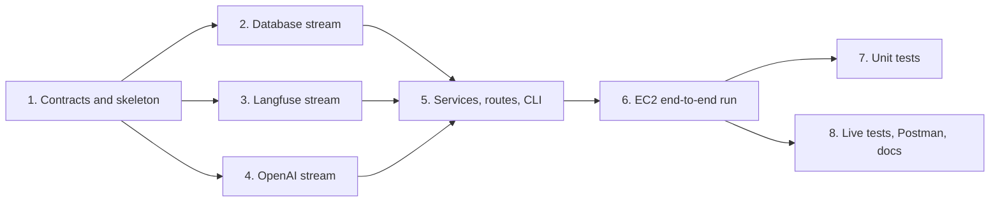

# Implementation Plan

## Overview

Build the Incident Triage API from [requirements.md](requirements.md) and [design.md](design.md) within the take-home timebox. Task 1 (contracts) comes first. Tasks 2, 3 and 4 are independent streams (database, Langfuse, OpenAI) that run in parallel, because each depends only on the Protocols in `core/ports.py`. Task 5 joins them into services, routes and CLI. Task 6 is the first end-to-end run on EC2. Unit tests (task 7) start only after the whole structure works on EC2. Live tests and documentation come last.



## Tasks

- [ ] 1. Contracts and project skeleton (blocks everything else)
  - [ ] 1.1 Create the folder structure from `architecture.md` (`main.py`, `app/core`, `app/api`, `app/services`, `app/support`, `app/container.py`, `app/cli.py`, `tests/unit`, `tests/live`, `data/`)
    - Replace `requirements.txt` with the EC2 dependencies (fastapi, uvicorn, pydantic, psycopg[binary,pool], pgvector, boto3, openai, langfuse>=5,<6, httpx, pytest, hypothesis)
    - Add `requirements-dev.txt` (ruff) and ruff config in `pyproject.toml` (line length 100, rules E, F, I, B, UP)
    - _Requirements: 1.2, 3.1_
  - [ ] 1.2 Write core models: `Incident`, `Environment`, `Severity`, `SearchFilters`, `LLMConfig`, `CompiledPrompt`, `LLMResult[T]`, `EmbeddingResult`
    - _Requirements: 3.2_
  - [ ] 1.3 Write `core/ports.py` Protocols: `PromptProvider`, `LLMClient`, `EmbeddingClient`, `IncidentRepository`, `SchemaRepository`, `TraceReader`
    - _Requirements: 3.3_
  - [ ] 1.4 Write `core/settings.py` (env vars and defaults) and `core/errors.py` (domain errors with HTTP status)
    - _Requirements: 2.3, 14.4_
  - [ ] 1.5 Write pure helpers `core/normalize.py`, `core/fingerprint.py`, `core/embedding_text.py`
    - _Requirements: 7.5, 7.7, 8.1_
  - [ ] 1.6 Write `support/secrets/secrets_manager.py` reading the four secrets with exact keys
    - _Requirements: 2.1, 2.2_

- [ ] 2. Database stream (parallel with 3 and 4)
  - [ ] 2.1 Write SQL files `001_types.sql` … `005_query_embeddings.sql` (tables, constraints, generated `search_vector`, indexes)
    - _Requirements: 4.1, 4.4_
  - [ ] 2.2 Implement the connection pool (`sslmode=require`, statement timeout) and `SchemaRepository` (apply SQL files, drop the six incident tables, upsert types)
    - _Requirements: 2.5, 4.2, 4.3, 6.2_
  - [ ] 2.3 Implement `SchemaService.create()`
    - _Requirements: 4.1, 4.2_
  - [ ] 2.4 Implement `IncidentRepository` writes: load types, find by IDs and hashes, write plan (incidents, tags, links), lock pending embeddings (`FOR UPDATE SKIP LOCKED`), save embeddings
    - _Requirements: 7.2, 7.8, 8.3_
  - [ ] 2.5 Implement `query_builder` (hybrid full-text + vector, filters, RRF, `id` tiebreak, real `total`) and `IncidentRepository` reads (search, get, get_many, query embeddings)
    - _Requirements: 4.5, 10.1-10.6, 11.1_
  - [ ] 2.6 Implement `IngestService` (normalize, defensive check, hash, outcomes, commit, then embed pending; empty body embeds only)
    - Build with a fake `EmbeddingClient` until task 4 is done
    - _Requirements: 7.1-7.11, 8.2-8.5_
  - [ ] 2.7 Implement `SeedService` (drop, schema, type tables, reproducible generation from the catalog, 200-500 check, ingest)
    - _Requirements: 6.1-6.5_

- [ ] 3. Langfuse stream (parallel with 2 and 4)
  - [ ] 3.1 Create the Langfuse client (host `LANGFUSE_HOST`, keys from secrets) and the correlation middleware
    - _Requirements: 13.1_
  - [ ] 3.2 Implement `traced_endpoint` (resolve APP_ENV, root observation with trace ID from correlation_id, environment and metadata, flush after the response) and re-export `@observe` as `traced`
    - _Requirements: 9.4, 13.2, 13.3, 13.6_
  - [ ] 3.3 Implement JSON stdout logging with correlation_id and observation ID, and `LangfuseLogHandler` (events, levels, never raises)
    - _Requirements: 13.7, 13.8, 13.10_
  - [ ] 3.4 Implement `PromptProvider` (text prompt by label, no cache, compile variables, validate config into `LLMConfig`, clear 503 errors)
    - _Requirements: 9.1-9.5_
  - [ ] 3.5 Implement `TraceReader` (observations by trace ID, unchanged, Langfuse URL, 404 retry, 503)
    - _Requirements: 13.5_
  - [ ] 3.6 Create prompts `incident-assist` and `incident-catalog` in Langfuse from `prompts/` with labels `dev`, `qa`, `stage`, `production` (owner, in the Langfuse UI)
    - _Requirements: 9.1, 9.2_

- [ ] 4. OpenAI stream (parallel with 2 and 3)
  - [ ] 4.1 Implement `OpenAIClient` (`LLMClient`): Responses API, config pass-through, parse into the output model, schema name check, 502/503/504 errors, timeout
    - _Requirements: 9.6-9.8_
  - [ ] 4.2 Implement `OpenAIEmbedder` (`EmbeddingClient`): batches of up to 100, timeout, count and dimension checks
    - _Requirements: 8.1, 8.6_
  - [ ] 4.3 Write output models `AssistAnswer`, `CatalogBatch` and `cli schemas`; confirm they match `prompts/*.config.json`
    - _Requirements: 9.8_

- [ ] 5. Services, routes and CLI (after 2, 3 and 4)
  - [ ] 5.1 Implement `SearchService` (search and candidates, stored query embeddings) and `IncidentService`
    - _Requirements: 10.1-10.8, 11.1, 11.2_
  - [ ] 5.2 Implement `CatalogService` (defaults, limits, one LLM call per service, exact count, save and get)
    - _Requirements: 5.1-5.6_
  - [ ] 5.3 Implement `guardrails.validate` and `AssistService` (n × 5 candidates, full records, prompt, one LLM call, status, top 5 never padded, step logs)
    - _Requirements: 12.1-12.8, 13.9_
  - [ ] 5.4 Implement `container.build_container`, `api/deps.py`, the FastAPI lifespan and the exception handler
    - _Requirements: 3.4, 3.5, 14.4_
  - [ ] 5.5 Implement routes: `POST /ingest`, `GET /search`, `GET /incidents/{id}`, `POST /assist`, `GET /catalog`, `GET /debug/trace/{correlation_id}`, `GET /health`, all with `traced_endpoint` except `/debug/trace`
    - _Requirements: 7.2-7.4, 10.1, 11.1, 12.1, 5.5, 13.5, 14.5_
  - [ ] 5.6 Implement `app/cli.py`: `schema`, `catalog`, `seed`, `schemas`
    - _Requirements: 1.5_

- [ ] 6. End-to-end run on EC2 (checkpoint: structure works)
  - [ ] 6.1 Deploy to EC2, install dependencies, start uvicorn (owner)
    - _Requirements: 1.1, 1.2_
  - [ ] 6.2 Run `cli catalog`, commit `data/service_catalog.json`, run `cli seed`
    - _Requirements: 5.1, 6.1_
  - [ ] 6.3 Call each endpoint with curl; check counts, search results, assist answer, and the trace and log events in Langfuse
    - _Requirements: 7.11, 10.1, 12.7, 13.2, 13.7_
  - [ ] 6.4 Fix issues found; repeat until all endpoints work

- [ ] 7. Unit tests (start after task 6 passes)
  - [ ] 7.1 Core: `normalize`, `fingerprint`, `embedding_text`, settings, secrets loader
    - _Requirements: 2.2, 7.5, 7.7, 8.1_
  - [ ] 7.2 Database stream: `query_builder` (filters, parameterized, tiebreak, NULL embeddings), `SchemaService`, `IngestService` (every outcome, embedding failure, empty body), `SeedService` (reproducible, weights, 200-500)
    - _Requirements: 4.5, 6.4, 7.6-7.10, 8.3-8.5, 10.6_
  - [ ] 7.3 Langfuse stream: APP_ENV mapping, root observation attributes, log handler, `PromptProvider` errors, `TraceReader`
    - _Requirements: 9.3-9.5, 13.2, 13.5, 13.7, 13.8_
  - [ ] 7.4 OpenAI stream: config pass-through, output parsing errors, timeouts, embedding shape checks, schema sync with `prompts/`
    - _Requirements: 8.6, 9.6-9.8_
  - [ ] 7.5 Services: `CatalogService`, `SearchService`, `AssistService`, `guardrails` (every rejection rule, never pads)
    - _Requirements: 5.2-5.4, 12.2-12.7_
  - [ ] 7.6 Routes and container: 422/404 responses, `dependency_overrides` fakes, same wiring for API and CLI
    - _Requirements: 3.4, 3.5, 14.1_
  - [ ] 7.7 Property tests (Hypothesis) for design Properties 1, 2, 3, 9, 10, 11
    - _Requirements: 7.5, 7.7, 7.9, 4.5, 12.5, 12.7_

- [ ] 8. Live tests, Postman and documentation
  - [ ] 8.1 Live tests (`@pytest.mark.live`, `API_BASE_URL`): ingest twice, search, details, assist, catalog, debug trace
    - _Requirements: 15.3_
  - [ ] 8.2 `postman_collection.json` with `{{base_url}}`
    - _Requirements: 16.3_
  - [ ] 8.3 Ask the owner about EC2 deployment steps, then write `README.md` (run steps, curl examples, tests)
    - _Requirements: 16.1_
  - [ ] 8.4 Write `PROMPTS.md` from `docs/prompt-log.md`, `AI-NOTES.md` (at least 2 AI mistakes), `TRADEOFFS.md` (Requirement 17 deviations, known risks, next steps)
    - _Requirements: 16.2, 17.1-17.4_

## Notes

- Tasks 2, 3 and 4 never import each other. They share only `app/core`. The database stream uses a fake `EmbeddingClient` until task 4 is done.
- Owner tasks: 3.6 (create prompts and labels in the Langfuse UI) and 6.1 (deploy and start on EC2). The agent cannot reach AWS or Langfuse from the dev machine.
- Unit tests are planned in task 7 and start only after task 6 passes, by owner decision.
- Task 8.3 must ask the owner about EC2 deployment steps before writing the README.
- Add prompts used during the build to `docs/prompt-log.md` as work progresses.
- Anything not finished within the timebox goes to `TRADEOFFS.md`.
- All code follows `.kiro/steering/code-standards.md`. Sub-agents running parallel streams receive the same standards in their instructions.

## Task Dependency Graph

```json
{
  "waves": [
    { "id": 0, "tasks": ["1.1"] },
    { "id": 1, "tasks": ["1.2", "1.4", "1.6"] },
    { "id": 2, "tasks": ["1.3", "1.5"] },
    { "id": 3, "tasks": ["2.1", "3.1", "3.6", "4.1", "4.2", "4.3"] },
    { "id": 4, "tasks": ["2.2", "3.2", "3.3", "3.4", "3.5"] },
    { "id": 5, "tasks": ["2.3", "2.4", "2.5"] },
    { "id": 6, "tasks": ["2.6"] },
    { "id": 7, "tasks": ["2.7", "5.1", "5.2"] },
    { "id": 8, "tasks": ["5.3"] },
    { "id": 9, "tasks": ["5.4"] },
    { "id": 10, "tasks": ["5.5", "5.6"] },
    { "id": 11, "tasks": ["6.1"] },
    { "id": 12, "tasks": ["6.2"] },
    { "id": 13, "tasks": ["6.3"] },
    { "id": 14, "tasks": ["6.4"] },
    { "id": 15, "tasks": ["7.1", "7.2", "7.3", "7.4", "7.5", "7.6", "7.7", "8.1", "8.2"] },
    { "id": 16, "tasks": ["8.3", "8.4"] }
  ]
}
```

Waves 3 to 5 hold the three parallel streams: database (2.x), Langfuse (3.x) and OpenAI (4.x). Tasks in the same wave do not depend on each other.
