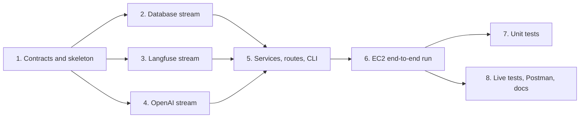

# Implementation Plan

## Overview

Build the Incident Triage API from [requirements.md](requirements.md) and [design.md](design.md) within the take-home timebox. Task 1 (contracts) comes first. Tasks 2, 3 and 4 are independent streams (database, Langfuse, OpenAI) that run in parallel, because each depends only on the Protocols in `core/ports.py`. Task 5 joins them into services, routes and CLI. Task 6 is the first end-to-end run on EC2. Unit tests (task 7) start only after the whole structure works on EC2. Live tests and documentation come last.



## Tasks

- [x] 1. Contracts and project skeleton (blocks everything else)
  - [x] 1.1 Create the folder structure from `architecture.md` (`main.py`, `app/core`, `app/api`, `app/services`, `app/support`, `app/container.py`, `app/cli.py`, `tests/unit`, `tests/live`, `data/`)
    - Replace `requirements.txt` with the EC2 dependencies (fastapi, uvicorn, pydantic, psycopg[binary,pool], pgvector, boto3, openai, langfuse>=5,<6, httpx, pytest, hypothesis)
    - Add `requirements-dev.txt` (ruff) and ruff config in `pyproject.toml` (line length 100, rules E, F, I, B, UP)
    - _Requirements: 1.2, 3.1_
  - [x] 1.2 Write core models: `Incident`, `Environment`, `Severity`, `SearchFilters`, `LLMConfig`, `CompiledPrompt`, `LLMResult[T]`, `EmbeddingResult`
    - _Requirements: 3.2_
  - [x] 1.3 Write `core/ports.py` Protocols: `PromptProvider`, `LLMClient`, `EmbeddingClient`, `IncidentRepository`, `SchemaRepository`, `TraceReader`
    - _Requirements: 3.3_
  - [x] 1.4 Write `core/settings.py` (env vars and defaults) and `core/errors.py` (domain errors with HTTP status)
    - _Requirements: 2.3, 14.4_
  - [x] 1.5 Write pure helpers `core/normalize.py`, `core/fingerprint.py`, `core/embedding_text.py`
    - _Requirements: 7.5, 7.7, 8.1_
  - [x] 1.6 Write `support/secrets/secrets_manager.py` reading the four secrets with exact keys
    - _Requirements: 2.1, 2.2_

- [x] 2. Database stream (parallel with 3 and 4)
  - [x] 2.1 Write SQL files `001_types.sql` … `005_query_embeddings.sql` (tables, constraints, generated `search_vector`, indexes)
    - _Requirements: 4.1, 4.4_
  - [x] 2.2 Implement the connection pool (`sslmode=require`, statement timeout) and `SchemaRepository` (apply SQL files, drop the six incident tables, upsert types)
    - _Requirements: 2.5, 4.2, 4.3, 6.2_
  - [x] 2.3 Implement `SchemaService.create()`
    - _Requirements: 4.1, 4.2_
  - [x] 2.4 Implement `IncidentRepository` writes: load types, find by IDs and hashes, write plan (incidents, tags, links), lock pending embeddings (`FOR UPDATE SKIP LOCKED`), save embeddings
    - _Requirements: 7.2, 7.8, 8.3_
  - [x] 2.5 Implement `query_builder` (hybrid full-text + vector, filters, RRF, `id` tiebreak, real `total`) and `IncidentRepository` reads (search, get, get_many, query embeddings)
    - _Requirements: 4.5, 10.1-10.6, 11.1_
  - [x] 2.6 Implement `IngestService` (normalize, defensive check, hash, outcomes, commit, then embed pending; empty body embeds only)
    - Build with a fake `EmbeddingClient` until task 4 is done
    - _Requirements: 7.1-7.11, 8.2-8.5_
  - [x] 2.7 Implement `SeedService` (drop, schema, type tables, reproducible generation from the catalog, 200-999 check, ingest)
    - _Requirements: 6.1-6.5_
  - [x] 2.8 Build the IVFFlat cosine index at the end of the seed
    - After ingest and embeddings: `lists = clamp(embedded_rows / IVFFLAT_ROWS_PER_LIST, 1, IVFFLAT_MAX_LISTS)`, `CREATE INDEX ... USING ivfflat (embedding vector_cosine_ops) WITH (lists = n)`, then `ANALYZE incidents`
    - Built last because IVFFlat learns its lists from the rows present when it is created
    - _Requirements: 6.6, 6.7_
  - [x] 2.10 Repeat each catalog event `SEED_REPEATS` times (default 2) with distinct (environment, severity) pairs and own dates; size check 200-999
    - _Requirements: 6.3a, 6.5, 17.5_
  - [x] 2.9 Use the index in the vector branch with probes
    - Vector branch reads `incidents` directly (not the shared CTE) and orders by `embedding <=> query` with `LIMIT`, so the planner can use the index; similarity and threshold applied on that result
    - Each search transaction sets `ivfflat.probes = IVFFLAT_PROBES` with `set_config(..., true)`; probes ≥ lists, so results are exact and reproducible
    - _Requirements: 10.2, 10.6, 10.9_

- [x] 3. Langfuse stream (parallel with 2 and 4)
  - [x] 3.1 Create the Langfuse client (host `LANGFUSE_HOST`, keys from secrets) and the correlation middleware
    - _Requirements: 13.1_
  - [x] 3.2 Implement `traced_endpoint` (resolve APP_ENV, root observation with trace ID from correlation_id, environment and metadata, flush after the response) and re-export `@observe` as `traced`
    - _Requirements: 9.4, 13.2, 13.3, 13.6_
  - [x] 3.3 Implement JSON stdout logging with correlation_id and observation ID, and `LangfuseLogHandler` (events, levels, never raises)
    - _Requirements: 13.7, 13.8, 13.10_
  - [x] 3.4 Implement `PromptProvider` (text prompt by label, no cache, compile variables, validate config into `LLMConfig`, clear 503 errors)
    - _Requirements: 9.1-9.5_
  - [x] 3.5 Implement `TraceReader` (observations by trace ID, unchanged, Langfuse URL, 404 retry, 503)
    - _Requirements: 13.5_
  - [x] 3.6 Create prompts `incident-assist` and `incident-catalog` in Langfuse from `prompts/` with labels `dev`, `qa`, `stage`, `production` (owner, in the Langfuse UI)
    - _Requirements: 9.1, 9.2_

- [x] 4. OpenAI stream (parallel with 2 and 3)
  - [x] 4.1 Implement `OpenAIClient` (`LLMClient`): Responses API, config pass-through, parse into the output model, schema name check, 502/503/504 errors, timeout
    - _Requirements: 9.6-9.8_
  - [x] 4.2 Implement `OpenAIEmbedder` (`EmbeddingClient`): batches of up to 100, timeout, count and dimension checks
    - _Requirements: 8.1, 8.6_
  - [x] 4.3 Write output models `AssistAnswer`, `CatalogBatch` and `cli schemas`; confirm they match `prompts/*.config.json`
    - _Requirements: 9.8_

- [x] 5. Services, routes and CLI (after 2, 3 and 4)
  - [x] 5.1 Implement `SearchService` (search and candidates, stored query embeddings) and `IncidentService`
    - _Requirements: 10.1-10.8, 11.1, 11.2_
  - [x] 5.2 Implement `CatalogService` (defaults, limits, one LLM call per service, exact count, save and get)
    - _Requirements: 5.1-5.6_
  - [x] 5.7 Validation step before assist: `incident-validation` prompt and config, `ValidationAnswer` model, `CandidateScreener` (batches of at most 15, offset paging, rate-based batch size, stop rules), search `offset`, only valid incidents to assist, verdicts in the response
    - Owner: create `incident-validation` in Langfuse with labels `dev`, `qa`, `stage`, `production`
    - _Requirements: 12.1a, 12.1b, 12.1c, 12.3_
  - [x] 5.3 Implement `guardrails` and `AssistService` (n × 5 candidates, full records, prompt, one LLM call, status, top 5 never padded, step logs)
    - _Requirements: 12.1-12.8, 13.9_
  - [x] 5.8 Group related incidents: per relevant candidate a global `rank`, a `group` and a `group_reason` (same root cause and fix); one entry per group led by its best-ranked incident, others under `related`; top 5 counts groups; note counts distinct problems
    - Owner: create the matching `incident-assist` version in Langfuse with all labels
    - _Requirements: 12.1d, 12.7_
  - [x] 5.9 Ground LLM output in the input: drop IDs not sent (validation and assist), drop next steps citing no incident or a non-relevant one, renumber ranks and groups; incident fields come from the database
    - _Requirements: 12.5, 12.5a_
  - [x] 5.4 Implement `container.build_container`, `api/deps.py`, the FastAPI lifespan and the exception handler
    - _Requirements: 3.4, 3.5, 14.4_
  - [x] 5.5 Implement routes: `POST /ingest`, `GET /search`, `GET /incidents/{id}`, `POST /assist`, `GET /catalog`, `GET /debug/trace/{correlation_id}`, `GET /health`, all with `traced_endpoint` except `/debug/trace`
    - _Requirements: 7.2-7.4, 10.1, 11.1, 12.1, 5.5, 13.5, 14.5_
  - [x] 5.6 Implement `app/cli.py`: `schema`, `catalog`, `seed`, `schemas`
    - _Requirements: 1.5_

- [x] 6. End-to-end run on EC2 (checkpoint: structure works)
  - [x] 6.1 Deploy to EC2, install dependencies, start uvicorn (owner)
    - _Requirements: 1.1, 1.2_
  - [x] 6.2 Run `cli catalog` (400 events) and `cli seed` (800 ingested and embedded, lists = 1) on EC2
    - _Requirements: 5.1, 6.1_
  - [x] 6.3 Copy `data/service_catalog.json` from EC2 and commit it
    - Without it the dataset is not repeatable
    - _Requirements: 5.1, 6.1_
  - [x] 6.4 Check `/health`, `/search`, `/assist` (validation) and `/debug/trace` with curl, plus the trace and log events in Langfuse
    - _Requirements: 10.1, 12.7, 13.2, 13.7_
  - [x] 6.5 Check `/assist` after 5.8 and 5.9 (groups, `group_reason`, grounding)
    - _Requirements: 12.1d, 12.5_
  - [x] 6.6 Check `/incidents/{id}` and an unknown id (404)
    - _Requirements: 11.1, 11.2_
  - [x] 6.7 Check `/catalog`
    - _Requirements: 5.5_
  - [x] 6.8 Check `/ingest` twice (second run all skipped) and with an empty body (embeds pending only)
    - _Requirements: 7.11, 8.5_
  - [x] 6.9 Check failure paths: errors are clear, have no stack trace, and say what to set
    - `LLM_TIMEOUT_SECONDS=0.01` gives 504 `llm_timeout`; an unreachable `LANGFUSE_HOST` gives 503 `langfuse_unavailable`
    - Messages now name the setting or secret to check (timeout, Langfuse host and keys, Secrets Manager access)
    - _Requirements: 14.4_
  - [x] 6.10 Tighten `incident-validation`: same failure type required, a shared product area or generic word is not enough, the verdict must agree with its reason
    - _Requirements: 12.1a_
  - [x] 6.11 Verify `incident-validation` v4 on EC2 (`test-assist-008b`): gateway, certificate and slow-query incidents are `valid: false`, the 2 groups still appear
    - 30 hits checked in 2 batches, 4 valid (the connection-pool incidents), 26 invalid with reasons that agree; stopped after an all-invalid batch
    - _Requirements: 12.1a, 12.1d_
  - [x] 6.12 Fix issues found; repeat until all endpoints work

- [x] 7. Unit tests (start after task 6 passes)
  - [x] 7.0 Minimum required by the take-home, first: `guardrails` (unknown IDs dropped, uncited steps dropped, renumbering, rejections) and `query_builder` (filters, parameters)
    - `tests/unit/test_guardrails.py` and `tests/unit/test_query_builder.py`: 16 tests, run with `python -m pytest tests/unit -q`
    - _Requirements: 12.5, 10.6_
  - [x] 7.1 Core: `normalize`, `fingerprint`, `embedding_text`, settings, secrets loader
    - _Requirements: 2.2, 7.5, 7.7, 8.1_
  - [x] 7.2 Database stream: `query_builder` (filters, parameterized, tiebreak, NULL embeddings), `SchemaService`, `IngestService` (every outcome, embedding failure, empty body), `SeedService` (reproducible, weights, 200-999)
    - _Requirements: 4.5, 6.4, 7.6-7.10, 8.3-8.5, 10.6_
  - [x] 7.3 Langfuse stream: APP_ENV mapping, root observation attributes, log handler, `PromptProvider` errors, `TraceReader`
    - _Requirements: 9.3-9.5, 13.2, 13.5, 13.7, 13.8_
  - [x] 7.4 OpenAI stream: config pass-through, output parsing errors, timeouts, embedding shape checks, schema sync with `prompts/`
    - _Requirements: 8.6, 9.6-9.8_
  - [x] 7.5 Services: `CatalogService`, `SearchService`, `AssistService`, `guardrails` (every rejection rule, never pads)
    - _Requirements: 5.2-5.4, 12.2-12.7_
  - [x] 7.6 Routes and container: 422/404 responses, `dependency_overrides` fakes, same wiring for API and CLI
    - _Requirements: 3.4, 3.5, 14.1_
  - [x] 7.7 Property tests (Hypothesis) for design Properties 1, 2, 3, 9, 10, 11
    - Full suite: 343 passed
    - Decision: a repeated `id` in one batch applies in order and the last version wins (requirement 7.9a, Property 3); a re-run leaves the data and embeddings unchanged
    - Found and fixed: 500 responses lost the correlation_id (handler runs outside `CorrelationMiddleware`)
    - _Requirements: 7.5, 7.7, 7.9, 4.5, 12.5, 12.7_

- [x] 8. Live tests, Postman and documentation
  - [x] 8.1 Live tests (`@pytest.mark.live`, `API_BASE_URL`): ingest twice, search, details, assist, catalog, debug trace
    - `tests/live/test_live_api.py`: 10 tests, passed against EC2 in about 30 s
    - _Requirements: 15.3_
  - [x] 8.2 `postman_collection.json` with `{{base_url}}`
    - _Requirements: 16.3_
  - [x] 8.3 Write `README.md` (run steps, curl examples, tests); EC2 steps from the deployment done in task 6
    - _Requirements: 16.1_
  - [x] 8.4 Write `PROMPTS.md` from `docs/prompt-log.md`, `AI-NOTES.md` (at least 2 AI mistakes), `TRADEOFFS.md` (Requirement 17 deviations, known risks, next steps)
    - `PROMPTS.md`: 10 prompts in the take-home template; `AI-NOTES.md`: 7 AI mistakes; Mermaid diagrams in all three
    - _Requirements: 16.2, 17.1-17.4_
  - [x] 8.5 Sync `architecture.md`, `trace-architecture.md`, `database-architecture.md` and `design.md` with the code (validation, groups, grounding, errors, last version wins), with a Mermaid diagram per decision
  - [x] 8.6 Remove the pre-task leftovers (`src/dayforce_task`, `SETUP.md`, `docs/01-03`, `docs/README.md`); write `.env.example` with the real settings; ignore `.hypothesis/` and `.ruff_cache/`

- [ ] 9. Prompt fine-tuning (after the docs)
  - [ ] 9.1 Build a fixed question set with expected incident groups (clear match, reworded match, no match, filter-only, misleading shared word)
  - [ ] 9.2 Run `incident-validation` and `incident-assist` on the set as Langfuse experiments; record precision, missed incidents, group quality, calls and latency per question
  - [ ] 9.3 Change the prompts one rule at a time, compare versions on the same set, and move the `production` label only to a version that is better on the set
  - [ ] 9.4 Copy the chosen versions to `prompts/`, update `prompts/README.md`, `PROMPTS.md` and `TRADEOFFS.md`

## Notes

- Tasks 2, 3 and 4 never import each other. They share only `app/core`. The database stream uses a fake `EmbeddingClient` until task 4 is done.
- Owner tasks: 3.6 and 6.11 (create prompts and labels in the Langfuse UI), 6.1 (deploy and start on EC2), and every `git pull` and restart on EC2. The agent cannot use AWS or Langfuse; it can call the public API on port 8000 and copy files with `scp`.
- Unit tests are planned in task 7 and start only after task 6 passes, by owner decision.
- Add prompts used during the build to `docs/prompt-log.md` as work progresses.
- Anything not finished within the timebox goes to `TRADEOFFS.md`.
- All code follows `.kiro/steering/code-standards.md`. Sub-agents running parallel streams receive the same standards in their instructions.

## Task Dependency Graph

```json
{
  "waves": [
    { "id": 0, "tasks": ["1.1"] },
    { "id": 1, "tasks": ["1.2", "1.4", "1.6"] },
    { "id": 2, "tasks": ["1.3", "1.5"] },
    { "id": 3, "tasks": ["2.1", "3.1", "3.6", "4.1", "4.2", "4.3"] },
    { "id": 4, "tasks": ["2.2", "3.2", "3.3", "3.4", "3.5"] },
    { "id": 5, "tasks": ["2.3", "2.4", "2.5"] },
    { "id": 6, "tasks": ["2.6", "2.9"] },
    { "id": 7, "tasks": ["2.7", "5.1", "5.2"] },
    { "id": 8, "tasks": ["2.8", "2.10", "5.3"] },
    { "id": 9, "tasks": ["5.4", "5.7"] },
    { "id": 10, "tasks": ["5.5", "5.6", "5.8"] },
    { "id": 11, "tasks": ["5.9", "6.1"] },
    { "id": 12, "tasks": ["6.2"] },
    { "id": 13, "tasks": ["6.3", "6.4"] },
    { "id": 14, "tasks": ["6.5", "6.6", "6.7", "6.8", "6.9", "6.10"] },
    { "id": 15, "tasks": ["6.11", "6.12"] },
    { "id": 16, "tasks": ["7.0"] },
    { "id": 17, "tasks": ["7.1", "7.2", "7.3", "7.4", "7.5", "7.6", "7.7", "8.1", "8.2", "8.5", "8.6"] },
    { "id": 18, "tasks": ["8.3", "8.4"] },
    { "id": 19, "tasks": ["9.1"] },
    { "id": 20, "tasks": ["9.2"] },
    { "id": 21, "tasks": ["9.3"] },
    { "id": 22, "tasks": ["9.4"] }
  ]
}
```

Waves 3 to 5 hold the three parallel streams: database (2.x), Langfuse (3.x) and OpenAI (4.x). Tasks in the same wave do not depend on each other.
