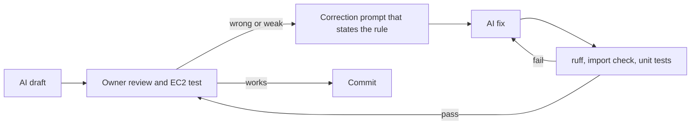

# AI-NOTES

Reflection on how AI tools were used to build the Incident Triage API. The prompts themselves are in [PROMPTS.md](PROMPTS.md) and [docs/prompt-log.md](docs/prompt-log.md).

## How AI was used across the build

All work used Kiro (chat, sub-agents and web search).

* **Spec first.** Kiro wrote the requirements, design and task list in `.kiro/specs/incident-triage-api/` from the take-home and my answers. The architecture documents (`architecture.md`, `database-architecture.md`, `trace-architecture.md`) came out of the same conversation. Every later prompt pointed back to the spec.
* **Scaffolding.** Task 1 created the folders, core models, `core/ports.py` Protocols, settings and errors. These contracts were then frozen so the streams could work in parallel.
* **Parallel sub-agents per stream.** Three sub-agents built the database, Langfuse and OpenAI streams at the same time. Each one owned its own folders and depended only on `app/core`. Task 5 then joined them into services, routes and the CLI.
* **Unit tests.** Three more sub-agents wrote the unit suite in parallel (core and database, Langfuse and OpenAI, services, routes and Hypothesis properties). Each owned its own test files.
* **Refactors.** AI applied the design changes I asked for: removing the trace store, moving to LLM grouping, grounding the LLM output, and tightening the validation prompt.
* **Debugging on EC2.** I deployed, called the public API with curl and a fixed correlation id, and read the Langfuse trace. I pasted the results back to Kiro, which found the cause and proposed the fix.
* **Docs.** AI drafted the README, these notes, `PROMPTS.md` and `TRADEOFFS.md` from the prompt log and the spec.

## Where AI output was wrong or weak, and how it was fixed

**1. Embedding model deprecation.** I remembered an OpenAI email about deprecating `text-embedding-3-small` and asked about `ada-002`. The AI first left `ada-002` out of its comparison, then dismissed my memory without checking. A search of the OpenAI forum confirmed the email was sent by mistake and then corrected. We kept `text-embedding-3-small` (1536 dimensions). Lesson: search before contradicting the user.

**2. Seed and ingest wired backwards.** The AI had `IngestService` calling `SeedService`. I corrected it: the seed generates incidents and calls ingest, and ingest is the single write path for both the seed and `POST /ingest`. One write path means one set of normalization, hashing and validation rules.

**3. A trace store next to Langfuse.** The AI built an in-memory `TraceStore` and span tree in parallel with Langfuse. I rejected it: "Langfuse is the guardian of the tracing". It was replaced by Langfuse `@observe` (re-exported as `traced`), and `/debug/trace` now reads traces back from Langfuse. The in-memory store would also have broken with several uvicorn workers.

**4. Duplicates found only by identical text.** The first duplicate handling in `/assist` clustered incidents by a text hash, so it only caught identical wording. I wanted related incidents with different wording grouped. The fix moved the decision to the LLM: each relevant candidate gets a global `rank`, a `group` and a `group_reason`. The clustering rules require the same root cause AND the same fix, because a shared symptom alone mixed different problems.

**5. Validation too lenient.** The first `incident-validation` prompt passed incidents whose own reason said they did not match, and a shared product area (for example payments) made everything valid. Version 4 requires the same failure type, rejects area-only or word-only matches, and forces the verdict to agree with its reason. On EC2 (`test-assist-008b`), the old prompt marked 15 of 15 hits valid. The new one checked 30 hits in 2 batches and kept 4 (the connection-pool incidents), with reasons that agree.

**6. Guardrails too strict in one place, too loose in another.** An unknown id in the LLM output rejected the whole answer with 502, and next-step citations were not checked at all. My rule was "never trust the LLM with real data". The guardrails now drop unknown ids, renumber ranks and groups, and remove next steps that cite no kept relevant incident. Incident fields always come from the database.

**7. A real bug found by the test agents.** The unit-test agents were told to report bugs as strict `xfail` and not fix app code. They found that 500 responses lost the `correlation_id`, because the exception handler runs outside `CorrelationMiddleware`. The bug was fixed in app code and the test now passes.

## Correction loop

## How changes were validated

* `ruff format` and `ruff check` on every change (config in `pyproject.toml`).
* `scripts/check_imports.py` imports every module, which catches broken wiring and import-time side effects.
* 343 offline unit tests (`python -m pytest`), using fakes through the `core/ports.py` Protocols and FastAPI `dependency_overrides`, plus Hypothesis property tests for normalization, hashing, idempotent ingest, parameterized queries, grounding and "assist never pads". No AWS access is needed.
* Live tests marked `live` that call the EC2 API, skipped unless `API_BASE_URL` is set.
* Manual curl calls against http://18.222.137.172:8000 with a fixed `X-Correlation-ID`, then the matching trace through `GET /debug/trace/{correlation_id}` and the Langfuse UI.
* Failure paths on EC2: `LLM_TIMEOUT_SECONDS=0.01` gives 504 `llm_timeout`, and an unreachable `LANGFUSE_HOST` gives 503 `langfuse_unavailable`. Both errors say what to set and contain no stack trace.

## Prompt patterns that worked

* **Spec first.** Requirements, design and tasks before code. Sub-agents then had a source of truth and fewer chances to invent features.
* **An always-on steering file.** `.kiro/steering/code-standards.md` holds the layers, style, patterns and definition of done. Every agent reads it, so parallel work stays consistent.
* **One stream per sub-agent with strict file ownership.** Each agent edits only its folders. For tests: "report bugs as strict xfail, do not fix". No two agents touched the same file.
* **One question at a time.** Asking the AI to raise one open question at a time gave decisions I could answer quickly and record in the spec.
* **Correction prompts that state the rule.** "Never trust the LLM with real data" or "Langfuse is the guardian of the tracing" fixed the current bug and the next similar one.
* **Test on the real deployment with a correlation id.** A fixed id such as `test-assist-008b` links the curl output, the stdout logs and the Langfuse trace, so a pasted result is enough for the AI to find the cause.
