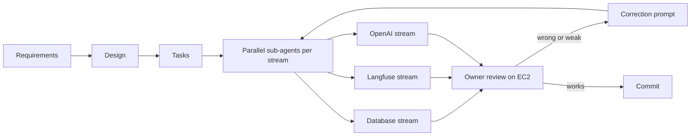

# PROMPTS

Ten prompts from the build, picked from [docs/prompt-log.md](docs/prompt-log.md) (log number in brackets). Prompts are copied as typed, with spelling and typos corrected; the wording and meaning are unchanged. The raw text is in the prompt log.

All work used Kiro: a spec first (requirements, design, tasks in `.kiro/specs/incident-triage-api/`), then sub-agents working in parallel on separate streams, then owner review on the EC2 deployment and correction prompts before each commit.



---

**Prompt #1** (log #1, layered architecture)

* Tool used: Kiro (chat)
* Goal: define the project architecture before writing any code.
* Prompt (copy/paste):

    ```
    Project architecture: create an md called architecture.md. Each FastAPI endpoint is hollow and calls a service. I want a service layer (business layer) and a support layer (Langfuse, OpenAI, database). Each model is in a folder inside each service. Just be wise about where you add the model: never add a model in a lower service that is used in an upper service. Check my architecture against incident-triage-take-home. Create Mermaid diagrams to illustrate. You also need to do unit tests for each component, service, ... Read the incident triage take-home and check if the proposed architecture is good, and what you would suggest to improve.
    ```
* Result summary: `architecture.md` with entry, service and support layers, the folder structure, Mermaid diagrams, a test plan and a check against the take-home.
* What you kept: thin routes that call a service, the service and support layers, one test file per component.
* What you changed manually (and why): the first draft was far too long, so I asked for a short document. I accepted the AI's suggestion of a `core` layer, because shared models (`Incident`, `SearchFilters`) would otherwise force a lower layer to import from a higher one.
* Any follow up prompt(s): "I asked for an md, not a PhD thesis" (part of the follow-up).
* Link to code/commit: [8f55175](https://github.com/gustavomoises/dayforce/commit/8f55175) (services, routes, CLI on this structure), [architecture.md](architecture.md)

---

**Prompt #2** (log #2, seed vs ingest order)

* Tool used: Kiro (chat)
* Goal: make clear who writes incidents to the database.
* Prompt (copy/paste):

    ```
    You are wrong. We will populate first with the seed service and apply the ingest service; it is the opposite. The ingest service is a service that will be used to add incidents later.
    ```
* Result summary: `SeedService` generates incidents from the catalog and passes them to `IngestService`. `IngestService` is the single write path, reused by `POST /ingest`.
* What you kept: the corrected direction and one write path for seed and API.
* What you changed manually (and why): the AI had `IngestService` calling `SeedService`. That is backwards and would have created two write paths with different rules.
* Any follow up prompt(s): none.
* Link to code/commit: [8f55175](https://github.com/gustavomoises/dayforce/commit/8f55175), later seed changes [2024205](https://github.com/gustavomoises/dayforce/commit/2024205) (seed repeats) and [8284b95](https://github.com/gustavomoises/dayforce/commit/8284b95) (IVFFlat after seeding)

---

**Prompt #3** (log #3, content hash for duplicates)

* Tool used: Kiro (chat)
* Goal: detect the same incident sent under a different id.
* Prompt (copy/paste):

    ```
    I want you to add a key to the incident: a SHA256 encryption of the whole incident. We will create a JSON object and clear the text of extra spaces and special characters, so we can check that you are not adding a similar incident.
    ```
* Result summary: canonical JSON of the normalized incident, hashed with SHA-256 into a unique `content_hash` column. Ingest counts a hash that belongs to another id as `duplicates`.
* What you kept: the canonical JSON and SHA-256 hash, excluding `id` and dates.
* What you changed manually (and why): the AI correctly pointed out that SHA-256 is a hash, not encryption. I added sorted tags and null removal so that equal content always gives the same hash, and a defensive type check so bad values are skipped and counted instead of failing the batch.
* Any follow up prompt(s):

    ```
    I would recommend adding the tags in alphabetical order and removing any null property. In the database service we will need to add a defensive check: environment must be in the types, like service and severity. If not, we will need to skip it and count it in the service reply.
    ```
* Link to code/commit: [8f55175](https://github.com/gustavomoises/dayforce/commit/8f55175), [app/core/fingerprint.py](app/core/fingerprint.py), [app/services/ingest/plan.py](app/services/ingest/plan.py)

---

**Prompt #4** (log #4, embedding model)

* Tool used: Kiro (chat and web search)
* Goal: choose an active OpenAI embedding model and decide what text to embed.
* Prompt (copy/paste):

    ```
    What is the best embedding model that you recommend that is active in OpenAI, and what would be embedded?
    ```
* Result summary: `text-embedding-3-small` (1536 dimensions) over labeled plain text of title, description and resolution.
* What you kept: the model and the embedded text.
* What you changed manually (and why): the AI first left `ada-002` out of the comparison. It then dismissed my memory of a deprecation email without checking. A search of the OpenAI forum confirmed that OpenAI sent a mistaken deprecation email and then corrected it, so the model is still active.
* Any follow up prompt(s):

    ```
    You are wrong: one of them was deprecated, and there's ada-002.
    ```
    ```
    I am not crazy. Yes, OpenAI sent an email to developers stating that text-embedding-3-small would be deprecated, but they quickly reversed it and admitted it was a mistake.
    ```
* Link to code/commit: [app/support/llm/openai_embedder.py](app/support/llm/openai_embedder.py), [app/core/embedding_text.py](app/core/embedding_text.py)

---

**Prompt #5** (log #6, Langfuse owns tracing)

* Tool used: Kiro (chat)
* Goal: stop the code from rebuilding what Langfuse already does.
* Prompt (copy/paste):

    ```
    That is why I didn't understand your question. Langfuse is the guardian of the tracing; don't try to do its job.
    ```
* Result summary: the in-memory trace store and custom span tree were removed. `traced` is Langfuse `@observe`, and `GET /debug/trace/{correlation_id}` reads observations back from Langfuse unchanged.
* What you kept: Langfuse as the only trace store, trace ids derived from the correlation id.
* What you changed manually (and why): the AI had built a trace store in parallel with Langfuse. It duplicated work and gave wrong results with several uvicorn workers, because each worker had its own memory.
* Any follow up prompt(s): none.
* Link to code/commit: [app/support/tracing/](app/support/tracing/), [app/support/langfuse/trace_reader.py](app/support/langfuse/trace_reader.py)

---

**Prompt #6** (log #11 to #13, related incidents and grouping)

* Tool used: Kiro (chat)
* Goal: stop `/assist` from showing the same problem several times, without relying on identical text.
* Prompt (copy/paste):

    ```
    Groups don't have to have the same title; incidents should be related if the LLM says they are related. Use the most relevant as the first one, and say these are related incidents of this relevant ticket.
    ```
* Result summary: the text-hash clustering was removed. The `incident-assist` prompt gives each relevant candidate a global `rank`, a `group` and a `group_reason`. The response has one entry per group, led by its best-ranked incident, with the other members under `related`.
* What you kept: one global relevance order, groups numbered by first appearance in rank order, top 5 counted in groups.
* What you changed manually (and why): the first version used `related_to` pointers, which made the order hard to read. I replaced it with rank plus group. Groups then mixed incidents with the same symptom but different causes, so I asked for a grouping reason and clustering rules: same root cause AND same fix.
* Any follow up prompt(s):

    ```
    Let's see if you got it: ticket A group 1 relevance 1, ticket B group 1 relevance 2, ticket C group 2 relevance 3.
    ```
    ```
    Add a reason for grouping.
    Add clustering group rules.
    ```
* Link to code/commit: [a6749c3](https://github.com/gustavomoises/dayforce/commit/a6749c3) (LLM related grouping), [c965b9a](https://github.com/gustavomoises/dayforce/commit/c965b9a) (rank + group), [694ad05](https://github.com/gustavomoises/dayforce/commit/694ad05) (group_reason + clustering rules)

---

**Prompt #7** (log #14, never trust the LLM with real data)

* Tool used: Kiro (chat)
* Goal: make sure every incident in the response exists in what was sent to the LLM.
* Prompt (copy/paste):

    ```
    After the response from the LLM, do you check if the incident exists based on the most-similar call? Never trust the LLM with real data; always check the output against the input. If it doesn't exist, remove it from the response.
    ```
* Result summary: `guardrails.ground` and `screening.ground_verdicts` remove ids that were not sent to the LLM, drop next steps that cite no incident or a non-relevant one, and renumber ranks and groups. Titles, environment, severity and dates come from the database.
* What you kept: removing unknown ids instead of failing, and the citation check on next steps.
* What you changed manually (and why): before this, one unknown id rejected the whole answer with 502, and next-step citations were not checked. A single bad id should not cost the user a valid answer.
* Any follow up prompt(s): none.
* Link to code/commit: [701cee9](https://github.com/gustavomoises/dayforce/commit/701cee9), [app/services/assist/guardrails.py](app/services/assist/guardrails.py)

---

**Prompt #8** (log #15, stricter validation)

* Tool used: Kiro (chat)
* Goal: validation passed every payments incident because they shared a product area, even when the incident's own reason said the failure type did not match.
* Prompt (copy/paste):

    ```
    Yes.   (to the proposal: valid only for the same failure type; a shared product area or generic word is not enough; the verdict must agree with the reason)
    ```
* Result summary: `incident-validation` v4. A hit is valid only for the same failure type (and product area when the question names one). An area-only or word-only match is invalid. The verdict must agree with its reason.
* What you kept: the three new rules; the prompt config is unchanged.
* What you changed manually (and why): I checked the result on EC2 with correlation id `test-assist-008b`. Before the change 15 of 15 hits were valid. After it, 30 hits were checked in 2 batches and 4 were valid (the connection-pool incidents), and the 2 expected groups still appeared.
* Any follow up prompt(s): none.
* Link to code/commit: [ecd5e64](https://github.com/gustavomoises/dayforce/commit/ecd5e64) (validation step), [7341439](https://github.com/gustavomoises/dayforce/commit/7341439) (stricter validation), [prompts/incident-validation.txt](prompts/incident-validation.txt)

---

**Prompt #9** (log #10 and #16, code standards for parallel agents)

* Tool used: Kiro (chat, then three sub-agents in parallel)
* Goal: keep code quality the same across sub-agents that work at the same time.
* Prompt (copy/paste):

    ```
    When you write the code, because of the time, you will need to rely on other agents. Tell the agents to be smart and concise and to find elegant and simple solutions that are effective, following best practices and design patterns. Make the code pristine.
    ```
* Result summary: an always-included steering file, `.kiro/steering/code-standards.md` (spec as source of truth, layers, style, patterns, definition of done), repeated in each sub-agent's instructions.
* What you kept: the steering file and strict file ownership per stream.
* What you changed manually (and why): for the unit tests I told each agent to own its own test files and to report bugs as strict `xfail` instead of fixing app code. This kept three agents from editing the same files. They found one real bug: 500 responses lost the `correlation_id`. I fixed it in app code.
* Any follow up prompt(s):

    ```
    Finish all the unit tests in task 7. Use up to 3 agents in parallel, please.
    ```
* Link to code/commit: [7f5d4b0](https://github.com/gustavomoises/dayforce/commit/7f5d4b0) (first unit tests), [fb9c856](https://github.com/gustavomoises/dayforce/commit/fb9c856) (full unit suite, 343 tests, and the 500 correlation fix)

---

**Prompt #10** (log #17, repeated id in one ingest batch)

* Tool used: Kiro (chat)
* Goal: decide what a batch that repeats an id means for idempotence.
* Prompt (copy/paste):

    ```
    Why can't we have one as an insert and the other as an update? Or both as updates?
    Winner takes all. Do what is best and explain the decision.
    ```
* Result summary: last version wins. Items apply in order and the id is written once. A re-run leaves rows and embeddings unchanged (no OpenAI call) but may count the repeated items as `updated`.
* What you kept: last version wins, recorded in requirement 7.9a and design Property 3.
* What you changed manually (and why): nothing in code. I rejected refusing repeated ids: it is stricter but loses a valid "last write" use.
* Any follow up prompt(s): none.
* Link to code/commit: [639e345](https://github.com/gustavomoises/dayforce/commit/639e345)
