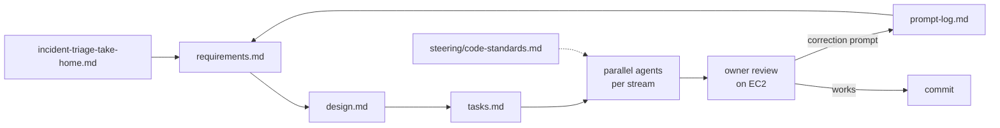
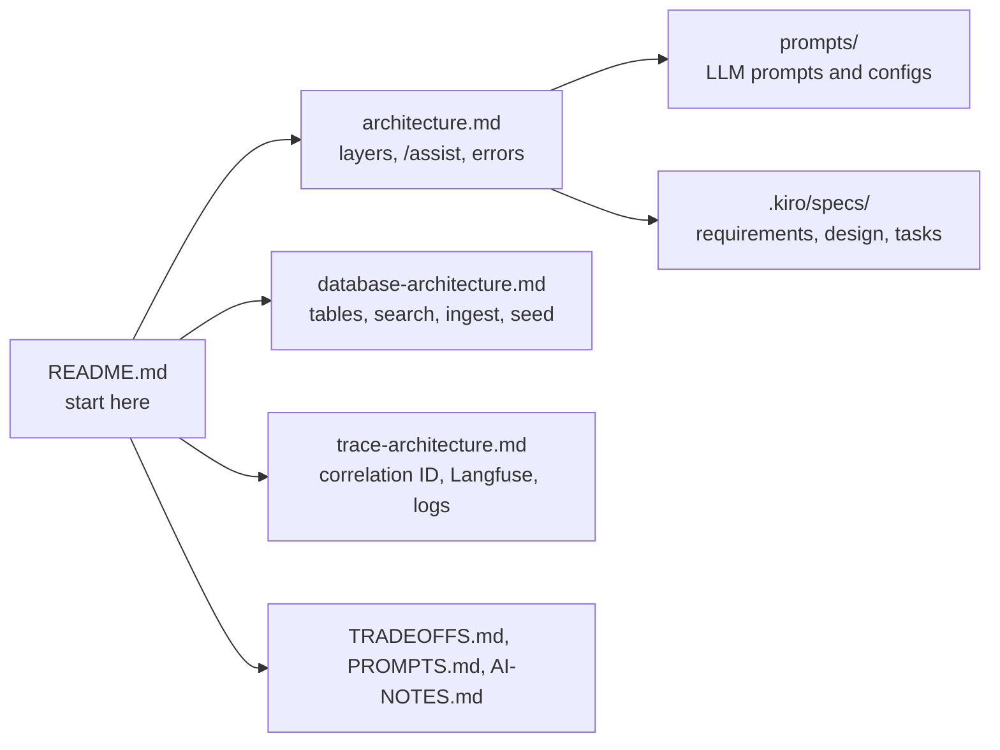
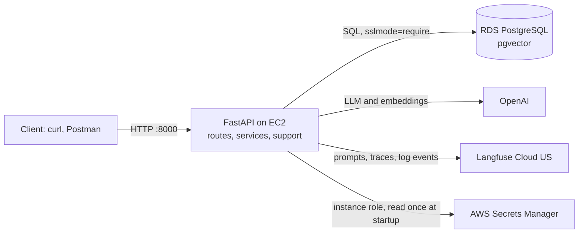
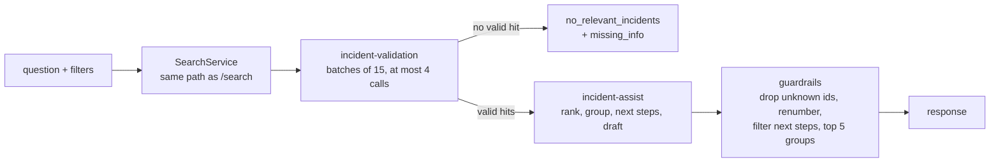
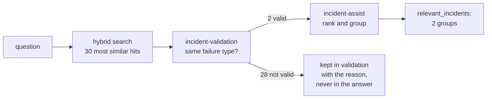
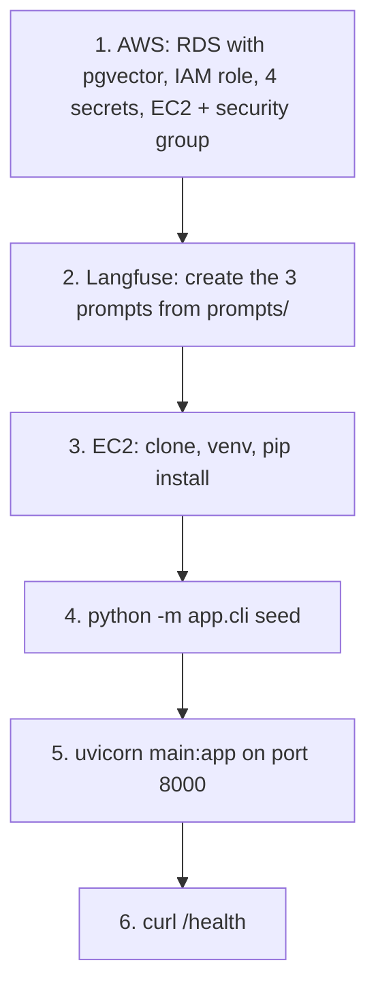

# Incident Triage API

Search and an AI assistant for incident triage. FastAPI on AWS EC2, PostgreSQL with pgvector on RDS, OpenAI for the LLM and embeddings, and Langfuse for prompts and tracing.

- **Live API:** http://18.222.137.172:8000 (OpenAPI docs at [/docs](http://18.222.137.172:8000/docs)). No auth during the review period.
- **Dataset:** 500 synthetic incidents from a committed catalog and a fixed seed.
- **Assignment:** [incident-triage-take-home.md](incident-triage-take-home.md), the original take-home this project answers. [TRADEOFFS.md](TRADEOFFS.md) lists where the build differs from it, and why.
- **Docs:** the architecture is defined in three files, each with Mermaid diagrams. See [Documentation](#documentation) for what each one covers.

## Documentation

| File | Defines | Read it for |
|------|---------|-------------|
| [incident-triage-take-home.md](incident-triage-take-home.md) | The original assignment: endpoints, grounding rules, observability, tests and required docs | What was asked; [TRADEOFFS.md](TRADEOFFS.md) maps the deviations |
| [architecture.md](architecture.md) | Layers, dependency injection, components, the `/assist` pipeline (validation, grouping, guardrails), errors, prompts and LLM config | How the code is organized and how `/assist` decides what to return |
| [database-architecture.md](database-architecture.md) | Tables (ER diagram), indexes, hybrid search and RRF, embeddings, normalization, content hash, ingest rules, seed | How `/search`, `/ingest` and the seed work and why results are reproducible |
| [trace-architecture.md](trace-architecture.md) | Correlation ID flow, Langfuse traces and observations, logging, `/debug/trace` | How to follow one request end to end, including token usage and cost |
| [prompts/](prompts/README.md) | The three Langfuse prompts and their configs (model, JSON schema) | What each LLM call is told and returns |
| [PROMPT-EVOLUTION.md](PROMPT-EVOLUTION.md) | Every version of each prompt, what changed and why, with the run that showed the problem | Why the prompts read the way they do now |
| [.kiro/specs/incident-triage-api/](.kiro/specs/incident-triage-api/requirements.md) | Requirements, design (with correctness properties) and the task list | The spec the code was built from |
| [TRADEOFFS.md](TRADEOFFS.md) | What is done, not done, deviations from the take-home, risks, next steps | Why some results differ from the take-home wording |
| [PROMPTS.md](PROMPTS.md), [AI-NOTES.md](AI-NOTES.md) | AI prompts used during the build, AI mistakes and how they were fixed | How AI tools were steered |

### How it was built: spec-driven with Kiro

The project was built from a Kiro spec: requirements first, then a design, then a task list. AI agents implemented the tasks, and the owner reviewed each step on the live deployment. The spec files show the process, and the reasoning behind each decision.

| File | What it shows |
|------|---------------|
| [requirements.md](.kiro/specs/incident-triage-api/requirements.md) | The take-home turned into numbered, testable requirements (EARS style: "WHEN ..., THE ... SHALL ..."), including the agreed deviations |
| [design.md](.kiro/specs/incident-triage-api/design.md) | Key decisions with reasons, component interfaces, data models, the error map and 13 correctness properties checked by tests |
| [tasks.md](.kiro/specs/incident-triage-api/tasks.md) | The build plan: 9 tasks with their subtasks, the requirements each one covers, and a dependency graph showing which streams ran in parallel |
| [.kiro/steering/code-standards.md](.kiro/steering/code-standards.md) | The coding rules every agent followed: layers, style, patterns, definition of done |
| [docs/prompt-log.md](docs/prompt-log.md) | Every steering prompt as typed, with what the AI produced and what was corrected |



Each correction went back into the spec before it went into the code. For example, "never trust the LLM with real data" became requirement 12.5. As a result, the spec and the code describe the same system.





Routes are thin and call one service each. Services hold the business logic and reach PostgreSQL, OpenAI and Langfuse only through the Protocols in `app/core/ports.py`. Langfuse owns the prompt text, the model settings and the traces, so a prompt or model change is a new Langfuse version, not a deploy.

## Endpoints

| Endpoint | Does |
|----------|------|
| `POST /ingest` | Upserts up to 500 incidents by `id` and returns counts. Idempotent. No body only embeds pending rows. |
| `GET /search` | Hybrid full-text and vector search with filters, top N, real `total`. |
| `GET /incidents/{id}` | Full incident record, or 404. |
| `POST /assist` | Search, LLM validation, one LLM call to rank and group, then grounding guardrails. Returns relevant incidents with reasons, next steps citing IDs, and a customer draft. |
| `GET /catalog` | The committed catalog the dataset is generated from. |
| `GET /debug/trace/{correlation_id}` | The request's trace, read back from Langfuse. |
| `GET /health` | API and database status. |

Every response carries `X-Correlation-ID`: the value you send, or a generated UUID. Errors are `{error, detail, correlation_id}`, never a stack trace, and the detail says what to set or fix.

## How `/assist` works



### Similar is not the same as relevant: a real run

The question "database connection timeouts in payments", filtered to `prod`, on the live API:



Search ranks by words and meaning, so "payment", "timeout" and "connection" also bring back expired certificates, DNS failures, gateway errors and slow queries. Validation asks a stricter question, whether the failure type is the same, and rejects 28 of the 30 hits, each with a reason such as "connection errors to the payment gateway, not the database". Only the 2 valid incidents reach `incident-assist`, which sees two different root causes and fixes and returns 2 groups. The response says "only 2 distinct problems found" rather than padding the list to 3-5.

| Response field | What it shows in this run |
|----------------|---------------------------|
| `validation` | all 30 hits search found, `valid` true or false, each with a reason: the audit trail |
| `candidates` | the 2 valid incidents as judged by `incident-assist` (relevant, rank, group) |
| `relevant_incidents` | `inc-00156` (connections held during gateway calls) and `inc-00517` (connection leak on an error path) |
| `related` | empty here: the `dev` copies of both events were filtered out by `environment: prod`; without the filter they appear under their group |

Validation keeps only hits with the same failure type as the question, so the assist call sees no noise. The assist call groups incidents that share a root cause and fix, so one problem appears once, with its other occurrences under `related`. The guardrails never trust the LLM with data: IDs it was not given are dropped, and titles, environments, severities and dates come from the database. Results are never padded, so the answer may hold 1 or 2 groups with a note. Details are in [architecture.md](architecture.md#assist).

## Try it (public API)

The examples are for bash. On Windows PowerShell, use `curl.exe`, put the command on one line, and escape inner double quotes as `\"` in `-d`. Postman users can import [postman_collection.json](postman_collection.json) (`base_url` is preset).

```bash
BASE=http://18.222.137.172:8000
```

**Health**

```bash
curl -s $BASE/health
# {"status":"ok","database":true}
```

**Search**

```bash
curl -s "$BASE/search?q=database%20connection%20timeouts&service=payments-api&limit=5"
```

`q` is optional. The filters are `environment` (dev, qa, stage, prod), `service`, `severity` (critical, high, medium, low), `tags` (comma-separated, all must match) and `limit` (1-50, default 10). The response is `{"total": N, "results": [{"id", "title", "snippet", "score"}]}`.

**Incident details**

```bash
curl -s $BASE/incidents/inc-00001
curl -s $BASE/incidents/inc-99999   # 404 {"error":"not_found",...}
```

**Ingest**

```bash
curl -s -X POST $BASE/ingest -H "Content-Type: application/json" -d '[{
  "id": "inc-90001", "created_at": "2026-11-07T14:02:00Z",
  "environment": "prod", "service": "payments-api", "severity": "high",
  "title": "Checkout timeouts after deploy",
  "description": "p95 latency above 8s on checkout after release 2.4.1.",
  "resolution_summary": "Rolled back release 2.4.1 and raised the pool size.",
  "tags": ["timeout", "deploy"]
}]'
# first call:  {"ingested":1,"updated":0,"skipped":0,...,"embedded":1}
# second call: {"ingested":0,"updated":0,"skipped":1,...}

curl -s -X POST $BASE/ingest   # no body: only embeds pending rows
```

The ingest call writes to the shared database. `inc-90001` is outside the seeded range, so it does not overwrite seed data. The next `cli seed` removes it.

**Assist** (takes about 60-100 s)

```bash
curl -s -X POST $BASE/assist -H "Content-Type: application/json" \
  -H "X-Correlation-ID: readme-assist-1" \
  -d '{"question": "database connection timeouts in payments"}' | python3 -m json.tool
```

The body accepts the same filters as `/search`, plus `candidate_multiplier` (1-5, default 3; the target is n × 5 valid candidates). An abbreviated response:

```json
{
  "status": "answered",
  "relevant_incidents": [
    {"group": 1, "rank": 1, "id": "inc-00156", "title": "New payment methods fail during traffic spike",
     "reason": "...", "group_reason": "Requests held database connections while waiting for the gateway ...",
     "environment": "prod", "severity": "high",
     "related": [{"rank": 2, "id": "inc-00155", "environment": "dev", "...": "..."}]},
    {"group": 2, "rank": 3, "id": "inc-00517", "title": "Database connection leak interrupted payment submissions",
     "related": [{"rank": 4, "id": "inc-00518", "...": "..."}]}
  ],
  "note": "only 2 distinct problems found",
  "next_steps": ["Release connections before the external gateway call ... [inc-00156, inc-00155]", "..."],
  "customer_draft": "...",
  "missing_info": ["What is the exact error message?", "..."],
  "candidates": ["every grounded verdict"],
  "validation": ["every validation verdict"],
  "prompt_version": 4
}
```

**Trace of that request**

```bash
curl -s $BASE/debug/trace/readme-assist-1 | python3 -m json.tool
```

The trace may return 404 `trace_not_ready` for a few seconds while Langfuse ingests it.

## Run it (EC2)

The app reads its secrets only from AWS Secrets Manager and needs RDS, so it runs on EC2. There is no local mode; see [TRADEOFFS.md](TRADEOFFS.md).



**1. AWS (us-east-2), once**

- **RDS PostgreSQL** with the `vector` extension available. The app runs `CREATE EXTENSION IF NOT EXISTS vector`.
- **IAM role** `incident-triage-ec2-role` for the instance, allowed only `secretsmanager:GetSecretValue` on the four secrets.
- **Secrets Manager.** Each secret is a JSON object with these exact keys:

  | Secret | Keys |
  |--------|------|
  | `incident-triage/db-credentials` | `host`, `port`, `dbname`, `username`, `password` |
  | `incident-triage/openai-api-key` | `OPENAI_API_KEY` |
  | `incident-triage/langfuse-public-key` | `LANGFUSE_PUBLIC_KEY` |
  | `incident-triage/langfuse-secret-key` | `LANGFUSE_SECRET_KEY` |

- **EC2:** Amazon Linux 2023 (t3.small) with the role attached. The security group allows port 22 from your IP and 8000 from anywhere. Use the RDS console's "Set up EC2 connection" to open the database to the instance.

**2. Langfuse.** Create `incident-validation`, `incident-assist` and `incident-catalog` as **text** prompts from [prompts/](prompts/README.md). Use each `.txt` file as the text and each `.config.json` file as the config. Give them the labels `production`, `dev`, `qa` and `stage`.

**3. Install on EC2**

```bash
ssh -i incident-triage.pem ec2-user@<public-ip>
sudo dnf install -y git python3.12
git clone https://github.com/gustavomoises/dayforce.git && cd dayforce
python3.12 -m venv .venv && .venv/bin/pip install -r requirements.txt
```

**4. Build the data**

```bash
.venv/bin/python -m app.cli seed      # drops and rebuilds the incident tables: 500 incidents, embeddings, IVFFlat index
```

`seed` creates the schema itself. The other commands are `schema` (create tables only, never drops), `catalog` (regenerate `data/service_catalog.json` with the LLM; the committed file makes this optional) and `schemas` (print the LLM output JSON schemas for the Langfuse configs). Each command prints its `correlation_id`.

**5. Start**

```bash
nohup .venv/bin/uvicorn main:app --host 0.0.0.0 --port 8000 > app.log 2>&1 &
curl -s localhost:8000/health
```

To deploy a change: `git pull`, then `pkill -f "[u]vicorn main:app"` and start again. Prompt changes in Langfuse need no restart, because prompts are fetched on every call.

**Configuration.** Non-secret settings are environment variables with defaults, listed in [.env.example](.env.example): region, Langfuse host, embedding model, timeouts, limits and seed. The chat model and its settings live in the Langfuse prompt config.

## Tests

```bash
.venv/bin/pip install -r requirements-dev.txt     # ruff
.venv/bin/python -m pytest                        # 346 unit tests, offline, about 8 s
API_BASE_URL=http://18.222.137.172:8000 .venv/bin/python -m pytest -m live   # 10 live tests against the API
.venv/bin/ruff format --check . && .venv/bin/ruff check .
```

The unit tests need no AWS, database, OpenAI or Langfuse. They inject fakes through the `core/ports.py` Protocols and FastAPI `dependency_overrides`, and use Hypothesis property tests for normalization, hashing, idempotent ingest, parameterized SQL and the guardrails. The minimum take-home tests are `tests/unit/test_query_builder.py` and `tests/unit/test_guardrails.py`. The live tests only read data or re-ingest an unchanged incident.

## Layout

```
main.py              FastAPI app: middleware, error handlers, routers, lifespan
app/api/             thin routes and Depends getters
app/services/        ingest, search, incidents, assist (validation, guardrails), catalog, seed, schema
app/support/         database (SQL lives only here), llm (OpenAI), langfuse, tracing, secrets
app/core/            shared models, Protocols, settings, errors, pure helpers
app/container.py     builds every client and service once (API and CLI)
app/cli.py           schema | catalog | seed | schemas
prompts/             Langfuse prompt text and config, source copy
data/                committed service catalog
tests/unit/          offline unit and property tests
tests/live/          tests against the running API
```
