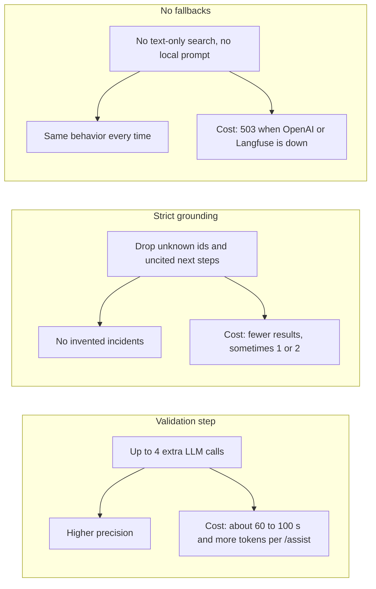
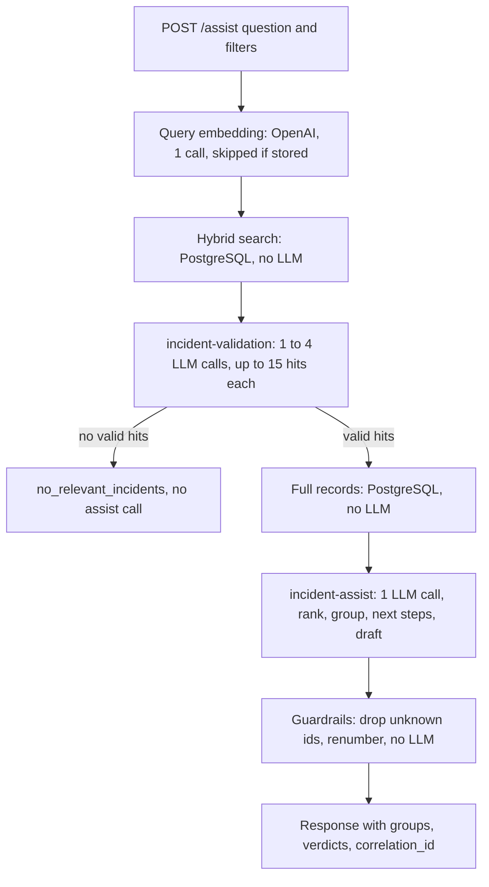
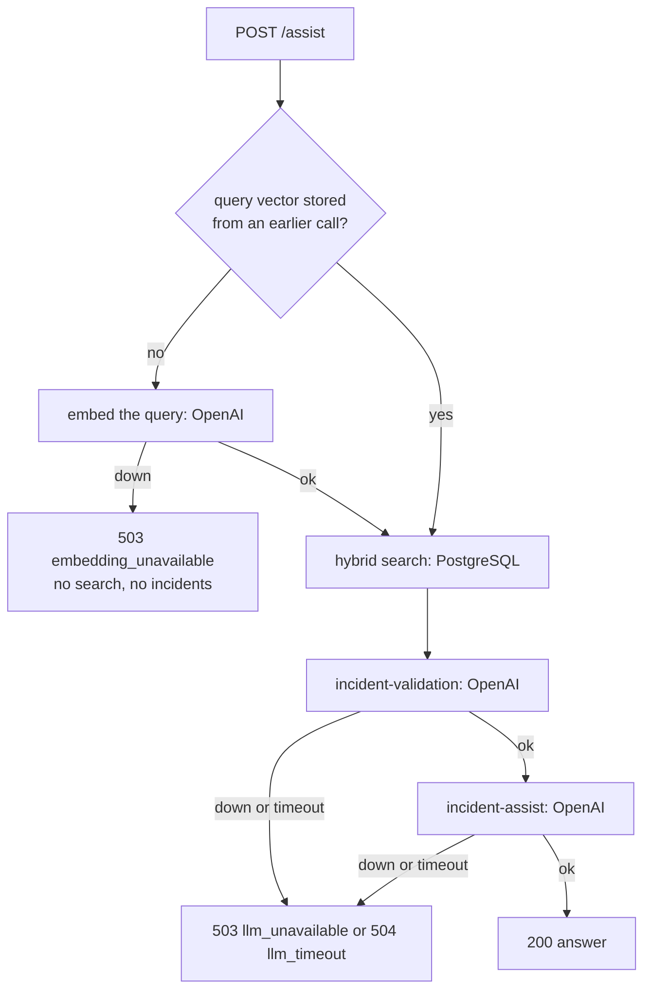

# TRADEOFFS

What was built, what was left out, and the decisions that differ from the take-home. The full spec is in `.kiro/specs/incident-triage-api/`.

## What is done

* Deployed on AWS EC2 with RDS PostgreSQL (pgvector), public at http://18.222.137.172:8000 (FastAPI `/docs` enabled).
* `POST /ingest`: upsert by `id` (up to 500 per call), SHA-256 content hash against duplicates, type checks against the type tables, counts for every outcome. Incidents are committed before embedding, so an OpenAI failure never loses data, and the next call retries pending embeddings.
* `GET /search`: hybrid full-text and vector search with reciprocal rank fusion, filters (`environment`, `service`, `severity`, all `tags`), real `total`, reproducible order, IVFFlat index.
* `GET /incidents/{id}`: full record, 404 for unknown ids.
* `POST /assist`: search, LLM validation of hits, one LLM call to rank and group, grounding guardrails, cited next steps, customer draft, `no_relevant_incidents` with `missing_info` when nothing matches.
* `GET /catalog`, `GET /health`, `GET /debug/trace/{correlation_id}`.
* CLI: `schema`, `catalog`, `seed`, `schemas`. The generator (LLM catalog, committed `data/service_catalog.json`, seed with `SEED=42`) is repeatable.
* Observability: correlation id per request in the header, every log line and every error body. JSON logs to stdout and Langfuse. One Langfuse trace per request with nested observations and the `/assist` steps `tool:search input`, `tool:search output` and `selected_ids`.
* Prompts versioned in Langfuse per environment label, copied to `prompts/`.
* Timeouts on every external call, input limits, `{error, detail, correlation_id}` errors that say what to set.
* 346 offline unit tests (fakes and Hypothesis property tests), live tests behind `API_BASE_URL`.

## What is not done

* Prompt fine-tuning: `incident-validation` and `incident-assist` have not been evaluated on a fixed question set. This is planned right after the docs, using Langfuse experiments.
* Authentication and rate limiting.
* Async or parallel validation batches to cut `/assist` latency.
* A CI pipeline.
* Infrastructure as code. The EC2, RDS, IAM and Secrets Manager resources were created by hand.
* A local run mode. The app reads secrets only from AWS Secrets Manager and needs RDS, so it runs only on EC2.

## Deviations from the take-home

* **`/assist` may return 1 or 2 entries instead of 3 to 5.** The answer is never padded with irrelevant incidents. Entries count distinct problems (groups), so 3 related tickets with the same cause and fix appear as 1 entry with 2 `related`. The note says "only N distinct problem(s) found" when N is 1 or 2.
* **Seeding is a CLI command, not an endpoint.** `python -m app.cli seed` drops and rebuilds the incident tables, which is too destructive for a public endpoint. `POST /ingest` upserts a body, or with an empty body only retries pending embeddings.
* **Search depends on OpenAI for query embeddings.** When OpenAI is unavailable, `/search` returns 503 instead of silently falling back to text-only results that would rank differently. Query embeddings are stored in `query_embeddings`, so a repeated query makes no OpenAI call.
* **Endpoints are public without authentication** for the review period, so reviewers can call them without setup.
* **500 incidents:** 25 services × 20 events, one incident per event (`SEED_REPEATS=1`).
* **Secrets come from AWS Secrets Manager, not environment variables.** The OpenAI key, Langfuse keys and database credentials are read with the EC2 instance role. Non-secret settings (region, Langfuse host, embedding model, timeouts, limits) are environment variables. The chat model and its settings come from the Langfuse prompt config, not `LLM_MODEL`.
* **A repeated id in one ingest batch: last version wins.** Items apply in order and the id is written once. A re-run leaves the data and embeddings unchanged, but may report those items as `updated` instead of `skipped`.
* **Validation adds LLM calls and latency for precision.** `/assist` checks hits with `incident-validation` in batches of up to 15, at most 4 calls, before the `incident-assist` call. This removes incidents that only share a product area or a word, at the cost of about 60 to 100 s per `/assist`.
* **`/assist` returns no incidents when OpenAI is down.** It answers 503 (`embedding_unavailable` or `llm_unavailable`), or 504 (`llm_timeout`) on a timeout, with what to check. No partial answer is possible: the query embedding, the `incident-validation` step and the `incident-assist` step all need OpenAI. Skipping only validation was considered and rejected, because the assist call still fails. Returning full-text hits marked "not validated" was also rejected, because it is the text-only fallback rejected for `/search`. See the observation below.
* **A missing key stops startup instead of failing each request.** Secrets are read once when the API starts. A missing secret, a missing JSON key or an empty OpenAI key stops the process with a message that names the secret and the key, and `uvicorn` exits. A rejected key, a timeout or an outage while the API is running returns 503 or 504 per request, saying what to check. Failing at startup means the API is never up in a state where every LLM call would fail.
* **Prompts live in Langfuse with no fallback.** If Langfuse is down or a label is missing, `/assist` and `cli catalog` return 503 with what to fix. A local fallback prompt could drift from the reviewed version without anyone noticing.

### Where the LLM calls and cost sit in `/assist`

### Observation: what `/assist` returns when OpenAI is down

Every `/assist` path needs OpenAI at least twice, so a full outage always ends in 503 or 504 with an error body that says what to check. A repeated question reuses its stored query vector and gets as far as validation, but the next LLM call fails the same way. Skipping validation would only send unvalidated hits into an `incident-assist` call that also cannot run. Clients should treat 503 as temporary and retry. `GET /incidents/{id}` and `GET /catalog` still work, because they need only PostgreSQL and the committed catalog.

## Known issues and risks

* **LLM nondeterminism.** Validation verdicts and groups can change between runs of the same question. Guardrails keep the output grounded, but not identical.
* **Free text is checked by the prompt, not by code.** Code enforces the IDs, ranks, groups and next-step citations, and every incident field shown comes from the database. The wording of `reason`, `group_reason`, `next_steps` and `customer_draft` follows the prompt rule "never invent details" but is not verified against the records. Prompt fine-tuning (task 9) measures it; an automated check would be an LLM-as-judge step.
* **Latency.** About 60 to 100 s per `/assist` can exceed default client or proxy timeouts.
* **Cost per `/assist`.** Up to 5 LLM calls plus one embedding per new question. A public endpoint lets anyone spend that.
* **Public endpoint.** No authentication or rate limiting, so `/ingest` can be called by anyone during the review period.
* **Langfuse changes.** Tracing relies on the Langfuse v5 SDK and its OTLP export. An SDK or API change could break traces or `/debug/trace`.
* **Trace delay.** Observations reach Langfuse after the response, so `/debug/trace` may return 404 "retry shortly" for a few seconds.
* **Single dependency points.** OpenAI down blocks search and assist. Langfuse down blocks `/assist` and `cli catalog`.

## What I would do next with 2 more hours

* Prompt fine-tuning: build a fixed set of questions with expected incidents, run `incident-validation` and `incident-assist` as Langfuse experiments, and compare prompt versions on precision and missed incidents.
* Add a simple API key header for `/ingest` and `/assist`.
* Add a CI job that runs `ruff format --check`, `ruff check` and the unit tests on every push.

## What I would do next with 2 more days

* Run validation batches concurrently, or validate a larger first batch, to cut `/assist` latency.
* Proper authentication and per-client rate limiting, with a cost budget per day.
* Infrastructure as code for EC2, RDS, IAM and Secrets Manager.
* A local run mode: PostgreSQL with pgvector in Docker and a secrets provider that reads local settings, so reviewers can run without AWS.
* Track cost and latency per `/assist` in Langfuse dashboards, and alert on 502/503 rates.
* Grow the evaluation set and run it in CI against new prompt versions before moving a Langfuse label.
