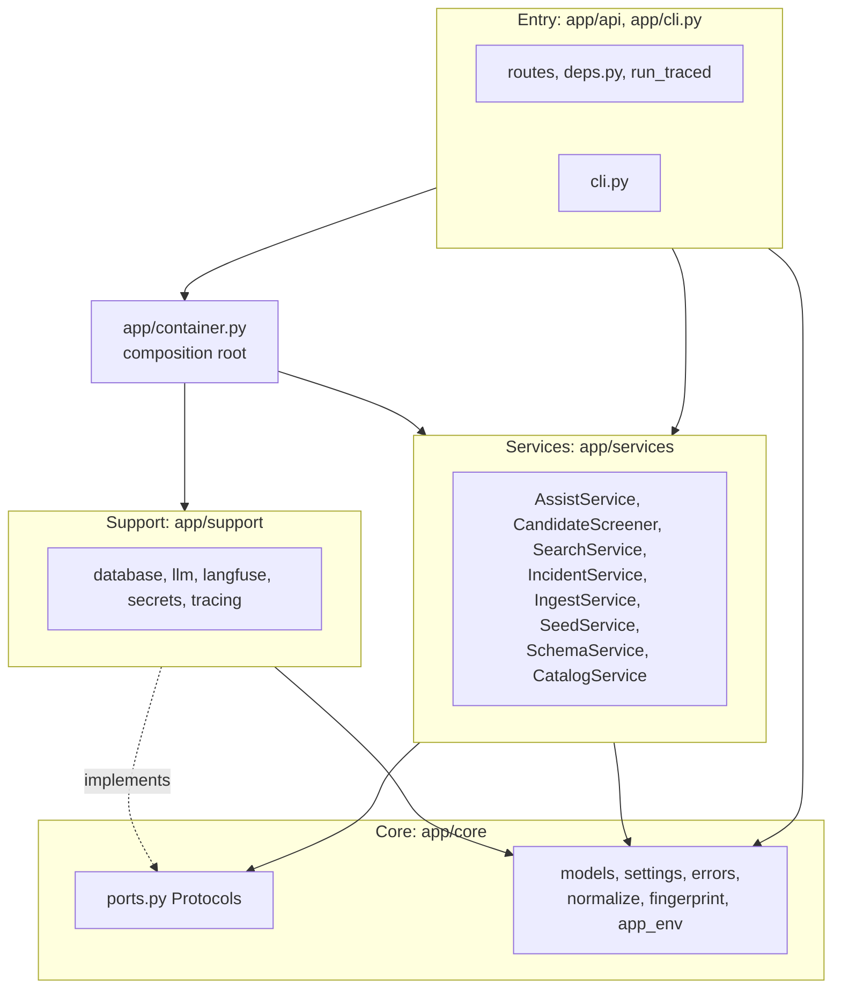
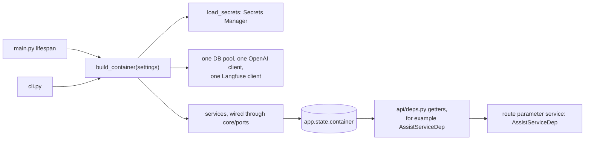
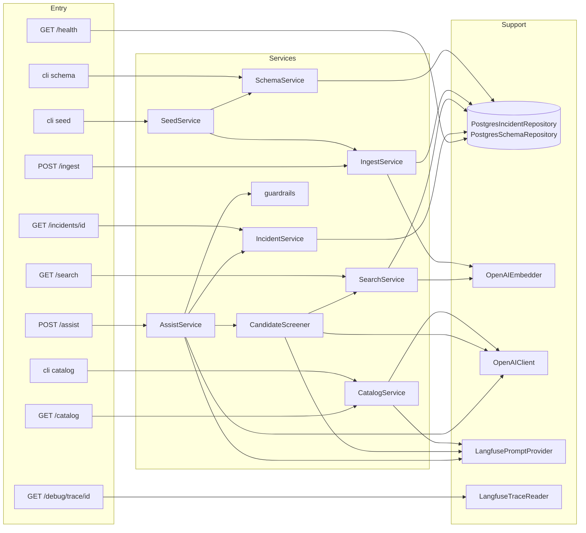
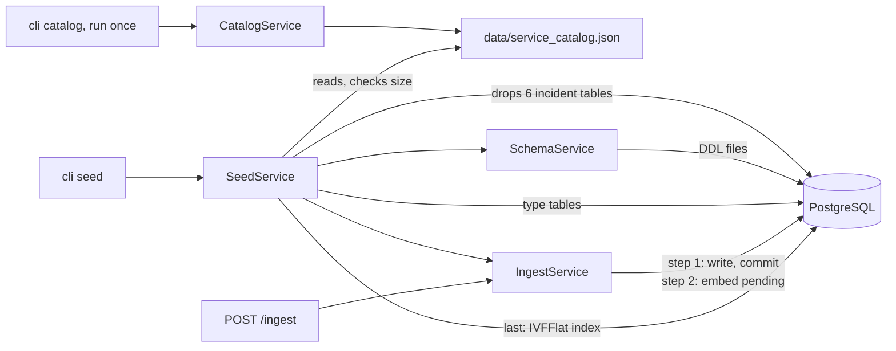
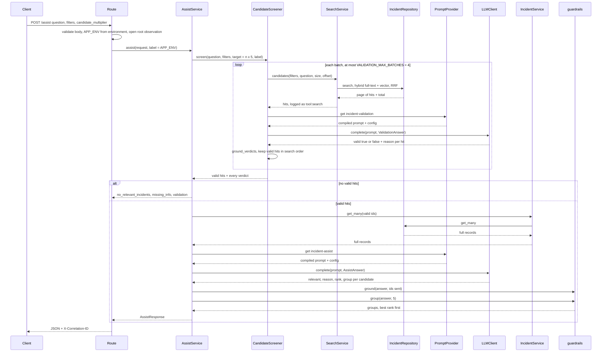
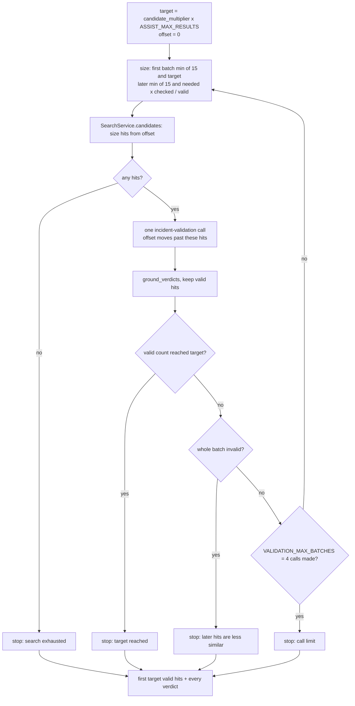
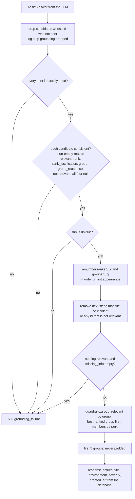
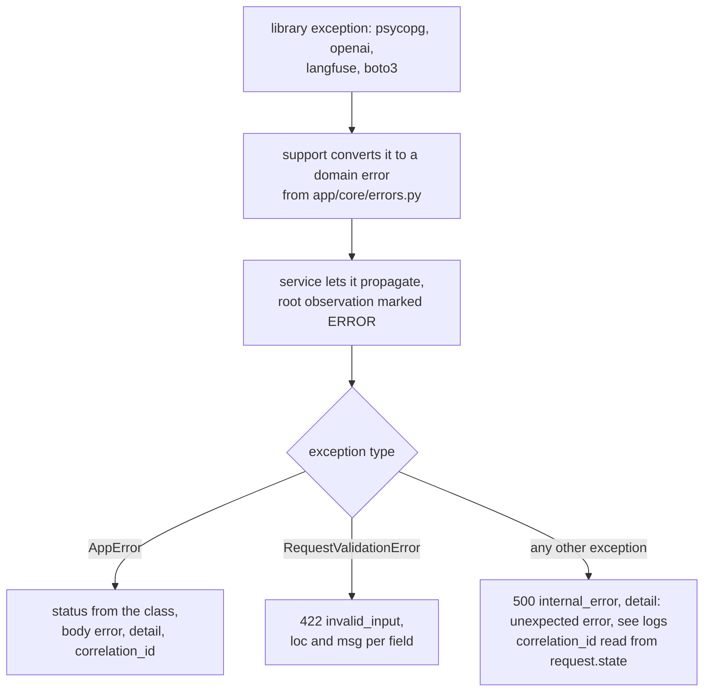
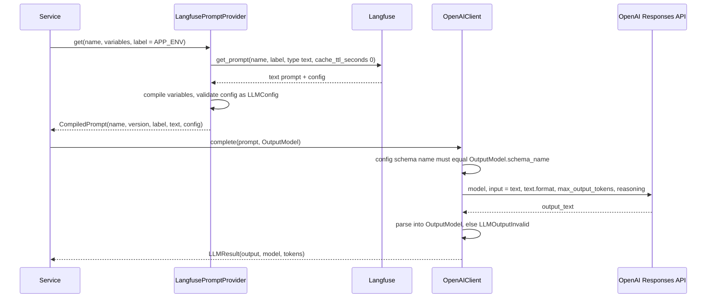

# Architecture

Incident Triage API: FastAPI on EC2 (us-east-2), RDS PostgreSQL with pgvector, OpenAI for the LLM and embeddings, Langfuse Cloud US for prompts and tracing. Database details: [database-architecture.md](database-architecture.md). Tracing and logging: [trace-architecture.md](trace-architecture.md). Prompts: [prompts/](prompts/README.md).

## Layers

| Layer | Role | May import |
|-------|------|-----------|
| Entry (`app/api/`, `app/cli.py`) | Thin routes and CLI commands. Validate input, open the root observation, call one service. No business logic. | services, support, core |
| Service (`app/services/`) | Business logic: schema, catalog, seed, ingest, search, incidents, assist. | other services, core, and `traced` from support |
| Support (`app/support/`) | External systems: PostgreSQL, OpenAI, Langfuse, Secrets Manager, logging glue. Implements `core/ports.py`. | core |
| Core (`app/core/`) | Shared models, Protocols, settings, errors, pure functions. | nothing |



Imports only point down, so a lower layer never depends on a higher one. Services reach support only through the Protocols in `core/ports.py`; the one direct import is `traced`, the Langfuse `@observe` decorator re-exported by `support/tracing/span.py`. `app/container.py` is the only place that builds clients and wires real implementations into services.

A model lives in the lowest layer that uses it. Shared models (`Incident`, `SearchFilters`, `SearchQuery`, `CompiledPrompt`, `LLMResult`, `TraceView`, storage rows) are in `app/core/models/`. Models used by one service stay in that service's `models` module.

## Structure

```
main.py                       create_app(): CorrelationMiddleware, error handlers, routers; lifespan builds the container
app/
  container.py                build_container(settings) -> Container (used by main.py and cli.py)
  cli.py                      python -m app.cli schema | catalog | seed | schemas
  core/
    models/                   catalog, filters, incident, prompt, search, storage, trace
    ports.py                  PromptProvider, LLMClient, EmbeddingClient, IncidentRepository,
                              IncidentUnitOfWork, SchemaRepository, TraceReader
    app_env.py                resolve_app_env: request environment -> Langfuse label and environment
    normalize.py  fingerprint.py  embedding_text.py  secrets.py  settings.py  errors.py
  api/
    deps.py                   one Depends getter and Annotated alias per service
    errors.py                 exception handlers -> {error, detail, correlation_id}
    tracing.py                run_traced: root observation around one route call
    ingest.py search.py incidents.py assist.py catalog.py debug.py health.py
  services/
    assist/                   service.py (AssistService), screening.py (CandidateScreener),
                              guardrails.py, models/ (request, validation, answer, response)
    search/                   service.py, models.py (SearchResult)
    incidents/service.py
    ingest/                   service.py, plan.py (pure classify), models.py (IncidentIn, IngestResult)
    seed/                     service.py, generator.py (fixed-seed incidents)
    schema/service.py
    catalog/                  service.py, defaults.py, models/ (CatalogRequest, CatalogBatch)
  support/
    database/                 pool.py, errors.py, incident_repository.py, unit_of_work.py,
                              query_builder.py, schema_repository.py, sql/001-005
    llm/                      openai_client.py, openai_embedder.py, errors.py, schemas.py
    langfuse/                 client.py, prompts.py, trace_reader.py
    tracing/                  correlation.py, context.py, endpoint.py, span.py, logging.py
    secrets/secrets_manager.py
prompts/                      incident-validation, incident-assist, incident-catalog (.txt + .config.json)
data/service_catalog.json     catalog generated once by the LLM, committed
tests/unit/                   one file per component     tests/live/   calls the running API
```

## Dependency injection



The container builds every client and service once, and the API and the CLI call the same `build_container`, so both are wired identically. Routes receive services through `Depends` aliases in `api/deps.py` and never read `app.state` or build a client. Tests replace a getter with `app.dependency_overrides`, so route tests need no database, OpenAI or Langfuse.

```python
# app/api/deps.py
AssistServiceDep = Annotated[AssistService, Depends(get_assist_service)]


# app/api/assist.py
@router.post("/assist", response_model=AssistResponse)
def assist(
    request: AssistRequest,
    background_tasks: BackgroundTasks,
    service: AssistServiceDep,
    langfuse: LangfuseDep,
) -> AssistResponse:
    return run_traced(
        langfuse,
        background_tasks,
        "POST /assist",
        lambda app_env: service.assist(request, label=app_env),
        environment=request.environment,
        input=request.model_dump(mode="json"),
    )
```

- Routes are sync `def`; the DB pool, OpenAI and Langfuse clients are sync. Nothing is created at import time.
- Services are stateless and shared across requests. Per-request state (connection, correlation_id) comes from the pool and a contextvar.
- `Container.close()` flushes Langfuse and closes the pool and the OpenAI client on shutdown.

## Secrets

Read once at startup by `support/secrets/secrets_manager.py` from AWS Secrets Manager in `AWS_REGION` (default `us-east-2`), using the EC2 instance role.

| Secret | JSON keys | Used by |
|--------|-----------|---------|
| `incident-triage/db-credentials` | `host`, `port`, `dbname`, `username`, `password` | DB pool (`sslmode=require`) |
| `incident-triage/openai-api-key` | `OPENAI_API_KEY` | OpenAI LLM and embedding clients |
| `incident-triage/langfuse-public-key` | `LANGFUSE_PUBLIC_KEY` | Langfuse client |
| `incident-triage/langfuse-secret-key` | `LANGFUSE_SECRET_KEY` | Langfuse client |

A problem stops startup with a `ConfigurationError` that names the secret and the key, never a value: "secret incident-triage/db-credentials is missing key dbname", or "secret ... is not readable (ClientError); check AWS_REGION and that the instance role allows secretsmanager:GetSecretValue on it". The CLI prints the same message and exits with code 1.

## Components



`/search` and `/assist` share one search path because `CandidateScreener` calls `SearchService.candidates`, which runs the same code as `SearchService.search` (take-home requirement). `GET /catalog` reads the committed file and never calls the LLM. `GET /health` pings the database.

## Database setup



`cli catalog` asks the LLM once per service (default 20 services × 20 events = 400 events) and the file is committed, because LLM output is not repeatable. `cli seed` turns each event into `SEED_REPEATS` (2) incidents with a fixed seed, so every run builds the same 800 incidents. `POST /ingest` uses the same `IngestService` later. Details: [database-architecture.md](database-architecture.md).

## /assist

`POST /assist` takes `question` (1-2000 characters), the `/search` filters and `candidate_multiplier` n (1-5, default 3). The target is n × `ASSIST_MAX_RESULTS` (5), so 15 valid candidates by default.



The work is split into two LLM steps with different jobs. `incident-validation` is a cheap filter on title and snippet; `incident-assist` sees full records of valid hits only, so its context holds no noise. Both steps go through `SearchService`, and every LLM answer passes code checks before it reaches the response.

### Step 1: validation in batches (`CandidateScreener`, `screening.py`)



Each batch holds at most `VALIDATION_BATCH_SIZE` (15) hits, most similar first, and the next batch starts at the offset already checked. Its size follows the valid rate seen so far, so a low rate fetches a full batch instead of wasting the call limit on small ones. A whole invalid batch stops the loop, because later hits rank lower still.

The prompt variables are `question`, `filters` and `incidents` (id, title, snippet). A hit is valid only when it has the same failure type as the question, and the same product area or service when the question names one; a shared product area or generic word ("timeout", "payment") is not enough, and the verdict must agree with its reason. `ground_verdicts` drops IDs that were not in the batch and raises `GroundingFailure` (502) when a hit is missing, repeated or has an empty reason.

### Step 2: relevance, rank and group (`incident-assist`)

`IncidentService.get_many` loads the full records of the valid hits, and one `incident-assist` call judges them. Per candidate the model returns `relevant`, `reason`, a global `rank` (1..k over all relevant candidates), `rank_justification`, `group` and `group_reason`; plus `next_steps`, `customer_draft` and `missing_info`. Two records share a group only when they have the same root cause and the same fix; a shared symptom is not enough.

### Grounding guardrails (`guardrails.ground`)



The rule is to never trust the LLM with real data. Wrong IDs and unsupported next steps are removed because the rest of the answer can still be used; a missing, repeated or half-filled assessment rejects the whole answer, because it cannot be repaired without guessing. Renumbering keeps ranks and groups gapless after drops, and every displayed fact about an incident comes from the database.

### Response

| Field | Content |
|-------|---------|
| `status` | `answered` when at least one candidate is relevant, else `no_relevant_incidents` (derived in code) |
| `relevant_incidents` | one entry per group, at most 5, led by its best-ranked incident: `group`, `rank`, `id`, `title`, `reason`, `rank_justification`, `group_reason`, `environment`, `severity`, `created_at`, and `related` (other members: `rank`, `id`, `title`, `reason`, `group_reason`, `environment`, `severity`, `created_at`) |
| `note` | "only 1 distinct problem found" or "only 2 distinct problems found"; otherwise null |
| `candidates` | every grounded assessment, relevant or not |
| `validation` | every verdict from `incident-validation` |
| `next_steps`, `customer_draft`, `missing_info` | from the LLM, next steps filtered by the guardrails |
| `prompt_version` | `incident-assist` version used (null when no assist call was made) |

When no hit is valid, no `incident-assist` call is made: the status is `no_relevant_incidents` and `missing_info` asks for the exact error message, the start time and the affected service and environment.

### Rejected alternatives

| Alternative | Why not |
|-------------|---------|
| Always return 3-5 incidents (take-home wording) | Padding shows unrelated incidents as answers. 1 or 2 groups are returned with a note (TRADEOFFS.md). |
| Several LLM votes per candidate | Multiplies cost and latency; one validation verdict plus the guardrails was enough. |
| HyDE `incident-query` step (LLM writes a fake incident to embed) | One more LLM call before search, and it changes what `/search` and `/assist` search for. |
| Text-hash clustering of results | Groups only identical text; the LLM `group` with the same-cause-and-fix rule groups reworded copies of the same problem. |

## Errors



Every error body is `{error, detail, correlation_id}` and never contains a stack trace; the stack trace goes only to the stdout log. Support code converts library exceptions at the boundary, so services and handlers deal with domain errors only. The 500 handler runs in Starlette's `ServerErrorMiddleware`, outside `CorrelationMiddleware`, so the middleware also stores the id in `scope["state"]` and the handler sets the `X-Correlation-ID` header itself.

| HTTP | `error` codes | When | Message names what to fix |
|------|---------------|------|---------------------------|
| 422 | `invalid_input` | bad body, query or filter; catalog file invalid | field errors |
| 404 | `not_found`, `trace_not_ready` | unknown incident; catalog file missing; trace not in Langfuse yet | "incident inc-00999 not found"; "run `python -m app.cli catalog`"; "retry shortly" |
| 502 | `upstream_invalid`, `llm_output_invalid`, `grounding_failure`, `embedding_invalid` | LLM output does not parse, is refused or incomplete; guardrails reject it; wrong embedding count or dimension | "LLM output does not match `AssistAnswer`: candidates.3.rank: ..." |
| 503 | `unavailable`, `langfuse_unavailable`, `prompt_label_missing`, `prompt_config_invalid`, `llm_unavailable`, `embedding_unavailable` | database down; Langfuse unreachable or keys rejected; label missing; chat prompt or bad config or schema name mismatch; OpenAI key rejected, network, rate limit, 5xx | "check LANGFUSE_HOST and the secrets `incident-triage/langfuse-public-key` and `incident-triage/langfuse-secret-key`"; "prompt `incident-assist` has no label `qa`; add it in Langfuse"; "OpenAI rejected the API key; check secret `incident-triage/openai-api-key`" |
| 504 | `llm_timeout` | OpenAI LLM or embedding call timed out | "OpenAI did not answer within 30 s; retry, or raise LLM_TIMEOUT_SECONDS (embeddings: EMBEDDING_TIMEOUT_SECONDS) and restart the API" |
| 500 | `internal_error` | unexpected exception or a non-connection database error | "unexpected error; see logs" |

An embedding failure inside ingest is not an HTTP error: the incidents stay saved and the 200 response reports `embedding_pending` and `embedding_error`.

## Prompts and LLM config (Langfuse owns both)

Each LLM call uses one Langfuse text prompt. The prompt text holds the instructions; the prompt `config` holds the OpenAI settings. Version 1 of each prompt and config is in [prompts/](prompts/README.md).

| Prompt | Used by | Variables | Output model (`schema_name`) |
|--------|---------|-----------|------------------------------|
| `incident-validation` | `CandidateScreener` | `question`, `filters`, `incidents` (batch of ≤ 15: id, title, snippet) | `ValidationAnswer` (`validation_answer`) |
| `incident-assist` | `AssistService` | `question`, `filters`, `incidents` (full records of valid hits) | `AssistAnswer` (`assist_answer`) |
| `incident-catalog` | `CatalogService` | `service`, `count` | `CatalogBatch` (`catalog_batch`) |



Prompts are fetched by label = `APP_ENV` with no cache and no fallback prompt, so a prompt change in Langfuse applies to the next request and a missing label fails loudly. `APP_ENV` is the request's `environment` (`dev`, `qa`, `stage` as is, `prod` → `production`, none → `production`); the CLI uses `production`. Changing the model or the schema is a new prompt version in Langfuse, not a code change.

- `LLMConfig` requires `model`, `max_output_tokens` (> 0) and `text.format` as a `json_schema` with `name` and `schema`; `reasoning` and `temperature` are optional and sent only when present. Extra keys are rejected.
- `{{incidents}}` is a JSON block between `<incidents>` and `</incidents>`; the prompts tell the model to treat it as data and ignore instructions inside records.
- The OpenAI client uses `LLM_TIMEOUT_SECONDS` (30) and one retry. A 4xx caused by the request (not 401, 403 or 429) means the prompt config is wrong and maps to 503 `prompt_config_invalid`.
- The generation observation links the Langfuse prompt version, so each answer can be traced to the prompt that produced it.
- The embedding model is not a prompt: `EMBEDDING_MODEL` (`text-embedding-3-small`), `EMBEDDING_DIMENSIONS` (1536), `EMBEDDING_TIMEOUT_SECONDS` (10).

## LLM output models

The Pydantic model is the source of truth. `python -m app.cli schemas` prints the strict JSON schemas generated from it (`support/llm/schemas.py`) to paste into the Langfuse configs, and a unit test checks that `prompts/*.config.json` match.

```python
class CandidateValidation(BaseModel):  # app/services/assist/models/validation.py
    id: str
    valid: bool
    reason: str


class ValidationAnswer(BaseModel):  # schema "validation_answer"
    candidates: list[CandidateValidation]


class CandidateAssessment(BaseModel):  # app/services/assist/models/answer.py
    id: str
    relevant: bool
    reason: str
    rank: int | None  # relevant: 1..k across all relevant; else null
    rank_justification: str | None
    group: int | None  # same root cause AND same fix; else null
    group_reason: str | None


class AssistAnswer(BaseModel):  # schema "assist_answer"
    candidates: list[CandidateAssessment]
    next_steps: list[str]
    customer_draft: str
    missing_info: list[str]


class CatalogBatch(BaseModel):  # schema "catalog_batch", app/services/catalog/models/batch.py
    events: list[CatalogEvent]  # CatalogEvent in app/core/models/catalog.py
```

Strict mode makes every field required and forbids extra keys; nullable fields are still required keys. Count and consistency rules (coverage, ranks, groups, exactly n catalog events) are checked in code, not in the schema.

## Tests

| Kind | Where | Notes |
|------|-------|-------|
| Unit | `tests/unit/`, one file per component | 343 tests, offline. Fakes are injected through the `core/ports.py` Protocols; route tests use `app.dependency_overrides`. No AWS, database, OpenAI or Langfuse. |
| Property | `tests/unit/test_properties.py` | Hypothesis tests for design Properties 1, 2, 3, 9, 10 and 11 |
| Schema sync | `tests/unit/test_prompt_schemas.py` | `prompts/*.config.json` equal the schemas generated from the output models |
| Live | `tests/live/`, marker `live` | `pytest -m live` with `API_BASE_URL` set; skipped otherwise. Plain `pytest` runs unit tests only. |

| Component | Test file |
|-----------|-----------|
| guardrails, validation grounding | `test_guardrails.py`, `test_screening.py` |
| AssistService | `test_assist_service.py` |
| query builder, SearchService | `test_query_builder.py`, `test_query_builder_extra.py`, `test_search_service.py` |
| ingest | `test_ingest_plan.py`, `test_ingest_service.py` |
| seed, schema, catalog | `test_seed_generator.py`, `test_seed_service.py`, `test_schema_service.py`, `test_catalog_service.py` |
| core | `test_core_normalize.py`, `test_core_fingerprint.py`, `test_core_embedding_text.py`, `test_core_app_env.py`, `test_core_settings.py` |
| OpenAI | `test_openai_client.py`, `test_openai_embedder.py`, `test_llm_errors.py` |
| Langfuse, tracing | `test_langfuse_prompts.py`, `test_langfuse_trace_reader.py`, `test_tracing_correlation.py`, `test_tracing_endpoint.py`, `test_tracing_logging.py` |
| secrets, container, routes | `test_secrets.py`, `test_container.py`, `test_routes.py` |

## Check against the take-home

| Requirement | Covered by |
|-------------|-----------|
| Separation: ingest, search, assist, config, observability | services, `support/tracing`, `core/settings.py` |
| Generator with fixed seed | `CatalogService` (LLM, committed file) + `SeedService` (`random.Random(SEED)`) |
| `POST /ingest` idempotent with counts | `IngestService`; a re-run leaves rows and embeddings unchanged |
| Same search path for `/assist` | `CandidateScreener` → `SearchService.candidates` |
| Grounding, cite IDs, no invention | prompts + `ground_verdicts` + `guardrails.ground` |
| "3 to 5 most relevant IDs and why" | relevant groups with rank, reason and justification; 1-2 returned with a note, never padded (TRADEOFFS.md) |
| Clear LLM errors | `core/errors.py`, `support/llm/errors.py`, `api/errors.py` |
| correlation_id in every log line, step list | JSON stdout logs and Langfuse events; `tool:search`, `step validation`, `step selected_ids`; `/debug/trace` |
| Config through env vars | `core/settings.py`; secrets from Secrets Manager |
| Unit tests on query building and guardrails | `test_query_builder*.py`, `test_guardrails.py`, `test_properties.py` |
