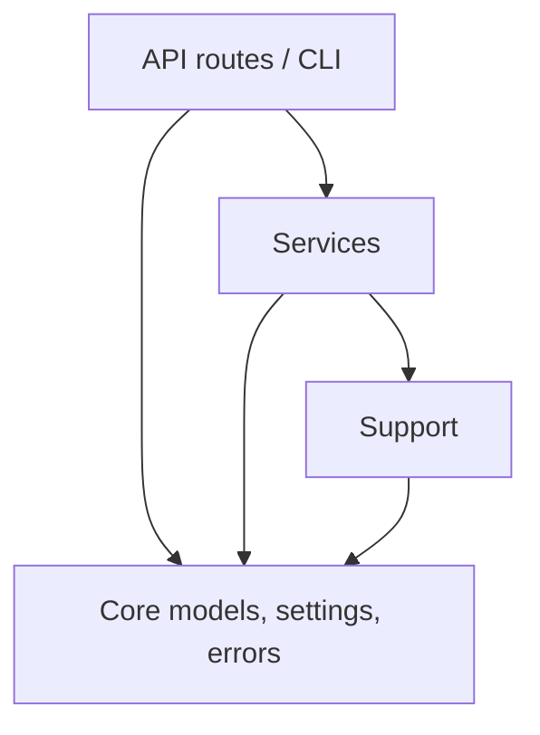
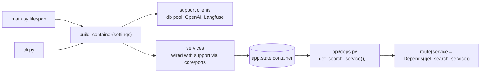
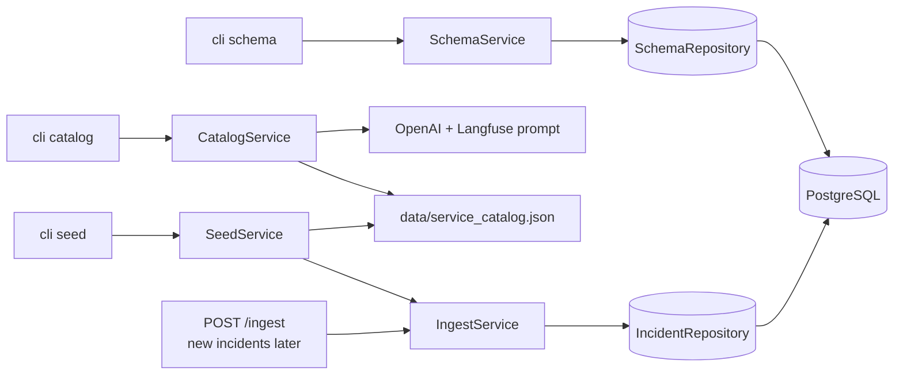
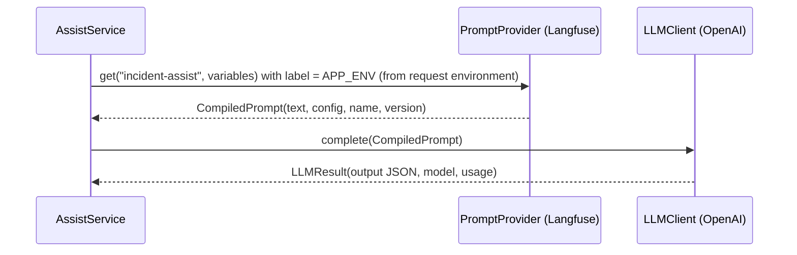
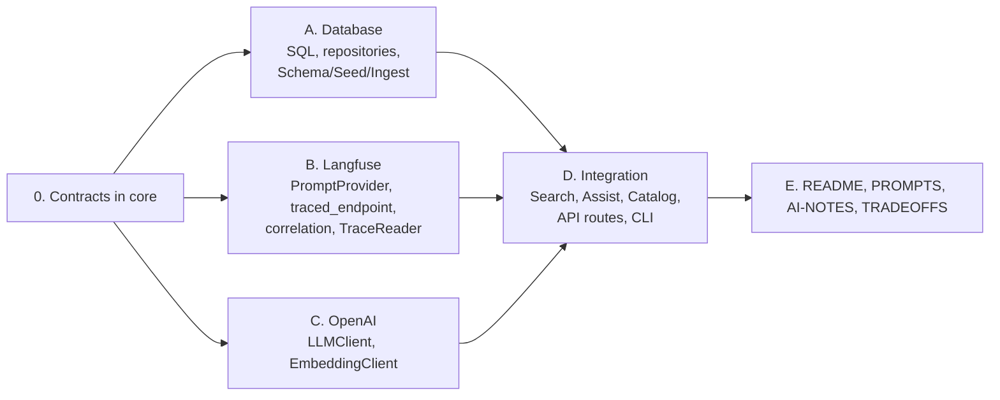

# Architecture

## Layers

| Layer | Role | May import |
|-------|------|-----------|
| Entry (`app/api/`, `app/cli.py`) | Thin FastAPI routes and CLI commands. Validate input, call one service, return result. No logic. | services, core |
| Service (`app/services/`) | Business logic: schema, catalog, seed, ingest, search, incidents, assist. Uses support only through the Protocols in `core/ports.py`. | core, other services |
| Support (`app/support/`) | External systems: database, OpenAI, Langfuse, Secrets Manager, logging/trace. Implements `core/ports.py`. | core |
| Core (`app/core/`) | Shared domain models, settings, errors. No dependencies. | nothing |

**Rule:** imports only point down. A model lives in the lowest layer that uses it. A lower layer never imports a model from a higher layer.
Shared models (`Incident`, `SearchFilters`) go in `core`. Models used by only one service stay in that service's `models/` folder.



## Structure

```
main.py                         # create_app(), lifespan builds the container
app/
  container.py                  # build_container(settings): support clients + services (used by main.py and cli.py)
  cli.py                        # python -m app.cli schema | catalog | seed | schemas
  core/
    models/incident.py          # Incident, Environment, Severity
    models/filters.py           # SearchFilters (used by search, assist, database)
    models/prompt.py            # LLMConfig, CompiledPrompt, LLMResult (Langfuse <-> OpenAI)
    ports.py                    # Protocols: PromptProvider, LLMClient, EmbeddingClient, repositories, TraceReader
    normalize.py                # lowercase/trim codes and tags, tags alphabetical
    fingerprint.py              # normalized JSON + SHA-256 content hash (see database-architecture.md)
    embedding_text.py           # labeled text (title, description, resolution) to embed
    settings.py  errors.py
  api/
    deps.py                     # one Depends getter per service
    ingest.py search.py incidents.py assist.py catalog.py debug.py health.py
  services/
    schema/   service.py  sql/              # creates all tables and indexes (idempotent)
    catalog/  service.py  defaults.py  models/catalog.py  # LLM: services x n events -> JSON {service: [events]}
    seed/     service.py  models/seed_config.py   # reset: drop app tables, SchemaService, type tables, incidents (fixed seed), IngestService
    ingest/   service.py  models/ingest_result.py   # reusable write path: normalize, check, hash, upsert
    search/   service.py  models/search_result.py
    incidents/service.py
    assist/   service.py  guardrails.py  models/assist.py
  support/
    database/  pool.py  query_builder.py  incident_repository.py  schema_repository.py
    llm/       openai_client.py  openai_embedder.py   # LLMClient + EmbeddingClient protocols
    langfuse/  client.py  prompts.py  trace_reader.py   # PromptProvider (prompt + config), read trace by id
    tracing/   span.py  endpoint.py  context.py  correlation.py  logging.py   # thin glue to Langfuse, see trace-architecture.md
    secrets/   secrets_manager.py
data/service_catalog.json       # output of the catalog service (LLM), committed
tests/unit/  (mirrors app/)   tests/live/
```

## Dependency injection (services injected into endpoints)

Services are built once at startup and injected into routes with FastAPI `Depends`. Routes never construct a service or a client.



```python
# app/api/deps.py
def get_search_service(request: Request) -> SearchService:
    return request.app.state.container.search

# app/api/search.py
@router.get("/search")
def search(params: SearchParams = Depends(), service: SearchService = Depends(get_search_service)):
    return service.search(params.to_filters(), params.q, params.limit)
```

- `app/container.py` holds `build_container(settings) -> Container`: reads secrets, creates the support clients (one DB pool, one OpenAI client, one Langfuse client), then the services with those clients passed in through `core/ports` Protocols. `main.py` calls it in the FastAPI lifespan and closes the clients on shutdown; `cli.py` calls the same function, so API and CLI are wired identically.
- One getter per service in `app/api/deps.py`. Routes depend on the getter, not on `app.state`.
- Services are stateless and shared across requests; per-request state (DB connection, correlation_id) comes from the pool and the request context.
- Tests replace a service with `app.dependency_overrides[get_search_service] = lambda: FakeSearchService()`, so route tests need no database, OpenAI or Langfuse.

## Secrets (AWS Secrets Manager, us-east-2, read at startup by `support/secrets/secrets_manager.py`)

| Secret | JSON keys | Used by |
|--------|-----------|---------|
| `incident-triage/db-credentials` | `host`, `port`, `dbname`, `username`, `password` | database pool (`sslmode=require`) |
| `incident-triage/openai-api-key` | `OPENAI_API_KEY` | OpenAI LLM and embedding clients |
| `incident-triage/langfuse-public-key` | `LANGFUSE_PUBLIC_KEY` | Langfuse client |
| `incident-triage/langfuse-secret-key` | `LANGFUSE_SECRET_KEY` | Langfuse client |

Exact keys only, no guessing. A missing key stops startup with a message naming the secret and the expected key, never the value. A missing key stops startup with "secret `incident-triage/db-credentials` is missing key `dbname`" (names only, never values).

## Database setup flow



Run order: `cli seed` (drops the app tables, recreates them through SchemaService, populates). Later, new incidents arrive through `POST /ingest`. `cli schema` alone creates missing tables without touching data. (`cli catalog` was run once; its file is committed.)

1. **SchemaService** creates every table and index from versioned SQL files. Idempotent (`CREATE ... IF NOT EXISTS`). Tables, content hash and ingest rules: [database-architecture.md](database-architecture.md).
2. **CatalogService** asks the LLM, once per service, for `n` events with `title`, `description`, `resolution_summary`, `tags`. Returns a JSON string `{"<service>": [event, ...]}`, saved to `data/service_catalog.json`. Run once; the file is committed because LLM output is not repeatable.

   Input (`CatalogRequest`, `app/services/catalog/models/catalog.py`), defaults used for anything not given:

   | Field | Default | Rules |
   |-------|---------|-------|
   | `services` | the 20 in `defaults.py` (below) | 1-50 names; normalized like service codes (lowercase, trimmed); duplicates removed |
   | `events_per_service` (`n`) | 20 | 1-50 |

   CLI: `python -m app.cli catalog` (all defaults), or `--services payments-api,auth-service --events 10`.

   Default services: `api-gateway`, `auth-service`, `user-service`, `payroll-service`, `timesheet-service`, `benefits-service`, `payments-api`, `billing-service`, `checkout-service`, `order-service`, `inventory-service`, `shipping-service`, `notification-service`, `email-service`, `search-service`, `reporting-service`, `data-pipeline`, `message-queue`, `file-storage`, `web-frontend`.

   Default output: 20 × 20 = 400 events. The seed uses every event once, so the catalog total must be 200-500 (take-home range); otherwise `cli seed` stops with "catalog has 120 events; need 200-500. Re-run `cli catalog` with more services or events".
3. **SeedService** (`cli seed`, CLI only, no endpoint, no confirmation) drops the six app tables, calls SchemaService to recreate them, fills the type tables, then combines each catalog event with `environment`, `severity` and `created_at`, chosen with a fixed seed, into 200-500 incidents. It hands them to IngestService. Same catalog + same seed = same data, so every seed run produces the identical database.
4. **IngestService** is the single write path for incidents, used by the seed now and by `POST /ingest` later. It normalizes, runs the defensive check, hashes and upserts `incidents`, `tags` and `incident_tags`, then embeds all pending rows. Returns ingested / updated / skipped / duplicates / invalid / embedded / embedding_pending counts.

## Component diagram

```mermaid
flowchart LR
    subgraph API
      R1[POST /ingest] & R2[GET /search] & R3[GET /incidents/id] & R4[POST /assist] & R5[GET /debug/trace/id] & R6[GET /catalog]
    end
    subgraph CLI
      C1[cli schema] & C2[cli seed] & C3[cli catalog]
    end
    subgraph Services
      SCH[SchemaService]
      SEED[SeedService]
      CS[CatalogService]
      IS[IngestService]
      SS[SearchService]
      ICS[IncidentService]
      AS[AssistService] --> G[guardrails]
    end
    subgraph Support
      DB[(IncidentRepository<br/>SchemaRepository<br/>Postgres)]
      LLM[OpenAIClient]
      EMB[OpenAIEmbedder]
      LF[Langfuse<br/>prompts + tracing owner]
      SM[SecretsManager]
    end
    C1-->SCH-->DB
    C2-->SEED-->IS
    C3-->CS-->LLM
    R1-->IS-->DB
    IS-->EMB
    R2-->SS-->DB
    SS-->EMB
    R3-->ICS-->DB
    R4-->AS-->SS
    AS-->ICS
    AS-->LLM
    AS-->LF
    R5-->LF
    R6-->CS-->CF[data/service_catalog.json]
```



`GET /catalog` returns the committed catalog file as `{service: [events]}`. It only reads the file and never calls the LLM.

`AssistService` calls `SearchService`, so `/search` and `/assist` share one search path (take-home requirement). That path is hybrid: full-text plus `text-embedding-3-small` vectors, merged by reciprocal rank fusion ([database-architecture.md](database-architecture.md#search-hybrid-one-code-path-for-search-and-assist)).

## Tracing (every endpoint, nested)

Langfuse owns tracing. Every request and CLI command is one Langfuse trace keyed by `correlation_id`; every service and support call is a nested observation through Langfuse's `@observe` (re-exported as `traced`). The app keeps no trace store: `GET /debug/trace/{correlation_id}` asks Langfuse. Log lines (with `correlation_id`) go to stdout as JSON and to Langfuse as events inside the trace. Details: [trace-architecture.md](trace-architecture.md).

## /assist flow

```mermaid
sequenceDiagram
    participant C as Client
    participant A as AssistService
    participant S as SearchService
    participant P as Langfuse
    participant L as LLMClient
    C->>A: question + filters (correlation_id)
    A->>S: search(q, filters) — observation tool:search (input / output: hits, top IDs) in Langfuse
    alt no hits
      A-->>C: "nothing relevant, please add details"
    else hits
      A->>A: IncidentService.get_many(top IDs) for full records
      A->>P: get prompt "incident-assist"
      alt Langfuse unreachable
        P-->>C: 503 "Langfuse unreachable, check keys / network"
      end
      A->>L: prompt with retrieved records only
      L-->>A: JSON answer
      Note over A,P: the LLM call is a Langfuse generation observation
      A->>A: guardrails (observation, output: selected IDs): every retrieved ID judged relevant true/false; relevant ones ranked; top 5, never padded
      A-->>C: IDs + reasons, next steps, draft
    end
```

Failures map to clear errors with what to check: Langfuse unreachable → 503, LLM missing key → 503, LLM timeout → 504. No fallback prompt.

## Prompts and LLM config (Langfuse owns both)

Each LLM call uses one Langfuse **text** prompt (not chat) on Langfuse Cloud US, `https://us.cloud.langfuse.com` (env var `LANGFUSE_HOST`, this default). The prompt text holds the instructions; the prompt `config` holds the OpenAI settings.

- Fetch: `get_prompt(name, label=APP_ENV, type="text", cache_ttl_seconds=0)`, then `compile(**variables)` returns one string.
- Variables use Langfuse `{{name}}` syntax. `{{incidents}}` is inserted as a JSON block between `<incidents>` and `</incidents>` markers, and the instructions tell the model to treat it as data, not instructions. Changing the model or output schema is a new prompt version in Langfuse, not a code change.

**The request's `environment` defines `APP_ENV` for that request.** `APP_ENV` selects the Langfuse prompt label and the Langfuse trace environment.

The API and database use the take-home values `dev`, `qa`, `stage`, `prod` (the `Environment` enum in `core`). Langfuse uses `production` instead of `prod`, so the mapping happens only at the Langfuse boundary.

| Request `environment` (filter on `/search`, `/assist`) | `APP_ENV` = Langfuse label = Langfuse environment |
|---|---|
| `dev` / `qa` / `stage` | same value |
| `prod` | `production` |
| not provided, or endpoint has no filter | `production` |

- Resolved once per request in the route layer (`resolve_app_env(filters)`), stored in the request context. The search filter itself stays `prod`.
- Prompt fetch: `get_prompt(name, label=APP_ENV, type="text", cache_ttl_seconds=0)`.
- Langfuse prompts need the labels `dev`, `qa`, `stage`, `production`. Missing label → 503 "prompt `incident-assist` has no label `qa`; add it in Langfuse".
- CLI commands use `production`.

| Prompt | Used by | Variables |
|--------|---------|-----------|
| `incident-assist` | AssistService | `question`, `filters`, `incidents` (retrieved records) |
| `incident-catalog` | CatalogService | `service`, `count` (= `events_per_service`) |

Prompt `config` (validated by `LLMConfig` in `app/core/models/prompt.py`):

Version 1 of both prompts and configs: [prompts/](prompts/README.md).

```json
{
  "model": "gpt-6.1-terra",
  "reasoning": { "effort": "medium" },
  "max_output_tokens": 6000,
  "text": {
    "format": {
      "type": "json_schema",
      "name": "assist_answer",
      "strict": true,
      "schema": { "type": "object", "properties": { "...": {} }, "required": ["..."], "additionalProperties": false }
    }
  }
}
```

- `model` and `text.format` are required; `max_output_tokens` required (cost cap on a public endpoint; includes reasoning tokens); `reasoning` and `temperature` optional and passed through only when present.
- OpenAI call: Responses API, `model`, `input` = compiled prompt text, `text` and `max_output_tokens` from config. Output parsed into the call's Pydantic output model (see "LLM output models"), then checked by guardrails.
- Missing or invalid config → 503 "prompt `incident-assist` v3 config invalid: missing `model`".
- Embedding model is not a prompt, so it stays an env var (`EMBEDDING_MODEL`).
- The generation span links the prompt name and version, so Langfuse shows which prompt version produced each answer.



## LLM output models (every OpenAI call has a typed output)

Each call has one Pydantic output model. The model is the source of truth; the JSON schema in the Langfuse prompt `config.text.format.schema` is generated from it (`python -m app.cli schemas` prints them to paste into Langfuse). Output is always parsed into the model; nothing reads raw JSON.

| Call | Prompt | Output model | Location |
|------|--------|--------------|----------|
| Assist | `incident-assist` | `AssistAnswer` | `app/services/assist/models/assist.py` |
| Catalog (one call per service) | `incident-catalog` | `CatalogBatch` | `app/services/catalog/models/catalog.py` |
| Embeddings | none | `EmbeddingResult` | `app/core/models/prompt.py` (used by support and services) |

```python
class CandidateAssessment(BaseModel):
    id: str                          # one entry per retrieved incident, each exactly once
    relevant: bool                   # true / false, decided per candidate
    reason: str                      # why it is or is not relevant, from the record only
    rank: int | None                 # relevant: 1 = most relevant, 1..k unique; not relevant: null
    rank_justification: str | None   # relevant: why this position vs the next; not relevant: null

class AssistAnswer(BaseModel):            # schema name: "assist_answer"
    candidates: list[CandidateAssessment]   # every retrieved incident, relevant or not
    next_steps: list[str]                    # checklist (empty when nothing is relevant)
    customer_draft: str                      # short customer-facing reply
    missing_info: list[str]                  # what to ask the user; required when nothing is relevant

class CatalogEvent(BaseModel):
    title: str
    description: str
    resolution_summary: str
    tags: list[str]

class CatalogBatch(BaseModel):            # schema name: "catalog_batch"
    events: list[CatalogEvent]                  # exactly n (events_per_service), checked in CatalogService

class EmbeddingResult(BaseModel):
    vectors: list[list[float]]                  # one per input, each len == EMBEDDING_DIMENSIONS
    model: str
    total_tokens: int
```

Rules:
- Schemas use OpenAI strict mode: every field required, `additionalProperties: false`, no defaults. Count and value rules (relevance count, ranks, exactly `n` events, ID format) are checked in code, not in the schema.
- Candidates sent to the LLM: `n` × the maximum answer size, in one LLM call. `n` is an optional `/assist` input (`candidate_multiplier`), default 3, allowed 1-5 (422 otherwise). Up to 5 relevant incidents are returned (`ASSIST_MAX_RESULTS` = 5), so the default sends the 15 most similar incidents from hybrid search; `n = 5` sends 25. Fewer are sent if search finds fewer. The value used is recorded on the `tool:search` span.
- Coverage rule (guardrails): `candidates` contains every retrieved ID exactly once and no other ID.
- Nullable fields (`rank`, `rank_justification`) are still required keys in strict mode; their value is `null` when not relevant.
- Relevance rule (guardrails): `relevant: true` → `rank` and `rank_justification` set; `relevant: false` → both `null`. Every `reason` non-empty.
- Rank rule (guardrails): ranks of relevant candidates are 1..k with no gaps or repeats.
- Status is derived in code, not by the LLM: 0 relevant → `no_relevant_incidents` (requires non-empty `missing_info`); 1 or more → `answered`.
- API response `relevant_incidents` = relevant candidates sorted by rank, top 5. 1-2 are returned with the note "only N relevant incidents found"; never padded. The full `candidates` list (including `relevant: false` with reasons) is also returned, so the decision on every retrieved incident can be checked.
- The full input (question, filters, retrieved records) and output (ranked answer) are on the Langfuse generation span, so every ranking can be checked afterwards.
- `LLMClient.complete(prompt, output_model) -> LLMResult[T]`. The service passes the model; the client parses and validates.
- `config.text.format.name` must equal the model's schema name. Mismatch → 503 "prompt `incident-assist` v3 schema `x` does not match `AssistAnswer`".
- Output that fails validation → 502 "LLM output does not match `AssistAnswer`: <field errors>". Logged with the correlation_id; never returned half-parsed.
- Embedding vectors are checked for count and dimension; mismatch → 502.

The three support areas are built in parallel against shared contracts. Contracts are written first; each stream tests against fakes of the others.

| Contract | Fields / methods |
|----------|------------------|
| `models/incident.py` | `Incident`, `Environment`, `Severity` |
| `models/filters.py` | `SearchFilters` |
| `models/prompt.py` | `LLMConfig`, `CompiledPrompt(name, version, label, text, config)`, `LLMResult[T](output: T, model, usage)`, `EmbeddingResult` |
| `ports.py` | `PromptProvider.get(name, variables) -> CompiledPrompt`; `LLMClient.complete(CompiledPrompt, output_model: type[T]) -> LLMResult[T]`; `EmbeddingClient.embed_batch(texts) -> EmbeddingResult`; `IncidentRepository`; `SchemaRepository`; `TraceReader.get(correlation_id)` |

Protocols live in `core`, so services import only `core`; `main.py` wires the real implementations.



| Stream | Builds | Tests with |
|--------|--------|-----------|
| A. Database | SQL files, repositories, SchemaService, SeedService, IngestService | fake `EmbeddingClient` |
| B. Langfuse | `PromptProvider`, `LLMConfig` validation, `traced_endpoint` (root observation), correlation middleware, `TraceReader` | fake Langfuse client |
| C. OpenAI | `LLMClient` (Responses API, timeout), `EmbeddingClient` (batch, timeout) | fake OpenAI client |
| D. Integration | SearchService, AssistService + guardrails, CatalogService, routes, CLI | fakes from A, B, C |

## Unit tests (one file per component, no AWS)

| Component | Tests |
|-----------|-------|
| `SchemaService` | runs all SQL files in order, second run is a no-op, never drops |
| `CatalogService` | no input → 20 default services × 20 events; custom `services` and `n` respected; names normalized and deduped; out-of-range `n` or empty list rejected; one LLM call per service; wrong event count rejected (fake LLM); `get()` reads the file, missing file → clear error |
| `SeedService` | see [database-architecture.md](database-architecture.md#unit-tests); also every event comes from the catalog; catalog total outside 200-500 → clear error |
| `IngestService` | see [database-architecture.md](database-architecture.md#unit-tests) |
| `fingerprint` | see [database-architecture.md](database-architecture.md#unit-tests) |
| `query_builder` | see [database-architecture.md](database-architecture.md#unit-tests) (hybrid) |
| `SearchService` | limit cap, snippet length, empty query |
| `IncidentService` | found, not found → 404 error |
| `guardrails` | unknown, missing or repeated candidate IDs rejected; relevant without rank, or not relevant with rank, rejected; ranks 1..k unique; empty reasons rejected; 0 relevant → `no_relevant_incidents` and `missing_info` required; 1-2 relevant returned with the "only N" note; more than 5 relevant → top 5 by rank |
| `AssistService` | no hits skips LLM, Langfuse/LLM errors → clear error, steps recorded; `candidate_multiplier` missing → 3 (15 candidates); 1-5 accepted, other values → 422; one LLM call regardless of `n` |
| `resolve_app_env` | `dev`/`qa`/`stage` kept; `prod` → `production`; missing → `production`; search filter still `prod`; any other value rejected with 422 |
| `langfuse` prompts | text prompt only (chat prompt → clear error); host from `LANGFUSE_HOST`; `{{incidents}}` wrapped in markers; fetched with label = `APP_ENV`; missing label → clear error; prompt compiled with variables; `config` parsed into `LLMConfig`; missing `model`/`text.format`/`max_output_tokens` → clear error; unreachable → `LangfuseUnavailable` |
| output models | `AssistAnswer` and `CatalogBatch` schemas are strict-mode valid (all required, no extra fields); generated schema matches the expected name; `cli schemas` prints them |
| `openai` client | sends `model`, `text`, `max_output_tokens` from config; parses output into the given model; invalid output → 502 with field errors; schema name mismatch → 503; embedding count/dimension mismatch → 502; timeout → `LLMTimeout`; bad key → `LLMUnavailable` (fake OpenAI client) |
| `secrets_manager` | each secret read with its exact keys; missing key → message with secret and key name only; values never in messages or logs |
| tracing | see [trace-architecture.md](trace-architecture.md#unit-tests-testsunitsupporttracing) |
| API routes | validation 422, status codes, `GET /catalog` returns the dictionary (FastAPI TestClient + fake services via `dependency_overrides`) |
| `container` | builds every service with the given fake clients; API and CLI get the same wiring |

Fakes are injected through Protocols (`IncidentRepository`, `SchemaRepository`, `LLMClient`, `EmbeddingClient`, `PromptProvider`, `TraceReader`). Live tests in `tests/live/` hit the running EC2 API (skipped unless `API_BASE_URL` is set).

## Deferred to the documentation phase (ask before writing the README)

- EC2 deployment steps in the README: Python 3.12 on Amazon Linux 2023, venv, systemd unit (survives logout and reboot), `sslmode=require` for RDS.

## Check against the take-home

| Requirement | Covered by |
|-------------|-----------|
| Separation: ingest, search, assist, config, observability | services + support/tracing + core/settings |
| Generator with fixed seed | CatalogService (LLM, committed file) + SeedService (fixed seed) |
| `POST /ingest` idempotent with counts | IngestService (same payload twice = all `skipped`) |
| Same search path for /assist | AssistService → SearchService |
| Grounding, cite IDs, no invention | Langfuse prompt + guardrails |
| "3 to 5 most relevant IDs and why" | every candidate marked `relevant` true/false with a reason; relevant ones ranked with `rank_justification`; top 3-5 when available, 1-2 never padded (deviation explained in TRADEOFFS.md) |
| Clear LLM error | core/errors + API handler |
| correlation_id in every log, step list | JSON log lines to stdout and Langfuse events; step lines `tool:search` input/output and `selected_ids`; Langfuse observations + `/debug/trace` |
| Config via env vars | core/settings (secrets from Secrets Manager) |
| ≥2 unit tests on query/guardrails | covered above |

## Review: your design is sound. Suggested improvements

1. **Add a `core` layer** for models shared by several layers (`Incident`, `SearchFilters`). Without it, the database layer would have to import from a service, breaking your downward-only rule.
2. **Protocols in `core/ports.py`** (`LLMClient`, `IncidentRepository`, `PromptProvider`) so services are tested with fakes, work streams run in parallel, and OpenAI could be swapped for Azure.
3. **Dependency wiring only in `app/container.py`**, used by `main.py` and `cli.py`; services are injected into routes with `Depends`. Services never build their own clients.
4. **Keep `guardrails` and `query_builder` pure functions.** They are the take-home's required test targets.
5. **Schema and seed as CLI commands, not endpoints.** Creating tables is a deployment step and should not be exposed over HTTP.
