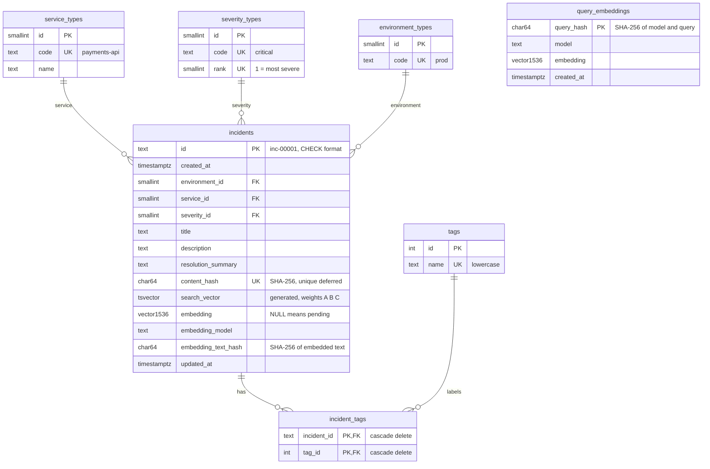
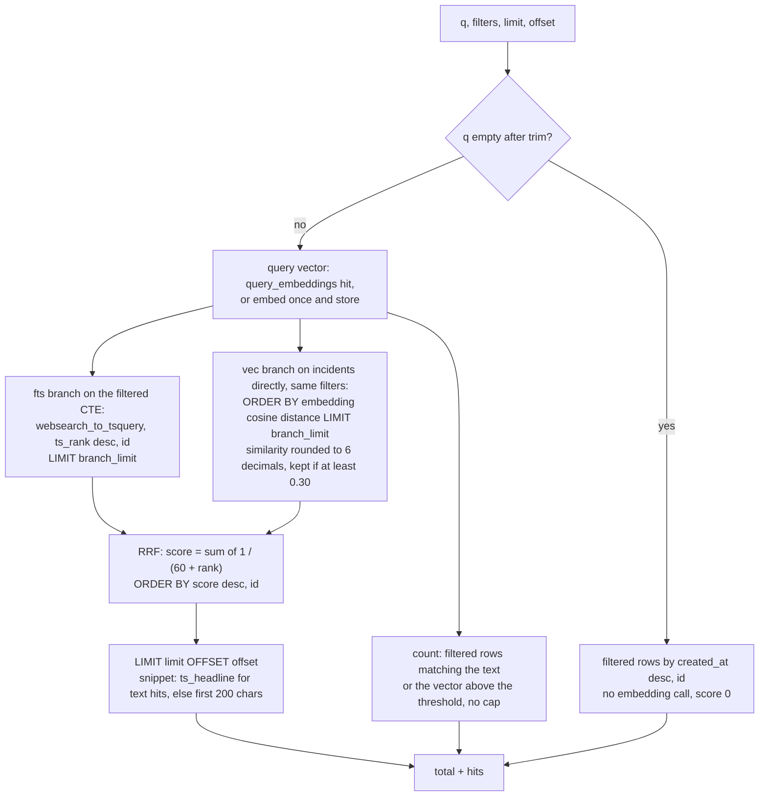
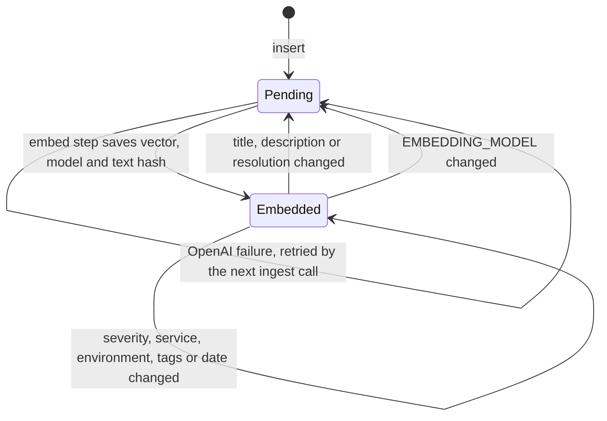
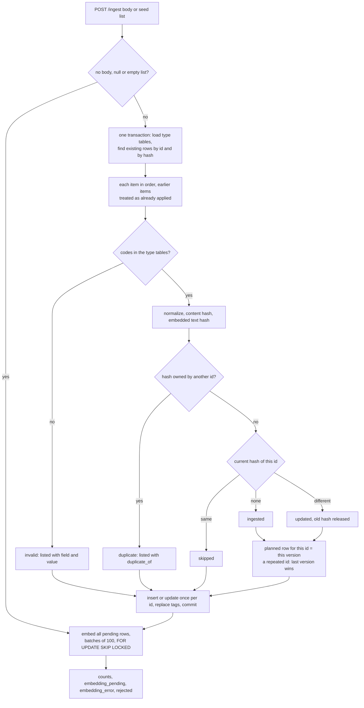
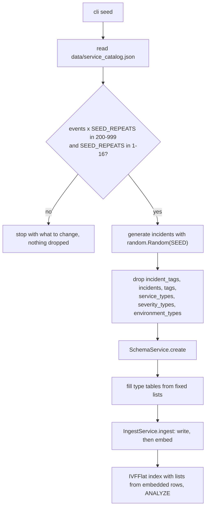

# Database Architecture

PostgreSQL on RDS (us-east-2) with the pgvector extension. All SQL lives in `app/support/database/`; DDL is in versioned `.sql` files and every statement with user values is parameterized. Three services own the database:

| Service | Does | Entry |
|---------|------|-------|
| `SchemaService` | Applies the DDL files in order. Idempotent (`IF NOT EXISTS`), never inserts or drops. | `python -m app.cli schema` |
| `SeedService` | Reset: drops the six incident tables, calls `SchemaService`, fills the type tables, generates incidents with a fixed seed, passes them to `IngestService`, builds the vector index. The only code that drops tables. | `python -m app.cli seed` (CLI only, no confirmation) |
| `IngestService` | The single write path for `incidents`, `tags` and `incident_tags`, then embeds pending rows. | seed; `POST /ingest` |

## ER diagram



Type tables hold the allowed codes, so foreign keys enforce them and filters compare short ids. `query_embeddings` stands alone and survives every reseed, so the same query keeps the same vector. Table names are snake_case.

## Tables

| Table | Notes |
|-------|-------|
| `environment_types` | `dev`, `qa`, `stage`, `prod` (from the `Environment` enum) |
| `severity_types` | `critical` 1, `high` 2, `medium` 3, `low` 4 (from `SEVERITY_RANK`) |
| `service_types` | keys of `data/service_catalog.json` (20 by default); `name` = `code` |
| `tags` | one row per distinct lowercase tag |
| `incident_tags` | PK `(incident_id, tag_id)`, both FKs `ON DELETE CASCADE` |
| `query_embeddings` | stored query vectors (see Reproducible results); never dropped by the seed |
| `incidents` | FKs to the type tables; `CHECK (id ~ '^inc-[0-9]{5}$')`; `content_hash` `UNIQUE DEFERRABLE INITIALLY DEFERRED`, so one batch may move a hash from one row to another in any order; `embedding vector(1536)` nullable |

Type tables are filled only by `SeedService` from fixed lists, never from incident data, so the ingest check against them stays meaningful. Inserts use `ON CONFLICT (code) DO NOTHING`.

SQL files, applied in name order: `001_types.sql`, `002_tags.sql`, `003_incidents.sql` (also `CREATE EXTENSION IF NOT EXISTS vector`), `004_query_embeddings.sql`, `005_indexes.sql`.

## Indexes

| Index | Purpose |
|-------|---------|
| `incidents_search_vector_idx` GIN on `search_vector` | full-text search |
| `incidents_filters_idx` on `(environment_id, service_id, severity_id)` | filters |
| `incidents_created_at_idx` | filter-only listing, newest first |
| `incidents_content_hash_key` UNIQUE | duplicate check |
| `incident_tags_tag_idx` on `(tag_id, incident_id)` | tag filter |
| `incidents_embedding_ivfflat` | vector search, built by the seed (below) |

`search_vector` is generated: `title` weight A, `description` B, `resolution_summary` C, English configuration. Tags are matched through `incident_tags`, not inside the vector.

### Vector index: IVFFlat, cosine, built at the end of the seed

| Choice | Value | Why |
|--------|-------|-----|
| Index | `USING ivfflat (embedding vector_cosine_ops) WITH (lists = n)` | Cosine is how OpenAI embeddings are compared (`<=>`). |
| When | last step of `cli seed`, after ingest and embedding, then `ANALYZE incidents` | IVFFlat learns its lists from the rows present at creation; built on an empty table, recall collapses. That is why it is not in the DDL files. |
| `lists` | `clamp(embedded_rows / 1000, 1, IVFFLAT_MAX_LISTS = 10)` | pgvector guidance is rows / 1000. The seed has 500 rows, so `lists = 1`. |
| `ivfflat.probes` | `IVFFLAT_PROBES` = 10, set per search transaction with `set_config('ivfflat.probes', '10', true)` | probes ≥ lists scans every list: exact results, filters never lose rows, same order every time. |

At 500 rows the index gives no speed gain; it is there so the query shape, settings and seed step are already right when the data grows. Past about 10,000 rows, raise `IVFFLAT_MAX_LISTS` and accept approximate results, or switch to HNSW. Rows added later through `POST /ingest` are found too; the lists are retrained on the next seed.

## Search (hybrid, one code path for `/search` and `/assist`)



Full-text finds exact words and codes; vectors find the same problem in other words. Reciprocal rank fusion (`RRF_K` = 60) merges the two rankings without tuning score scales. The vector branch reads `incidents` directly with `ORDER BY embedding <=> vector LIMIT n`, the shape pgvector can serve from the IVFFlat index.

1. Filters (`environment`, `service`, `severity`, all given `tags`) apply to both branches.
2. Each branch returns `branch_limit` = max(`SEARCH_BRANCH_LIMIT` 50, offset + limit) rows, so later pages are never empty.
3. `total` is the real number of matches, counted by a separate query without the branch cap.
4. Paging uses `LIMIT` and `OFFSET`. `/search` caps `limit` at `SEARCH_MAX_LIMIT` (50, default 10). `/assist` reads batches through `SearchService.candidates(filters, q, k, offset)`.
5. If the query embedding call fails: 503 `embedding_unavailable` (504 on timeout), no fallback to text only.

`IncidentRepository.get_many(ids)` returns full records in the requested order, with tags sorted; `/assist` uses it for the valid hits.

### Reproducible results

Same data and same request give the same `total`, IDs and order.

| Risk | Rule |
|------|------|
| Ties in a score | every `ORDER BY` ends with `id` (full-text rank, similarity, RRF score, `created_at`) |
| OpenAI returns a slightly different vector for the same text | query vectors are stored in `query_embeddings`, key = SHA-256 of `model + "\n" + query` (query trimmed, whitespace collapsed, case kept); the first call embeds and stores, later calls reuse it |
| Float noise at the threshold | similarity rounded to 6 decimals before the threshold and the ranking |
| Approximate index | probes ≥ lists, so the IVFFlat scan is exact |

`/assist` candidates follow these rules. The LLM verdicts are not guaranteed to be identical between calls, so every LLM input and output is kept on the Langfuse generation.

## Embeddings

| Choice | Value | Why |
|--------|-------|-----|
| Model | `text-embedding-3-small` (`EMBEDDING_MODEL`) | current, cheap OpenAI model; `3-large` costs 6.5× more for a small gain and has 3072 dimensions |
| Dimensions | 1536 (`EMBEDDING_DIMENSIONS`) | model default, full quality |
| Distance | cosine (`<=>`) | recommended for OpenAI embeddings |
| Timeout | `EMBEDDING_TIMEOUT_SECONDS` = 10 | |

Embedded text is labeled plain text from `app/core/embedding_text.py`, with empty fields left out:

```
title: Checkout timeouts after deploy
description: p95 latency above 8s on /checkout after release 2.4.1.
resolution: Rolled back release 2.4.1 and raised the pool size.
```

Service, environment, severity and tags are exact filters, so they are not embedded. Plain text matches how queries look; JSON punctuation would add noise to the vector.



Incidents are saved first and embedded in a separate step, so an OpenAI outage never loses data. An update clears the embedding only when the embedded text hash changes. Pending means `embedding IS NULL OR embedding_model IS DISTINCT FROM EMBEDDING_MODEL`.

- Every ingest call (seed or `POST /ingest`, even with no body) embeds all pending rows, not only its own, in batches of `EMBEDDING_BATCH_SIZE` (100).
- Each batch is one transaction: `SELECT ... FOR UPDATE SKIP LOCKED`, one OpenAI call, save. Two concurrent calls never embed the same row.
- A failure (unavailable, timeout, wrong count or dimension) stops the step, keeps everything already saved, and the 200 response reports `embedding_pending` and `embedding_error`.
- Pending rows are still found by full-text search; only the vector branch skips them.

## Normalization

Applied by `app/core/normalize.py` before checks, hashing and storage.

| Field | Stored as |
|-------|-----------|
| `id` | lowercase, trimmed, `inc-` + 5 digits (`" INC-00001"` → `"inc-00001"`) |
| `service`, `environment`, `severity` | lowercase, trimmed, inner whitespace collapsed (`" Payments-API "` → `"payments-api"`) |
| `tags` | each normalized like a code; empties and duplicates dropped; alphabetical |
| `title`, `description`, `resolution_summary` | trimmed; case and punctuation kept |
| `created_at` | timezone-aware input required, stored as UTC |

## Content hash (duplicate detection)

SHA-256 of canonical JSON, from the pure function `app/core/fingerprint.py`. It identifies duplicates; it does not protect data.

- Hashed: `service`, `environment`, `severity`, `title`, `description`, `resolution_summary`, `tags`.
- Not hashed: `id`, `created_at`, `updated_at`. The same incident under a new id or date is a duplicate.
- Free text, for the hash only: NFKC, lowercase, special characters replaced by spaces, whitespace collapsed.
- Null, empty string and empty list values removed; `json.dumps(sort_keys=True, separators=(",", ":"), ensure_ascii=False)`.

```
"DB  Timeout!!  on Checkout"            → "db timeout on checkout"
["Timeout", "postgres", "postgres "]   → ["postgres", "timeout"]
```

## Ingest (`POST /ingest`)

The body is a JSON array of up to 500 incidents, upserted by `id`. No body, `null` or `[]` writes nothing and only runs the embedding step.

```json
[
  {
    "id": "inc-00801",
    "created_at": "2026-11-07T14:02:00Z",
    "environment": "prod",
    "service": "payments-api",
    "severity": "high",
    "title": "Checkout timeouts after deploy",
    "description": "p95 latency above 8s on /checkout ...",
    "resolution_summary": "Rolled back release 2.4.1 ...",
    "tags": ["timeout", "deploy"]
  }
]
```

| Body check (422, whole request rejected) | Value check (per incident, counted as `invalid`) |
|---|---|
| not an array, or more than 500 items | `environment`, `service` or `severity` not in its type table |
| missing field, wrong type, `created_at` without a timezone | |
| `id` not `inc-` + 5 digits (case-insensitive, after trim) | |
| title 1-200 characters, description and resolution up to 5000, at most 20 tags of 50 characters | |



Classification is the pure function `plan_writes` (`services/ingest/plan.py`), so every case is unit-tested without a database. Items are applied in order: a repeated id within one batch is written once with its last version, and a hash freed by an earlier update can be reused later in the same batch (the unique constraint is checked at commit).

| Case | Result | Count |
|------|--------|-------|
| unknown environment, service or severity | not stored, listed with field and value | `invalid` |
| new id, new hash | insert incident and tags | `ingested` |
| existing id, same hash | nothing written | `skipped` |
| existing id, other hash | update incident, replace tags | `updated` |
| hash owned by a different id | not stored, listed with `duplicate_of` | `duplicates` |

Running the same body twice creates no duplicates and calls OpenAI for nothing. With unique ids, the second run counts every item as `skipped`. With a repeated id, the second run may count those items as `updated`: it writes the same values again (only `updated_at` moves) and keeps the embedding, because the embedded text hash is unchanged.

Response:

```json
{
  "ingested": 396, "updated": 0, "skipped": 0, "duplicates": 1, "invalid": 3,
  "embedded": 300, "embedding_pending": 96,
  "embedding_error": "OpenAI did not answer within 10 s; retry, or raise LLM_TIMEOUT_SECONDS (embeddings: EMBEDDING_TIMEOUT_SECONDS) and restart the API; pending rows will be retried on the next ingest call",
  "rejected": [
    {"id": "inc-00012", "reason": "duplicate", "duplicate_of": "inc-00007"},
    {"id": "inc-00144", "reason": "invalid", "field": "environment", "value": "uat"}
  ]
}
```

The foreign keys and the id `CHECK` are a second safety net; the service check gives a clear reason per incident instead of failing the batch.

## Seed



The catalog is loaded, checked and turned into incidents before anything is dropped, so a bad catalog never leaves an empty database. The default 500 events × `SEED_REPEATS` 1 give 500 incidents; below 1,000 keeps the IVFFlat index at one list (exact search).

| Rule | Value | Why |
|------|-------|-----|
| Random source | private `random.Random(SEED)`, default 42 | repeatable, unaffected by other code using `random` |
| Order | services sorted, events in catalog order, copies next to each other | same input order + same seed = same output |
| IDs | `inc-00001` upward in that order | stable IDs for README examples and tests |
| Repeats | each event becomes `SEED_REPEATS` incidents | real failures recur across environments, severities and dates |
| Combinations | each copy draws a different (environment, severity) pair, weighted by both weights, without replacement (16 pairs, so at most 16 repeats) | copies never share a content hash |
| `created_at` | uniform minute between 2026-01-01 00:00 and 2026-10-31 23:59 UTC | fixed bounds, so a run next week gives identical rows |
| `environment` weights | dev 15, qa 15, stage 20, prod 50 | production dominates real trackers; every value still has rows |
| `severity` weights | critical 10, high 25, medium 40, low 25 | critical is rare, most tickets are medium |

The drop is one statement: `DROP TABLE IF EXISTS incident_tags, incidents, tags, service_types, severity_types, environment_types CASCADE`. It never drops `query_embeddings`, the schema or the `vector` extension. It logs `seed: dropping app tables` with the host and database name, without asking. Incidents added through `POST /ingest` are lost on the next seed, so the seed is for setup and demo resets only.

## Errors at the database boundary

`support/database/errors.py` converts driver errors: `psycopg.OperationalError` (connection, pool, statement timeout) → 503 `unavailable` "database unavailable: ..."; any other `psycopg.Error` → 500 with the error class and PostgreSQL's primary message, never row data. The pool uses `sslmode=require`, a 10 s connect timeout and `statement_timeout` = `DB_STATEMENT_TIMEOUT_MS` (5000).

## Unit tests

| Component | File | Checks |
|-----------|------|--------|
| `normalize` | `test_core_normalize.py` | ids, codes and tags lowercased and trimmed; tags sorted and deduped; free text keeps case |
| `fingerprint` | `test_core_fingerprint.py` | formatting, tag order and duplicates ignored; id and dates ignored; any content change gives a new hash |
| `embedding_text` | `test_core_embedding_text.py` | fixed labels and order; empty fields left out |
| `query_builder` | `test_query_builder.py`, `test_query_builder_extra.py` | filters on both branches; vector branch skips `NULL`; threshold; RRF order; empty `q` skips the vector branch; offset paging; no user value in the SQL text |
| `SearchService` | `test_search_service.py` | limit default and cap; stored query vector reused; branch limit covers the offset |
| `plan_writes` | `test_ingest_plan.py` | each row of the ingest table; repeated id last wins; hash moved within a batch |
| `IngestService` | `test_ingest_service.py` | invalid codes listed; text change clears the embedding, other changes keep it; OpenAI failure keeps incidents and reports pending; next call embeds them; empty body only embeds |
| `SchemaService` | `test_schema_service.py` | DDL applied, no drops |
| seed | `test_seed_generator.py`, `test_seed_service.py` | same seed gives identical incidents; distinct pairs per event; every value present; size check 200-999 before any drop; drop, schema, types, ingest, index in order; `lists` clamp |
| properties | `test_properties.py` | Properties 1, 2, 3 and 9 with Hypothesis |
