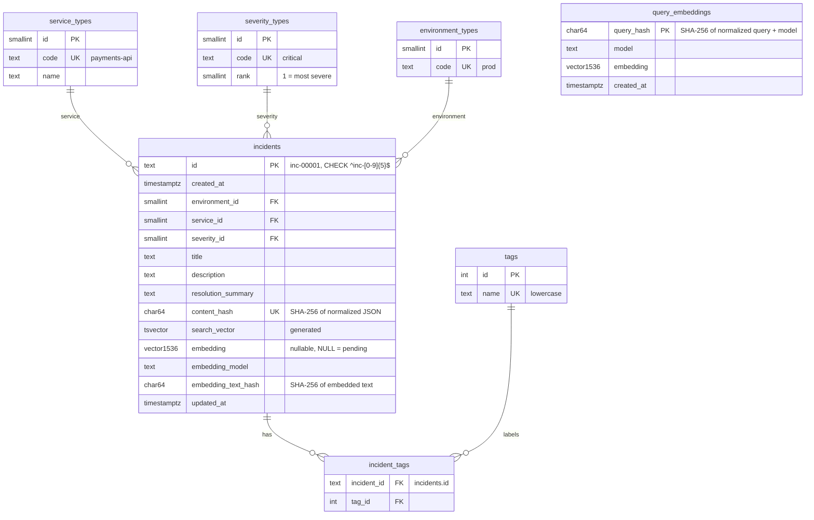
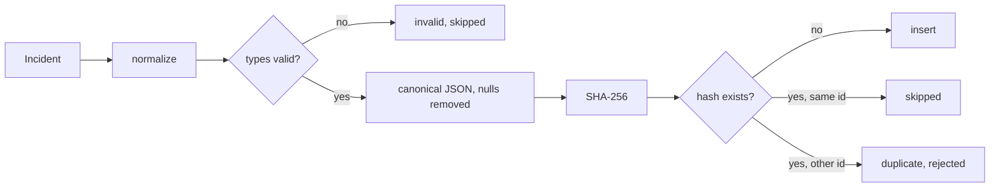

# Database Architecture

PostgreSQL on RDS (us-east-2) with the pgvector extension. Three services own the database:

| Service | Does | Entry |
|---------|------|-------|
| `SchemaService` | Creates tables and indexes only (DDL). No data. Idempotent. | `python -m app.cli schema` |
| `SeedService` | **Reset:** drops the app tables, calls `SchemaService` to recreate them, fills the type tables, generates the initial incidents, passes them to `IngestService`. The only code that drops tables. | `python -m app.cli seed` (CLI only, no endpoint, no confirmation) |
| `IngestService` | Single write path for incidents: `incidents`, `tags`, `incident_tags`. Used by the seed and later to add new incidents. | called by seed; `POST /ingest` |
 Table names are snake_case (Postgres convention): `serviceTypes` → `service_types`, `incidentTags` → `incident_tags`.

## ER diagram



## Tables

| Table | Notes |
|-------|-------|
| `environment_types` | `dev`, `qa`, `stage`, `prod` (take-home values) |
| `severity_types` | `critical`(1), `high`(2), `medium`(3), `low`(4). `rank` allows "severity ≥ high" filters later |
| `service_types` | The services in `data/service_catalog.json` (its keys; 20 by default) |
| `tags` | One row per distinct tag, lowercase, unique |
| `incident_tags` | PK `(incident_id, tag_id)`, both FKs `ON DELETE CASCADE` |
| `query_embeddings` | Stored query vectors so the same query always uses the same vector (see Reproducible results). Not dropped by the seed. |
| `incidents` | FKs to the three type tables, `content_hash` `UNIQUE NOT NULL`, `CHECK (id ~ '^inc-[0-9]{5}$')` as a second safety net, `embedding vector(1536)` nullable (`NULL` = pending, see Embeddings) |

Type tables are filled by `SeedService` from fixed lists, never from incident data, so the defensive check stays meaningful: environments and severities from the Python `Enum`s in `app/core/models/`, services from the keys of `data/service_catalog.json`. Insert uses `ON CONFLICT (code) DO NOTHING`. The API uses the same enums to validate filters before hitting the database.

## Indexes

| Index | Purpose |
|-------|---------|
| `incidents.search_vector` GIN | full-text search |
| `incidents (environment_id, service_id, severity_id)` | filters |
| `incidents.created_at` | ordering / date filters |
| `incidents.content_hash` UNIQUE | duplicate check |
| `incident_tags (tag_id, incident_id)` | tag filter |

`search_vector` is a generated column: `title` weight A, `description` B, `resolution_summary` C. Tags are matched through `incident_tags`, not inside the vector.

No vector index: at 200-500 rows an exact scan takes a few milliseconds and stays correct with filters. An approximate HNSW index filters after the search and can return fewer rows than asked. Add `HNSW (embedding vector_cosine_ops)` past about 10,000 rows.

## Embeddings

| Choice | Value | Why |
|--------|-------|-----|
| Model | `text-embedding-3-small` | Current OpenAI model, $0.02 / 1M tokens. `3-large` scores 2.3 points higher on MTEB at 6.5× the price and 3072 dims, more than pgvector can index as `vector`. `ada-002` is older, costs more, scores lower. |
| Dimensions | 1536 (model default) | Full quality; size is irrelevant at this row count |
| Distance | cosine (`<=>`) | Recommended for OpenAI embeddings |
| Settings | `EMBEDDING_MODEL`, `EMBEDDING_DIMENSIONS` env vars with these defaults | |

**Embedded text:** labeled plain text, built by one pure function `app/core/embedding_text.py`:

```
title: Checkout timeouts after deploy
description: p95 latency above 8s on /checkout after release 2.4.1.
resolution: Rolled back release 2.4.1 and raised the pool size.
```

- Fields: `title`, `description`, `resolution_summary`. Service, environment, severity and tags are exact filters, not meaning.
- Original text (trimmed), not the lowercased hash copy. Empty fields are left out.
- Plain text, not JSON: queries are plain text, and braces, quotes and escapes add noise to the vector.
- Query side: the `/search` `q` or `/assist` question, embedded with the same model.

**When to embed:** incidents are saved first; embedding is a separate, retryable step.

- `embedding` is nullable. `NULL` means pending.
- `embedding_text_hash` = SHA-256 of the text the stored embedding was built from.
- When an incident is inserted, or updated so that its embedded text hash changes, `embedding`, `embedding_model` and `embedding_text_hash` are set to `NULL`. A change to severity or tags alone keeps the embedding.
- **Pending** = `embedding IS NULL OR embedding_model IS DISTINCT FROM <EMBEDDING_MODEL>`. Changing the model re-embeds everything on the next call.
- At the end of every ingest call (seed or `POST /ingest`), IngestService embeds **all** pending rows, not only the ones in this call. This runs even if every incident in the call was skipped, duplicate or invalid. Only a request rejected with 422 skips it. Up to 100 rows per OpenAI request. Rows are selected with `FOR UPDATE SKIP LOCKED` so two concurrent calls never embed the same row.
- If OpenAI fails, the incidents stay saved, the call still returns 200, and the response reports what is pending. The next ingest call picks them up. Rows already embedded are never touched again, so retrying is idempotent.
- Pending rows are still found by full-text search; only the vector branch skips them.

## Search (hybrid, one code path for `/search` and `/assist`)

The take-home requires `/assist` to use the same search path as `/search`, so both use hybrid search.

1. Apply filters (environment, service, severity, tags) to both branches.
2. Full-text branch: top 50 by `ts_rank` on `search_vector`.
3. Vector branch: rows with `embedding IS NOT NULL`, top 50 by cosine similarity, kept only if similarity ≥ `VECTOR_MIN_SIMILARITY` (default 0.30, tuned on the seed data).
4. Merge with reciprocal rank fusion: `score = Σ 1 / (60 + rank)`.
5. `total` = real number of matching incidents: full-text matches plus vector matches above the threshold, each counted once, without the top-50 cap (a separate `COUNT` with the same filters). Return top `limit`.

Empty `q` with filters only: no embedding, ordered by `created_at` desc, then `id`. If the query embedding call fails: 503 "OpenAI unavailable", no silent fallback to text only.

### Reproducible results

Same data + same request = same `total`, same IDs, same order.

| Risk | Rule |
|------|------|
| Ties in a score | every `ORDER BY` ends with `id ASC` (full-text rank, similarity, RRF score, `created_at`) |
| OpenAI returns a slightly different vector for the same query text | query embeddings are stored in `query_embeddings` (key: SHA-256 of normalized query text + model). The first call embeds and stores; every later call reuses the stored vector. |
| Float noise at the threshold | similarity rounded to 6 decimals before comparing with `VECTOR_MIN_SIMILARITY` and before ranking |
| Incident vectors | stored once per text hash, never recomputed unless the text or model changes |

`query_embeddings` is not dropped by the seed, so the same query gives the same vector across reseeds. `/assist` candidates are reproducible by these rules; the LLM's selection is not guaranteed to be identical between calls, so every input and output is kept on the Langfuse generation span.

## Normalization (stored values)

Applied by `app/core/normalize.py` before validation, hashing and storage.

| Field | Stored as |
|-------|-----------|
| `id` | lowercase, trimmed, format `inc-00001` (zero-padded so text order = numeric order; `" INC-00001"` → `"inc-00001"`) |
| `service`, `environment`, `severity` | lowercase, trimmed, inner whitespace collapsed (`" Payments-API "` → `"payments-api"`) |
| `tags` | each lowercase and trimmed; empties dropped; deduped; **alphabetical order** |
| `title`, `description`, `resolution_summary` | original case and punctuation kept; trimmed |

Tags are also returned in alphabetical order by the API.

## Content hash (duplicate detection)

SHA-256 is a hash, not encryption: one-way, same input → same 64-char hex. It identifies duplicates; it does not protect data.

**Fields hashed:** `service`, `environment`, `severity`, `title`, `description`, `resolution_summary`, `tags`.
**Not hashed:** `id`, `created_at`, `updated_at`. The same incident under a new id or date is still a duplicate.

**Steps** (pure function `app/core/fingerprint.py`, used by seed and ingest), on the normalized values above:

1. Free text (`title`, `description`, `resolution_summary`), for the hash only: Unicode NFKC, lowercase, remove special characters (keep letters, digits, spaces), collapse whitespace, trim.
2. Tags already alphabetical.
3. Remove properties that are `null`, empty string or empty list.
4. Build JSON with sorted keys and no spaces: `json.dumps(obj, sort_keys=True, separators=(",", ":"), ensure_ascii=False)`.
5. `sha256(json.encode("utf-8")).hexdigest()`.

```
"DB  Timeout!!  on Checkout"            → "db timeout on checkout"
["Timeout", "postgres", "postgres "]   → ["postgres", "timeout"]
{"title": "x", "resolution_summary": null} → {"title":"x"}
```



## Ingest rules (`POST /ingest`)

Input: a list of incidents to upsert (from SeedService, or the `POST /ingest` body).

`POST /ingest` body is a JSON array of incidents, upserted by `id`:

```json
[
  {
    "id": "inc-00401",
    "created_at": "2026-11-07T14:02:00Z",
    "environment": "prod",
    "service": "payments-api",
    "severity": "high",
    "title": "Checkout timeouts after deploy",
    "description": "p95 latency above 8s on /checkout ...",
    "resolution_summary": "Rolled back release 2.4.1 ...",
    "tags": ["timeout", "deploy"]
  }
]
```

| Body check (422, whole request rejected) | Value check (per incident, counted as `invalid`) |
|---|---|
| not an array, more than 500 items (no body, `null` and `[]` are allowed) | `environment`, `service` or `severity` not in its type table |
| missing required field, wrong type, bad `created_at` | |
| `id` not matching `inc-` + 5 digits, case-insensitive (`^inc-\d{5}$` after trim and lowercase) | |
| text over length limits (title 200, description and resolution 5000, 20 tags of 50 chars) | |

Order per call:

1. **Write step, one transaction:** load the three type tables (filled earlier by the seed); for each incident normalize, defensive check, hash, then insert, update, skip or reject; upsert `tags`, link `incident_tags`. Commit.
2. **Embed step, after commit:** embed all pending rows in batches; each batch is its own small transaction. An OpenAI failure stops this step but never undoes step 1.

`POST /ingest` with no body, `null` or `[]` skips step 1 and only runs step 2. Use it to retry pending embeddings without sending incidents. All write counts are 0.

**Defensive check:** after normalization, `environment`, `service` and `severity` must each exist in their type table. The ingest service loads the three type tables once per run and checks every incident against them. An incident that fails is not stored, is counted as `invalid`, and is listed with its reason.

| Case | Result | Count |
|------|--------|-------|
| Unknown environment, service or severity | not stored, listed with reason | `invalid` |
| New id, new hash | insert incident + tags | `ingested` |
| Existing id, same hash | nothing | `skipped` |
| Existing id, new hash, not used by another row | update incident, replace tags | `updated` |
| Hash already used by a different id | not stored, listed | `duplicates` |

Response:

```json
{
  "ingested": 396, "updated": 0, "skipped": 0, "duplicates": 1, "invalid": 3,
  "embedded": 300, "embedding_pending": 96,
  "embedding_error": "OpenAI timeout after 30s; pending rows will be retried on the next ingest call",
  "rejected": [
    {"id": "inc-00012", "reason": "duplicate", "duplicate_of": "inc-00007"},
    {"id": "inc-00144", "reason": "invalid", "field": "environment", "value": "uat"}
  ]
}
```

The database FKs are a second safety net. The service check gives a clear per-incident reason instead of failing the batch.

## Layering

| Item | Layer |
|------|-------|
| `Incident`, `Environment`, `Severity` enums, `normalize()`, `fingerprint()`, `embedding_text()` | `app/core` (used by seed, ingest, search, database) |
| `EmbeddingClient` protocol + OpenAI implementation (batch, timeout) | `app/support/llm/` |
| SQL files `001_types.sql`, `002_tags.sql`, `003_incidents.sql`, `004_query_embeddings.sql`, `005_indexes.sql` | `app/support/database/sql/` (no SQL outside the database package) |
| `SchemaRepository`, `IncidentRepository` | `app/support/database/` |

## Unit tests

| Component | Tests |
|-----------|-------|
| `normalize` | `id` lowercased and trimmed; `INC-00001` and `inc-00001` are the same incident; codes and tags lowercase and trimmed; tags alphabetical and deduped; free text keeps its case |
| `fingerprint` | spaces, case and punctuation changes give the same hash; tag order and duplicates ignored; null and empty properties ignored; any content change gives a new hash; `id`/`created_at` not included |
| `embedding_text` | labels and field order fixed; empty fields left out; original case kept; same input = same text |
| reproducibility | same query twice → one embedding call, same vector reused; every `ORDER BY` ends with `id`; tied scores return the same order; `total` not capped at 100 |
| `query_builder` (hybrid) | filters applied to both branches; vector branch excludes `NULL` embeddings; similarity threshold; RRF order; empty `q` skips the vector branch; values always parameterized |
| `SchemaService` | SQL files run in order; DDL only, no inserts, no drops; second run is a no-op (fake repo) |
| `SeedService` | two runs with the same `SEED` give identical incidents; IDs follow sorted service order; `created_at` within the fixed bounds; every environment and severity value present; drops exactly the six app tables, nothing else; calls SchemaService after the drop; type tables filled from fixed lists only; same seed = same incidents; 200-500 rows; passes them to IngestService (fake) |
| `IngestService` | never writes type tables; each row of the ingest rules table, including unknown environment, service and severity each counted as `invalid` with reason; text change clears the embedding, severity/tag change keeps it; OpenAI failure still saves incidents and reports `embedding_pending`; next call embeds the pending rows; rows already embedded are not sent again; model change marks rows pending; no body, `null` and `[]` each write nothing and embed pending rows (fake repo, fake embedder) |

## Seed data rules

| Rule | Value | Why |
|------|-------|-----|
| Random source | `random.Random(SEED)`, `SEED` env var, default `42`; never the global `random` | Take-home requires a fixed seed and repeatable results. A private generator is not affected by other code using `random`. |
| Order | services sorted alphabetically, events in catalog order | Same input order + same seed = same output. Dict or file order can't change the result. |
| IDs | `inc-00001` upward, in that order | Stable IDs, so `/incidents/{id}` examples in the README and tests always point to the same incident. |
| Events | each catalog event used once (default 400) | Inside the take-home range (200-500) and no near-duplicates, which would fail the content-hash check. |
| `created_at` | uniform between 2026-01-01 00:00 and 2026-10-31 23:59 UTC, minute precision | Fixed bounds, not "now minus N days", so a seed run today and next week gives identical rows. Ten months gives realistic spread for date ordering. |
| `environment` | dev 15%, qa 15%, stage 20%, prod 50% | Incident trackers are dominated by production issues; lower environments still appear so the `environment` filter has something to find in every value. |
| `severity` | critical 10%, high 25%, medium 40%, low 25% | Real incident mix: critical outages are rare, most tickets are medium. Every value still has dozens of rows (~40 critical at 400), so severity filters return results. |
| Choice method | `rng.choices(values, weights)` per incident, environment first, then severity, then `created_at` | Fixed draw order keeps results identical; changing the order would reshuffle everything. |

A unit test runs the seed twice and compares the output, and checks each value of environment and severity appears at least once.

## Seed reset (the only destructive operation)

`python -m app.cli seed` rebuilds the database from scratch:

1. Log `seed: dropping app tables on <host>/<db>` (no prompt).
2. One transaction: `DROP TABLE IF EXISTS incident_tags, incidents, tags, service_types, severity_types, environment_types CASCADE`. Only these six names. Never `DROP SCHEMA`, never other tables, never the `vector` extension.
3. `SchemaService.create()` recreates tables and indexes.
4. Fill type tables, generate incidents (fixed seed), call `IngestService`, embed.

This also replaces the `incidents` table that already exists on RDS. Every seed run drops without asking. Incidents added later through `POST /ingest` are lost on the next seed, so seed is for setup and demo resets only. `SchemaService` and `IngestService` never drop anything.
