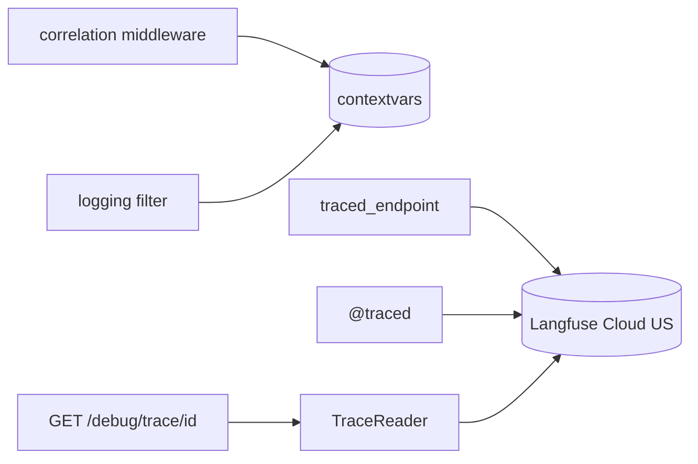
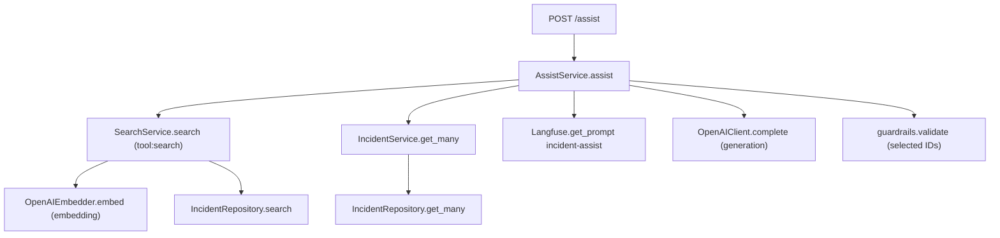

# Trace Architecture

Every API request and CLI command is one trace in Langfuse. Every service and support call inside it is a nested observation. Langfuse is the only trace store: `GET /debug/trace/{correlation_id}` reads the tree back from Langfuse.

## Concepts

| Term | Meaning |
|------|---------|
| `correlation_id` | One per request. From the `X-Correlation-ID` header or generated (UUID4). Returned in the response header and in every error body. |
| Trace | All observations of one request. Langfuse trace id = `create_trace_id(seed=correlation_id)`, so the id can be rebuilt from the correlation_id at any time. |
| Observation | One unit of work: `id`, `parent_observation_id`, `name`, `type` (span, generation or embedding), input/output summary, start/end time, `level` (error on failure), status message. |
| Root observation | Created by the route wrapper after validation, named after the route (`POST /assist`). |
| `APP_ENV` | Per request: the request's `environment` filter (`dev`/`qa`/`stage`; `prod` → `production`), or `production` if none. Used as the Langfuse prompt label and the Langfuse trace environment. |

## Components (`app/support/tracing/`, `app/support/langfuse/`)

| File | Responsibility |
|------|----------------|
| `correlation.py` | FastAPI middleware: read or create `correlation_id`, set response header, add it to error bodies. |
| `endpoint.py` | `traced_endpoint` route wrapper: after validation, resolves `APP_ENV`, opens the root observation with `propagate_attributes(environment=APP_ENV, ...)`, calls the service, flushes spans to Langfuse after the response. Same helper used by `cli.py` (with `production`). |
| `span.py` | `traced` = Langfuse's own `@observe` decorator, re-exported so services don't import Langfuse directly. No logic of ours: Langfuse captures input, output, errors, timing and nesting. |
| `context.py` | `contextvars` holding `correlation_id` (for logs). Works across `async` and FastAPI's threadpool. |
| `logging.py` | Logging filter that adds `correlation_id` and the current observation id to every log line; JSON formatter for stdout; `LangfuseLogHandler` that forwards each log record to Langfuse as an event under the current observation (see Logging). |
| `langfuse/trace_reader.py` | `TraceReader.get(correlation_id)`: rebuilds the trace id and returns Langfuse's observations as Langfuse returns them, plus the trace URL. Used by `/debug/trace`. |

**Principle: Langfuse is the owner of tracing.** The app does not store, build, merge or reshape traces. It only (1) sets the trace id, environment and correlation_id on the root, (2) marks functions with Langfuse's decorator, and (3) asks Langfuse for a trace by id.

Services only use `@traced`. They never import Langfuse or touch ids.



## Request lifecycle

```mermaid
sequenceDiagram
    participant C as Client
    participant M as Middleware
    participant R as Route (traced_endpoint)
    participant S as Service (@traced)
    participant L as Langfuse
    C->>M: request (X-Correlation-ID optional)
    M->>M: correlation_id
    M->>R: request
    R->>R: validate; APP_ENV = filters.environment (prod → production) or "production"
    R->>L: root observation (trace_id from correlation_id) + propagate_attributes(environment=APP_ENV, correlation_id)
    R->>S: call service
    S->>L: child observation (parent = current, same environment)
    S-->>R: result or error
    R->>L: close root (input, output, status)
    R-->>M: response
    M-->>C: response + X-Correlation-ID
    R->>L: flush (background task, after the response is sent)
```

The flush runs as a FastAPI background task after the response, so it does not add latency and spans reach Langfuse within seconds.

## What each endpoint produces



| Entry | Observations |
|-------|--------------|
| `POST /ingest` | IngestService.ingest → IncidentRepository.upsert_many, OpenAIEmbedder.embed_batch (embedding) |
| `GET /search` | SearchService.search → OpenAIEmbedder.embed (embedding), IncidentRepository.search |
| `GET /incidents/{id}` | IncidentService.get → IncidentRepository.get |
| `GET /catalog` | CatalogService.get |
| `POST /assist` | tree above |
| `cli schema / catalog` | SchemaService / CatalogService (generation per service) |
| `cli seed` | SeedService.seed → SchemaRepository.drop_app_tables, SchemaService.create, SchemaRepository.upsert_types, IngestService.ingest → IncidentRepository.upsert_many, OpenAIEmbedder.embed_batch |
| `/health` | root only |
| `/debug/trace` | not traced (reading a trace should not create traces) |

## Required `/assist` steps (take-home)

Recorded as observation input/output, so they appear in Langfuse and in `/debug/trace`:

- `tool:search` input: query, filters, `candidate_multiplier`
- `tool:search` output: hit count, top IDs
- `guardrails.validate` output: selected incident IDs

## `GET /debug/trace/{correlation_id}`

1. `trace_id = create_trace_id(seed=correlation_id)`.
2. `langfuse.api.observations.get_many(trace_id=trace_id, fields="core,basic,io")`.
3. Return them unchanged (each has its `parent_observation_id`, so the tree is in the data) with a link to the trace in the Langfuse UI.

```json
{
  "correlation_id": "abc",
  "trace_id": "4f1c...",
  "langfuse_url": "https://us.cloud.langfuse.com/project/<project>/traces/4f1c...",
  "observations": [ "...as returned by Langfuse..." ]
}
```

| Case | Response |
|------|----------|
| Trace found | 200 with the tree |
| No observations yet | 404 "trace not available yet; Langfuse can take a few seconds, retry shortly" |
| Langfuse unreachable | 503 "Langfuse unreachable, check keys / network" |

Works with any number of uvicorn workers and survives restarts, because nothing is kept in app memory.

## Langfuse SDK calls (Python SDK v5, OpenTelemetry)

| Need | Call |
|------|------|
| Client | host `https://us.cloud.langfuse.com` (`LANGFUSE_HOST`), keys from Secrets Manager |
| Trace id | `langfuse.create_trace_id(seed=correlation_id)` |
| Root observation | `start_as_current_observation(as_type="span", name=route, trace_context={"trace_id": ...})` |
| Environment and correlation_id on every observation | `propagate_attributes(environment=APP_ENV, trace_name=route, metadata={"correlation_id": ...})` on the root; children inherit |
| Child observation | `@observe(name=..., as_type=...)` (re-exported as `traced`) |
| LLM call | `as_type="generation"`, `model=...`, `prompt=<prompt client>` |
| Embedding call | `as_type="embedding"`, `model=...`, input count and token usage (not the vectors) |
| Input/output | `observation.update(input=..., output=...)` |
| Prompt | `get_prompt(name, label=APP_ENV, type="text", cache_ttl_seconds=0)` |
| Read back | `langfuse.api.observations.get_many(trace_id=..., fields=...)` |
| Flush | `langfuse.flush()` after each response (background task) and in FastAPI shutdown |

Rules:
- Traces go out through the SDK's OTLP exporter. Never use legacy `POST /api/public/ingestion` (removed for traces on Langfuse Cloud, 2026-11-16).
- Do not use removed or deprecated calls: `update_current_trace`, `set_current_trace_io`, `start_span`, `start_generation`, `api.trace.get`.
- No generic OpenTelemetry auto-instrumentation (FastAPI, psycopg). The SDK's default filter drops those spans and the tree would have gaps.
- Metadata values are strings, max 200 characters.
- **Environment:** the request's `environment` filter is the Langfuse environment and prompt label for that request: `dev`, `qa`, `stage` as is, `prod` → `production`, no filter → `production`. It is set only once, by `traced_endpoint`, so one trace never has two environments. The mapping exists only at the Langfuse boundary; the API, search filter and database keep `prod`.

## Logging (take-home requirement, sent to stdout and Langfuse)

Every log line carries `correlation_id`. Each line goes to two places:

| Destination | Why | Format |
|-------------|-----|--------|
| stdout (journald on EC2) | take-home "correlation_id in every log line"; still works when Langfuse is down | one JSON object per line |
| Langfuse | logs sit inside the trace, next to the observation that wrote them | event observation under the current observation |

```json
{"ts":"2026-11-07T14:02:00.123Z","level":"INFO","logger":"assist","correlation_id":"abc","observation_id":"9f2e...","msg":"step tool:search output","hits":12,"top_ids":["inc-00042","inc-00107"]}
```

**Langfuse forwarding (`LangfuseLogHandler`):**
- Only while a request or CLI command has an active observation. Logs outside one (startup, shutdown) go to stdout only.
- One Langfuse event per record: name = the message, level mapped `ERROR`→`ERROR`, `WARNING`→`WARNING`, `INFO`→`DEFAULT`; `DEBUG` is not sent. Extra fields (`hits`, `top_ids`, ...) and `correlation_id` go in the event metadata.
- The event inherits the trace's environment from the root, like every other observation.
- If sending fails, the record is still on stdout; the handler never raises.
- Same redaction as observations: no secrets, inputs truncated.

**Required `/assist` step log lines** (also present as observation input/output):

| Log message | Fields |
|-------------|--------|
| `step tool:search input` | `q`, `filters`, `candidate_multiplier` |
| `step tool:search output` | `hits`, `top_ids` |
| `step selected_ids` | `selected_ids`, `relevant_count` |

## Data rules

- Log and trace summaries, not full payloads: IDs, counts, filters, lengths. Full LLM prompt and response only on the generation observation.
- Never record secrets, connection strings or API keys.
- Inputs truncated to a fixed length before recording.

## Failures

| Case | Behavior |
|------|----------|
| Exception in an observation | recorded by Langfuse's decorator; exception re-raised |
| Langfuse prompt fetch fails | `/assist` returns 503 "Langfuse unreachable" |
| Langfuse export fails | export runs after the response, so it is logged, not returned |
| `/debug/trace` before Langfuse has the trace | 404 with "retry shortly" |

## Unit tests (`tests/unit/support/tracing/`)

| Test | Checks |
|------|--------|
| correlation | header reused; generated when missing; returned in response header |
| environment | root and all children carry `APP_ENV`; `prod` → `production`; no filter → `production`; CLI → `production` |
| root | root observation gets the trace id from the correlation_id, the environment and the correlation_id metadata (fake Langfuse client) |
| context | correlation_id survives `await` and threadpool calls |
| trace_reader | trace id rebuilt from correlation_id; observations returned unchanged with the Langfuse URL; no observations → 404 "retry"; Langfuse error → 503 |
| flush | flush scheduled after the response, not before |
| logging | every stdout line is JSON with `correlation_id` and observation id; inside a request each record becomes one Langfuse event with mapped level and metadata; `DEBUG` not sent; outside a request nothing sent to Langfuse; Langfuse error does not raise; `/assist` writes the three step lines |
| redaction | secrets never appear in observation input/output |
