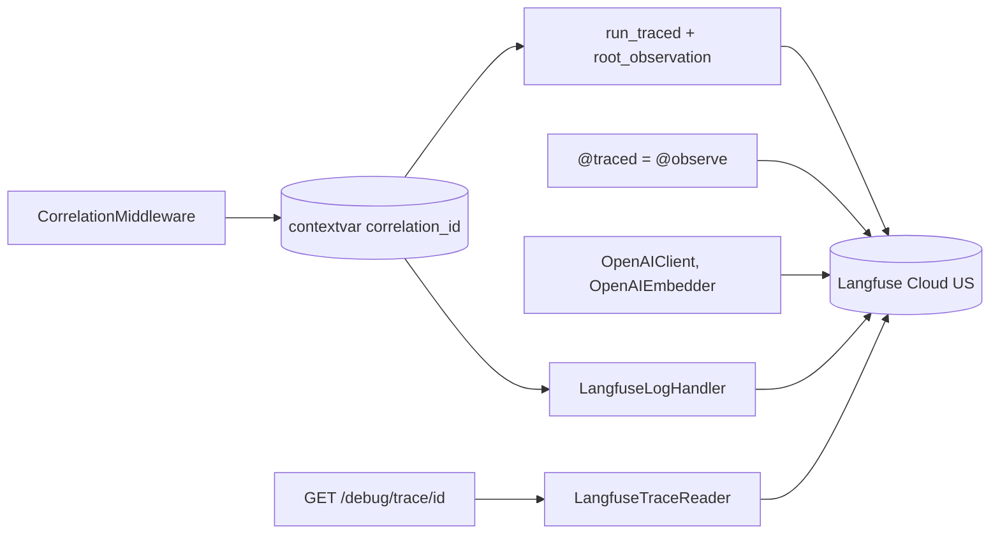
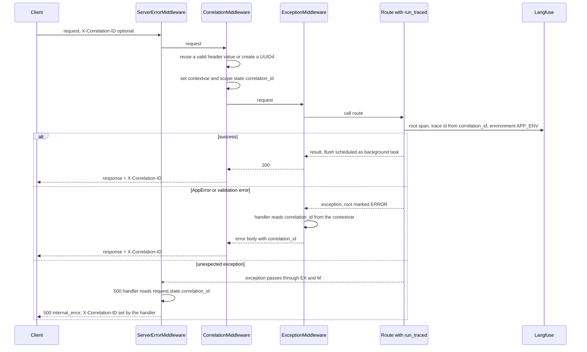
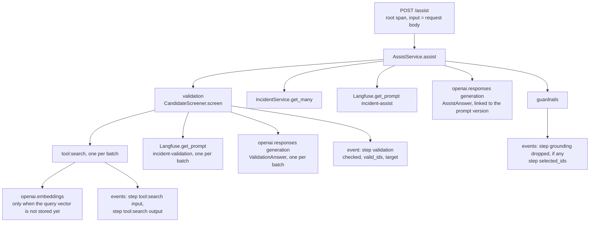
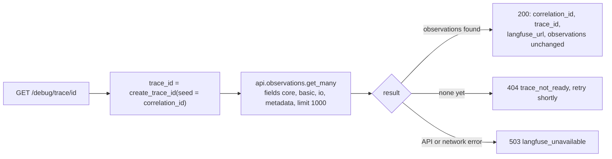

# Trace Architecture

Every API request and CLI command is one Langfuse trace. Service and support calls inside it are nested observations, and log lines are events in the same trace. Langfuse is the only trace store: `GET /debug/trace/{correlation_id}` reads the observations back from Langfuse.

## Concepts

| Term | Meaning |
|------|---------|
| `correlation_id` | One per request. Taken from `X-Correlation-ID` when it matches `[A-Za-z0-9._-]{1,64}`, otherwise a new UUID4. Returned in the response header and in every error body. |
| Trace id | `Langfuse.create_trace_id(seed=correlation_id)`, so the id can be rebuilt from the correlation_id at any time. |
| Root observation | One span per request or CLI command, named after the route (`POST /assist`) or the command (`cli seed`). |
| Observation | Span, generation (LLM call) or embedding (embedding call), with input, output, timing and level. |
| `APP_ENV` | The request's `environment` filter: `dev`, `qa`, `stage` as is, `prod` → `production`, none → `production`. The CLI uses `production`. It is the Langfuse trace environment and the prompt label. |

## Components

| File | Responsibility |
|------|----------------|
| `support/tracing/correlation.py` | `CorrelationMiddleware` (pure ASGI): resolves the correlation_id, sets the contextvar, stores it in `scope["state"]`, adds `X-Correlation-ID` to the response. |
| `support/tracing/context.py` | `correlation_scope` and `get_correlation_id`, backed by a contextvar that survives the threadpool. |
| `support/tracing/endpoint.py` | `root_observation`: trace id from the correlation_id, `propagate_attributes(environment, trace_name, metadata.correlation_id)`, root span; marks the root `ERROR` on an exception. `schedule_flush` adds `langfuse.flush` as a background task. |
| `api/tracing.py` | `run_traced`: resolves `APP_ENV`, opens the root, passes `APP_ENV` to the service as the prompt label, records a small output summary, schedules the flush. |
| `support/tracing/span.py` | `traced` = Langfuse's own `@observe`, re-exported so services never import Langfuse. |
| `support/tracing/logging.py` | `TraceContextFilter` (adds `correlation_id` and `observation_id`), `JsonFormatter` (stdout), `LangfuseLogHandler` (events). |
| `support/langfuse/trace_reader.py` | `LangfuseTraceReader.get(correlation_id)`: observations of the trace, unchanged, plus the trace URL. |
| `support/llm/openai_client.py`, `openai_embedder.py` | open the `openai.responses` generation and the `openai.embeddings` embedding observations. |

Langfuse owns tracing. The app only sets the trace id, environment and correlation_id on the root, marks functions with `@observe`, and asks Langfuse for a trace by id. It does not store, build or reshape traces.



## correlation_id flow



Starlette runs the catch-all `Exception` handler in `ServerErrorMiddleware`, outside every user middleware, where the contextvar is already reset. The middleware therefore also stores the id in `scope["state"]`, and the 500 handler reads it from `request.state`, logs inside a `correlation_scope` and sets the header itself. This keeps the correlation_id on every error, including the unexpected ones.

## Observation tree for one `/assist` request



Each step of the take-home list is an observation or an event, so Langfuse and `/debug/trace` show the search input and output, every validation verdict, the full LLM input and output, and the selected IDs. When no hit is valid, the tree stops after `validation` and `AssistService.assist` logs `step selected_ids` with an empty list.

## What each entry point records

| Entry | Observations under the root |
|-------|-----------------------------|
| `POST /assist` | tree above |
| `GET /search` | `tool:search` → `openai.embeddings` (only for a new query) |
| `GET /incidents/{id}` | `IncidentService.get` |
| `GET /catalog` | `CatalogService.get` |
| `POST /ingest` | `openai.embeddings` per batch of pending rows; events `ingest finished`, `ingest embedding stopped` |
| `GET /health` | root only |
| `GET /debug/trace/{id}` | not traced, so reading a trace creates none |
| `cli catalog` | `CatalogService.generate` → per service `Langfuse.get_prompt` + `openai.responses` |
| `cli seed` | `openai.embeddings` per batch; events for the drop, schema, type tables, ingest and vector index steps |
| `cli schema` | root with the `schema applied` event |
| `cli schemas` | no container, no trace |

`IngestService`, `SeedService` and `SchemaService` have no `@traced` span of their own; their work shows as events and embedding observations under the root.

## Required `/assist` step records

| Record | Fields |
|--------|--------|
| `step tool:search input` (event input) | `q`, `filters`, `limit`, `offset` |
| `step tool:search output` (event output) | `hits` (real total), `top_ids` |
| `step validation` (event output) | `checked`, `valid_ids`, `target` |
| `step grounding dropped` (warning) | `unknown_ids`, `dropped_steps` |
| `step selected_ids` (event output) | `selected_ids` (group leads), `groups`, `relevant_count` |

`candidate_multiplier` is on the root observation input (the request body); `target` = n × 5 is on `step validation`.

## Logging

```json
{"ts":"2026-11-07T14:02:00.123Z","level":"INFO","logger":"app.services.search.service","correlation_id":"abc","observation_id":"9f2e...","msg":"step tool:search output","io":"output","hits":12,"top_ids":["inc-00042","inc-00107"]}
```

| Destination | Why | Format |
|-------------|-----|--------|
| stdout (journald on EC2) | take-home "correlation_id in every log line"; works when Langfuse is down | one JSON object per line: `ts`, `level`, `logger`, `correlation_id`, `observation_id`, `msg`, extra fields, `exc` for exceptions |
| Langfuse | the log sits in the trace next to the observation that wrote it | event under the current observation |

`LangfuseLogHandler` rules:
- Only `INFO` and above, and only while an observation is active. Startup and shutdown logs go to stdout only.
- Event name = the message. Level: `ERROR` → `ERROR`, `WARNING` → `WARNING`, `INFO` → `DEFAULT`.
- The `extra={...}` fields go in the event input, or in the event output when the record has `extra={"io": "output"}`.
- Event metadata holds `correlation_id` and `logger`, each cut to 200 characters (Langfuse metadata limit).
- A send failure is suppressed; the stdout line is already written and the request continues. A guard stops SDK log records from looping back into the handler.
- `httpx`, `httpcore`, `botocore`, `urllib3` and `openai` loggers are set to `WARNING`, because Langfuse already records those calls.
- uvicorn's own handlers are removed and its loggers propagate to the JSON handler. Access lines are logged inside the request's context, so they carry the `correlation_id` too. Startup and shutdown lines have no request, so their `correlation_id` is null.

## `GET /debug/trace/{correlation_id}`



The trace id is rebuilt from the correlation_id, so the API keeps nothing in memory and works with any number of workers and across restarts. Observations are returned as Langfuse returns them; each has its parent id, so the tree is in the data. Without a project id the URL falls back to `{LANGFUSE_HOST}/trace/{trace_id}`, which Langfuse redirects.

## Langfuse SDK calls (Python SDK v5, OpenTelemetry)

| Need | Call |
|------|------|
| Client | `Langfuse(public_key, secret_key, base_url=LANGFUSE_HOST)`, keys from Secrets Manager, built in the container |
| Trace id | `Langfuse.create_trace_id(seed=correlation_id)` |
| Root | `propagate_attributes(environment=APP_ENV, trace_name=name, metadata={"correlation_id": ...})` + `start_as_current_observation(as_type="span", name=name, trace_context={"trace_id": ...})` |
| Nested span | `@observe(name=...)` re-exported as `traced` |
| LLM call | `start_as_current_observation(as_type="generation", model=..., prompt=<prompt client>)`, then `update(output, usage_details)` |
| Embedding call | `start_as_current_observation(as_type="embedding")`, input and output are counts, not vectors |
| Log event | `create_event(name, level, metadata, input or output)` |
| Prompt | `get_prompt(name, label=APP_ENV, type="text", cache_ttl_seconds=0)` |
| Read back | `api.observations.get_many(trace_id=..., fields=..., limit=1000)` |
| Flush | `langfuse.flush()` as a background task after each response, and in `Container.close()` |

Rules:
- Traces go out through the SDK's OTLP exporter. The legacy `POST /api/public/ingestion` endpoint and deprecated calls (`update_current_trace`, `start_span`, `start_generation`, `api.trace.get`) are not used.
- No generic OpenTelemetry auto-instrumentation (FastAPI, psycopg); the SDK filters those spans and the tree would have gaps.
- The environment is set once, on the root, so one trace never has two environments. The mapping `prod` → `production` exists only at the Langfuse boundary; the API, the search filter and the database keep `prod`.
- When a route raises, FastAPI does not run its background tasks; the SDK's batch exporter still sends the spans.

## Data rules

- Never record secrets, connection strings or API keys. Error messages name secrets and settings, never values.
- Embedding observations record counts, not vectors or texts. The full LLM prompt and output are only on the generation observation.
- The root output is a summary: list fields of the result are left out.

## Failures

| Case | Behavior |
|------|----------|
| Exception inside an observation | recorded by Langfuse (`@observe` or root `level=ERROR`), then re-raised to the error handler |
| Prompt fetch fails | 503 `langfuse_unavailable` or `prompt_label_missing`; no fallback prompt |
| Export to Langfuse fails | happens after the response, so it never changes the response |
| Log event fails | stdout line kept, request continues |
| `/debug/trace` before Langfuse has the trace | 404 `trace_not_ready` |
